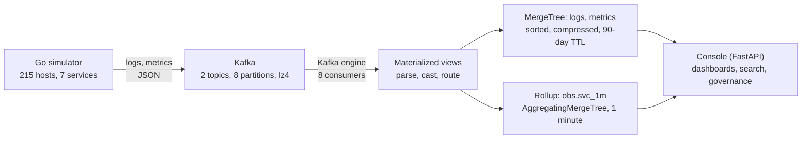

# Observability without the per-GB meter

A live demo of logs and metrics on ClickHouse, supported by EDB. A Go simulator publishes billions of
synthetic events to Kafka, ClickHouse ingests them and builds one-minute rollups as the data arrives, and a
web console serves dashboards, log search and governance views on top.

The point of the demo: the volume of telemetry should not set the price. Storage is compressed about 5x,
queries read only the data they need, and dashboards read small pre-aggregated rows instead of raw logs.

> All data is synthetic. Figures below were measured on one reference host and are dated. Re-measure on your own
> hardware before quoting them.

## Architecture



| Component | Role | Port |
| --- | --- | --- |
| `obs-sim` (Go) | Generates logs and metrics, control API for rate and incidents | 8090 |
| Kafka | Buffers bursts and decouples producers from ClickHouse | 9092 |
| ClickHouse (EDB build) | Storage and queries (native protocol) | 9094 |
| `obs-dash` (FastAPI) | Web console over ClickHouse's HTTP interface | 8088 |

## What the console shows

| Tab | What to look at |
| --- | --- |
| Overview | Pipeline health at a glance |
| Pipeline | Start and stop the stream, change the rate, trigger a bad deploy, load history, storage tiles |
| Dashboard | Error rate, p99 and a service heatmap. Each panel shows rows read and time taken. A "Scan raw rows" toggle compares the rollup with the raw table |
| Explore | Search logs by service, severity, window and text. The scan bar shows rows read and the share skipped by the index |
| Govern | Per-user query accounting from the query log, plus row policies and quotas |
| Code | The schema and SQL behind everything above |

## Quick start

Requirements: a Linux host with ClickHouse, Kafka, Python 3 and systemd. The reference host has 16 vCPU, 64 GB RAM
and fast disk.

```bash
# Console and simulator run as systemd units: obs-sim and obs-dash
sudo systemctl enable --now obs-sim obs-dash
```

See `install/` for the install scripts and unit files. The Kafka tarball is not in this repository
(it exceeds GitHub's file size limit): download Apache Kafka from the Apache archive.

Reach the console. Only port 22 needs to be open, so use an SSH tunnel:

```bash
ssh -i <your-key>.pem -L 8088:127.0.0.1:8088 ec2-user@<host>
# then open http://localhost:8088
```

## Run the demo
