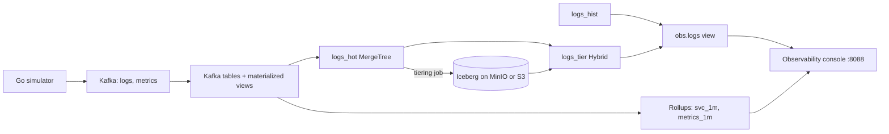

# Observability demo: logs and metrics on ClickHouse, hot and cold

A live demo of logs and metrics consolidated on one ClickHouse, with a hot tier on local disk and a cold tier in
Iceberg on object storage. A Go simulator writes events to Kafka, ClickHouse ingests and rolls them up, and a small
web console shows the pipeline, dashboards, search, governance and tiering, with the SQL behind each screen.

It backs the webinar *Observability without the per-GB bill*: per-GB licensing grows with every log ingested, the
do-it-yourself alternative swaps the bill for an operations burden, and this shows a third path.

Measured on the demo host on 9 Nov 2026 (one run, not a benchmark): 10.26 B log rows, 357 k rows/s ingested,
236.6 GB on disk, about 24.8 bytes per row after compression.

## Architecture



## What is in the repository

| Path | What it is |
| :-- | :-- |
| `simulator/` | Go load generator: logs and metrics to Kafka, a control API on `:8090`, a bad-deploy scenario. |
| `sql/` | `schema.sql` (Kafka tables, views, rollups), backfill, fleet and governance SQL. |
| `dashboard/` | FastAPI console (`app.py`), the Tiering API (`tiering.py`), the tiering job (`tier_job.py`, `tier.sh`) and `static/`. |
| `install/` | Numbered setup scripts for OS tuning, ClickHouse, Kafka, the apps, schema, backfill and governance. |
| `reset-demo.sh`, `stop-demo.sh` | Start the demo at a chosen rate, and stop it again. |

## Requirements

- A Linux host (developed on RHEL 9) with enough disk for the retention you want: at 300 k rows/s the hot tier grows
  by roughly 1 B rows per hour.
- ClickHouse. For the tiering part you need the **Altinity Antalya** build (tested with 26.6.8.20001), because Hybrid
  tables and `INSERT INTO` Iceberg are experimental features there. The base demo also runs on the EDB build installed
  by `install/10_install_clickhouse.sh`.
- Kafka, Go (to build the simulator), Python 3.9 or later with the packages in `dashboard/requirements.txt`.
- For tiering: MinIO or S3, the `ice` CLI and `ice-rest-catalog` (they need Java 21), and a ClickHouse database
  called `ice` created with `ENGINE = DataLakeCatalog(...)`.

## Quick start

```bash
cd install
# run the numbered scripts in order, as root: 00 OS tuning, 10 ClickHouse, 20 Kafka, 30 build the apps,
# 40 load the schema, 50 backfill, then 60_governance.sql, and 99_smoke_test.sh to check the result
cd ..
sudo ./reset-demo.sh 300k          # start the simulator and the console at 300k events/s
sudo ./stop-demo.sh                # stop them; the data stays
```

Open `http://127.0.0.1:8088`, or from a laptop: `ssh -L 8088:127.0.0.1:8088 <user>@<host>` and then
`http://localhost:8088`. Change the rate later with `sudo ./reset-demo.sh <rate> --live`.

Copy `dashboard/config.example.json` to `dashboard/config.json` and fill in your ClickHouse connection and, for
tiering, the object-storage settings. `config.json` is ignored by git.

## The console

| Tab | What it shows |
| :-- | :-- |
| Overview | The idea and the headline numbers. |
| Pipeline | Live ingest rate, row counts, the simulator controls and the bad-deploy button. |
| Dashboard | Error rate and latency per service, read from the per-minute rollups. |
| Explore | Search over raw rows by service, severity, text or trace ID, with the rows read and the share skipped by the index. |
| Govern | The same query as two users, a guardrail that rejects a heavy query, and the audit of what ran. |
| Tiering | Hot partitions with a countdown, the policy, a run log, direct writes to Iceberg, and a same-query comparison across tiers. |
| Code | Every statement behind the demo, ready to copy. |

## Governance

`sql/governance.sql` creates two users on the same tables. `payments_user` is limited by the row policy
`payments_only_logs` to `service = 'payments'`, and by a quota and a settings profile that cap how many queries run and how
much each may read. `sre_user` sees every service through the `all_rows` policy. Every query, including rejected ones,
is recorded in `system.query_log` and shown in the Audit panel. The query log needs a `config.d/query_log.xml` on
Antalya, and the table appears after the first flush.

## Tiering: hot logs on local disk, older logs in Iceberg

Recent logs stay in a MergeTree table. Older partitions move to an Iceberg table on object storage, and dashboards and
search keep querying one name, `obs.logs`.

There is no released `TTL ... MOVE TO ICEBERG` yet (`TTL ... EXPORT TO TABLE` is an open Altinity pull request, #1810,
for ReplicatedMergeTree only), so the policy is a small job: **copy, verify counts, move the Hybrid watermark, drop the
hot partition.**

| Object | What it is |
| :-- | :-- |
| `obs.logs_hot` | MergeTree, 10-minute partitions. The Kafka materialized views write here. |
| `ice."obs.logs_cold"` | Iceberg table on MinIO or S3. Created by the first tiering run. |
| `obs.logs_tier` | Hybrid table: hot where `ts >= W`, Iceberg where `ts < W`. W is the watermark. |
| `obs.logs_hist` | The history copied in at the cutover. Never written again. |
| `obs.logs` | The view the dashboards query: history plus the Hybrid table. |
| `obs.tier_meta`, `obs.tier_runs` | The watermark and the log of runs. |

### Use it

```bash
cd dashboard
./tier.sh probe                    # tests every moving part on throwaway tables
./tier.sh setup                    # logs -> logs_hist, creates logs_hot, logs_tier, the obs.logs view
./tier.sh run --age 0 --max 1      # test: tier the oldest closed partition
./tier.sh status
./tier.sh rollback                 # put everything back into a plain obs.logs
```

Or use the **Tiering** tab: set "Tier after (minutes)" and click **Run tiering now**, or tick the background job, which
checks every 30 seconds. Use one trigger at a time: the button, the background job, or `tier.sh run --loop`.

### What the job does per partition

1. Count the partition in `logs_hot`.
2. Copy it. The first run writes Parquet to MinIO and registers it with `ice insert --no-copy`; later runs use
   `INSERT INTO` the Iceberg table.
3. Verify: the same time range counted in Iceberg must equal step 1.
4. Move the watermark: recreate `logs_tier` with W at the partition end. From then on that range is answered from Iceberg.
5. Drop the hot partition.

Nothing is dropped until the Iceberg copy has been counted, and a failed run leaves the hot data untouched. A partition
becomes eligible once it has been closed for the "Tier after" time; the partition still receiving rows is never touched.

### Known limits

- Logs only: metrics are not tiered.
- The job leaves one small Parquet file per partition, with no compaction yet.
- Moving rows between MergeTree and Iceberg is not one transaction. Safety comes from counting before dropping.
- Hybrid tables and `INSERT INTO` Iceberg are experimental and need the Antalya build.
- Hybrid reads its hot side through `cluster('demo', ...)`, so the cluster must be defined in the ClickHouse config.

## Troubleshooting

| Symptom | Cause | Fix |
| :-- | :-- | :-- |
| Tiering tab: "Not Found" on Run | The app has fewer than five `/api/tier/*` routes | Check `/openapi.json`. On Python 3.9 use `Optional[float]`, not `float \| None`. |
| `ice`: `UnsupportedClassVersionError` | The launcher runs the `java` on `PATH`, which is 17 | Put Java 21 first on `PATH` in `ice_cmd`. |
| `ice`: S3 403 | The CLI had no MinIO endpoint | Set `AWS_ENDPOINT_URL_S3` and the keys in `ice_cmd`. |
| `ice`: file outside `table.location` | Registered files must sit in the table folder | Write under `warehouse/<namespace>/<table>/data/`. |
| `CAST AS FixedString` fails | UUID is not castable in Iceberg | Store `trace_id` as a string. |
| `EXPORT PART` not implemented | Needs a hive-partitioned S3 table with a plain-column key | The job writes Parquet directly instead. |
| Console search slow on a wide window | Newest-first sort reads the whole window | Search reads the newest minute first, then widens. |
| Scan through `obs.logs` slow | The `ts` filters in the view force reading the `ts` column for every row | Keep `logs_hist` free of rows at or after the boundary and drop the filters. |
| `systemctl start obs-dash` hangs | The unit orders itself after the old `clickhouse-server` service | Point `After=` at `antalya.service`. |

## License and credits

Demo code for a webinar. ClickHouse is a trademark of ClickHouse, Inc. Antalya, `ice` and `ice-rest-catalog` are from
Altinity.
