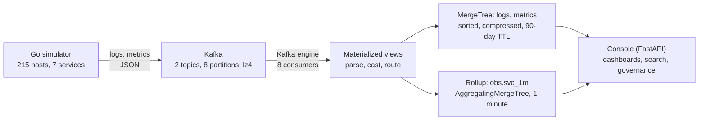

# Observability without the per-GB meter

A live demo of logs and metrics on ClickHouse, supported by EDB. A Go simulator publishes billions of
synthetic events to Kafka, ClickHouse ingests them and builds one-minute rollups as the data arrives, and a
web console serves dashboards, log search and governance views on top. 

The point of the demo: the volume of telemetry should not set the price. Storage is compressed about 5x,
queries read only the data they need, and dashboards read small pre-aggregated rows instead of raw logs.

> All data is synthetic. Figures below were measured on one reference host and are dated. Re-measure on your own
> hardware before quoting them.

## Architecture   



| Component | Role | Port |
| --- | --- | --- |
| `obs-sim` (Go) | Generates logs and metrics, control API for rate and incidents | 8090 |
| Kafka | Buffers bursts and decouples producers from ClickHouse | 9092 |
| ClickHouse (EDB build) | Storage and queries (native protocol) | 9094 |
| `obs-dash` (FastAPI) | Web console over ClickHouse's HTTP interface | 8088 |

## What the console shows

| Tab | What to look at |
| --- | --- |
| Overview | Pipeline health at a glance |
| Pipeline | Start and stop the stream, change the rate, trigger a bad deploy, load history, storage tiles |
| Dashboard | Error rate, p99 and a service heatmap. Each panel shows rows read and time taken. A "Scan raw rows" toggle compares the rollup with the raw table |
| Explore | Search logs by service, severity, window and text. The scan bar shows rows read and the share skipped by the index |
| Govern | Per-user query accounting from the query log, plus row policies, quotas, query limits and column-level grants. A burst button fires 30 cheap queries as `payments_user` to trip the per-minute quota (see [Governance guardrails](#governance-guardrails)) |
| Code | The schema and SQL behind everything above |

## Quick start

Requirements: a Linux host with ClickHouse, Kafka, Python 3 and systemd. The reference host has 16 vCPU, 64 GB RAM
and fast disk.

```bash
# Console and simulator run as systemd units: obs-sim and obs-dash
sudo systemctl enable --now obs-sim obs-dash
```

See `install/` for the install scripts and unit files. The Kafka tarball is not in this repository
(it exceeds GitHub's file size limit): download Apache Kafka from the Apache archive.

Reach the console. Only port 22 needs to be open, so use an SSH tunnel:

```bash
ssh -i <your-key>.pem -L 8088:127.0.0.1:8088 ec2-user@<host>
# then open http://localhost:8088
```

## Run the demo

```bash
sudo ./reset-demo.sh 200k            # restart at 200,000 events per second (starts Kafka and ClickHouse if down)
sudo ./reset-demo.sh 1m --wipe       # also empty all obs.* tables first
sudo ./reset-demo.sh 100k --live     # change the rate only, no restart
sudo ./reset-demo.sh --status        # show services, ports, disk and measured rows per second

sudo ./stop-demo.sh                  # stop simulator and console, keep data
sudo ./stop-demo.sh --all            # also stop ClickHouse and Kafka
```

Rates accept plain numbers or `k` and `m` suffixes. The console slider tops out near 316k events per second.

A suggested run order for a 15-minute live demo: start the stream on the Pipeline tab, watch the Dashboard
(compare rollup and raw scan), press Trigger bad deploy, find the cause on Explore, then show Govern: the row
policy, a blocked column, a heavy query stopped by the limits, and the burst button tripping the quota.

## Governance guardrails

`sql/governance_limits.sql` adds three guardrails for `payments_user` on top of the existing row policy. It is
additive and safe to re-run (`CREATE OR REPLACE`). It assumes `sre_user`, `payments_user` and the payments row
policy already exist (created by `sql/governance.sql`).

| Guardrail | Object | Configured value | Error when hit |
| --- | --- | --- | --- |
| Cap what one heavy query can consume | Settings profile `p_payments` | `max_rows_to_read` 600,000,000 (tune, see below), `max_execution_time` 20 s, `max_memory_usage` 4 GB, all set to throw | `TOO_MANY_ROWS` (158), `TIMEOUT_EXCEEDED` (159) |
| Cap what one team can consume per minute | Quota `q_payments`, keyed by user, 1-minute window | 20 queries and 3,000,000,000 rows read per minute | `QUOTA_EXCEEDED` (201) |
| Grant each team the tables and columns it needs | Column-level grant on `obs.logs` | `ts`, `service`, `host`, `severity`, `duration_ms`, `message`. `trace_id` and `attrs` are left out | `ACCESS_DENIED` (497) |

The values above are configured limits, not measurements.

Apply it as the admin user:

```bash
clickhouse-client --port 9094 --multiquery < sql/governance_limits.sql
```

**Size the row limit first.** The limit must sit above what the Govern panel reads and below what a full scan reads.
Both numbers depend on the simulator rate, so re-check them if you rehearse at a different rate:

```sql
-- A: rows the Govern panel reads for payments_user (last hour). The limit must stay above this.
SELECT count() FROM obs.logs WHERE service = 'payments' AND ts >= now() - INTERVAL 60 MINUTE;
-- B: rows a full scan reads for payments_user (all history). The limit must stay below this.
SELECT count() FROM obs.logs WHERE service = 'payments';
```

Pick a number between A and B (about 2 x A works) and put it in `max_rows_to_read`.

**How the demo uses them**

- **Heavy query:** run a full scan as `payments_user`. It is stopped by the row or time limit instead of taking the host.
- **Burst:** the Govern tab burst button fires 30 cheap queries. The quota allows 20 per minute, so the 21st fails. The
  window is one minute, so the user recovers on its own before the next step.
- **Blocked column:** `SELECT attrs[...]` as `payments_user` fails with `ACCESS_DENIED`. The console's payments panel
  reads only `ts`, `service` and `severity`, so it keeps working.

**Notes on the column grant.** The script revokes the table-level `SELECT` on `obs.logs` and grants the column list.
Check how `payments_user` is granted first with `SHOW GRANTS FOR payments_user;`. If the grant is on `obs.*` or comes
from a role, a table-level `REVOKE` needs partial revokes (`access_control_improvements.enable_partial_revokes = 1`)
or per-table grants. Adapt that block rather than running it as is.

**Check what is in force**

```sql
SHOW CREATE SETTINGS PROFILE p_payments;
SHOW CREATE QUOTA q_payments;
SHOW GRANTS FOR payments_user;
SELECT * FROM system.quota_usage WHERE quota_name = 'q_payments';
```

**Teardown** (back to the original demo):

```sql
DROP SETTINGS PROFILE IF EXISTS p_payments;
DROP QUOTA IF EXISTS q_payments;
REVOKE SELECT(ts, service, host, severity, duration_ms, message) ON obs.logs FROM payments_user;
GRANT SELECT ON obs.logs TO payments_user;
```

## Repository layout

```
simulator/        Go event generator (obs-sim)
sql/              schema, views, policies, governance limits and the history backfill
dashboard/        FastAPI console (app.py) and requirements
install/          install scripts and systemd units
reset-demo.sh     reset or retune the demo
stop-demo.sh      stop the demo
```

## Reference results

Measured on the reference host (16 vCPU, 64 GB, 4 TB disk at 16,000 IOPS, one node, ClickHouse 26.8 EDB build).

| Measure | Result | Date and size |
| --- | --- | --- |
| Ingest | About 316k events per second, pipeline lag about 1.5 s | 1 Nov, 1.0 B log rows |
| Storage | 23.3 GB for 999.8 M rows, about 25 bytes per row, about 5x compression (116.1 GB uncompressed) | 1 Nov |
| Active parts | 199 across 78 daily partitions | 1 Nov |
| Explore search (payments, ERROR, 15 min, text "timeout") | 195.9 k of 419.8 M rows read, 99.95% skipped, about 21 ms | 30 Oct, 420.7 M rows |
| Dashboard panel on the rollup | About 119 rows read, 7 to 12 ms | 30 Oct |
| Error-rate panel with Scan raw rows | 244.3 M rows, 3.0 GB, 1,568 ms | 30 Oct |

## Why it is fast

- **Columns:** a query reads only the columns it names, and each column compresses on its own.
- **Sort key and sparse index:** rows are sorted by service, severity and time, and the index keeps one entry per
  8,192-row granule, so a search skips ranges that cannot match.
- **Rollups on insert:** a materialized view builds per-minute aggregates, including percentile states, as data arrives.
- **Immutable parts and parallel reads:** writes append sorted parts that merge in the background, and one query can use every core.

## Known limitations

- **Rollup history:** the one-minute rollup is built by a materialized view, which fires only on new inserts. History loaded
  straight into the raw table with the backfill does not reach it, so 7-day and 30-day views are mostly empty until the
  rollup is rebuilt from the raw rows.
- **Single node:** the demo shows no replication or sharding. Do not extrapolate throughput to other hardware.
- **Synthetic data:** compression, selectivity and timings will differ on real logs.
- **Scope:** logs and metrics only. No traces and no alerting.
- **Governance limits are tuned per rate:** the `max_rows_to_read` value in `p_payments` depends on how much data is
  loaded and on the simulator rate. Re-size it before each rehearsal (see Governance guardrails). The limits apply to
  `payments_user` only.

## Troubleshooting

| Symptom | Likely cause and fix |
| --- | --- |
| Console does not load from a laptop | A corporate network may filter port 8088. Use the SSH tunnel above |
| `clickhouse-client` cannot connect | The native port is 9094, not 9000: `clickhouse-client --port 9094` |
| `obs-sim` fails with "address already in use" on 8090 | A stale `obs-sim` is running. `pkill -x obs-sim`, then `reset-demo.sh` |
| Dashboard blank or "Internal Server Error" | Check `journalctl -u obs-dash -n 50`. Known causes: shared ClickHouse session (use `autogenerate_session_id=False`) and an empty previous window returning NaN |
| Rates look low after a reset | Wait 60 seconds before quoting rows per second |
| Govern panel fails with `TOO_MANY_ROWS` for `payments_user` | `max_rows_to_read` in `p_payments` is now below what the panel reads, usually after a rate or data change. Re-run the sizing queries and update the limit |
| Burst button never trips the quota | Check that `q_payments` exists and is applied to `payments_user` with `SELECT * FROM system.quota_usage WHERE quota_name = 'q_payments'` |
| Column grant block fails or access is unchanged | `payments_user` was granted on `obs.*` or through a role. See the notes on the column grant above |

## Notes

- Keys and credentials are not committed. See `.gitignore`.
- The open-source engine is unmodified ClickHouse. This repository is a demo, not a product.
                                                                                                
                                                                                                                                                                                               

