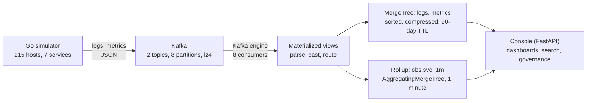

Last login: Fri Oct 30 17:55:48 on ttys002
franck.sidi@MAC-JXVJKG9K0W ~ % 
franck.sidi@MAC-JXVJKG9K0W ~ % 
franck.sidi@MAC-JXVJKG9K0W ~ % 
franck.sidi@MAC-JXVJKG9K0W ~ % 
franck.sidi@MAC-JXVJKG9K0W ~ % cd downloads
franck.sidi@MAC-JXVJKG9K0W downloads % cat webinar.sh 
ssh -i "greenplum.pem" -o ServerAliveInterval=10 ec2-user@ec2-3-101-72-38.us-west-1.compute.amazonaws.com 
franck.sidi@MAC-JXVJKG9K0W downloads % ssh -L 8088:127.0.0.1:8088 ec2-user@ec2-3-101-72-38.us-west-1.compute.amazonaws.com
ec2-user@ec2-3-101-72-38.us-west-1.compute.amazonaws.com: Permission denied (publickey,gssapi-keyex,gssapi-with-mic).
franck.sidi@MAC-JXVJKG9K0W downloads % vi port.sh
franck.sidi@MAC-JXVJKG9K0W downloads % https://claude.ai/artifact/BYLyDtYhJW9DDJpQ4B5zCq?sk=-i181ZtLHhGXXIsNwuovKA#34de09a2-f0c8
zsh: no matches found: https://claude.ai/artifact/BYLyDtYhJW9DDJpQ4B5zCq?sk=-i181ZtLHhGXXIsNwuovKA#34de09a2-f0c8
franck.sidi@MAC-JXVJKG9K0W downloads % 
franck.sidi@MAC-JXVJKG9K0W downloads % 
franck.sidi@MAC-JXVJKG9K0W downloads % ls -ltr 
total 4411088
drwx------@  9 franck.sidi  staff           288 Feb 14  2024 migration
drwxr-xr-x@ 11 franck.sidi  staff           352 Jul  8  2025 tax
-rw-r--r--@  1 franck.sidi  staff        276912 Sep 17  2025 israeli.jpeg
drwxr-xr-x@ 13 franck.sidi  staff           416 Sep 25  2025 footballer-lookalike-main
drwx------@  6 franck.sidi  staff           192 Oct  8  2025 Preparation steps
drwxr-xr-x  14 franck.sidi  staff           448 Oct 10  2025 whpg7rhel8
drwxr-xr-x@ 18 franck.sidi  staff           576 Oct 13  2025 data-compare-tool-master
drwxr-xr-x@  8 franck.sidi  staff           256 Nov 25  2025 explains
drwx------@  6 franck.sidi  staff           192 Dec 21  2025 demogpss
-rw-r--r--@  1 franck.sidi  staff          7794 Dec 22  2025 light_whpg_square.svg
-rw-r--r--@  1 franck.sidi  staff        174289 Dec 22  2025 edb-postgres-ai-landscape.svg
-rw-r--r--@  1 franck.sidi  staff          7220 Dec 22  2025 whpg-stack.svg
drwxr-xr-x  28 franck.sidi  staff           896 Dec 23  2025 flowui
-rwxr-xr-x   1 franck.sidi  staff            64 Dec 23  2025 bench.sh
drwxr-xr-x  11 franck.sidi  staff           352 Jan 14  2026 kickoff
drwxr-xr-x  12 franck.sidi  staff           384 Jan 22  2026 whpg7
drwxr-xr-x@  5 franck.sidi  staff           160 Jan 29  2026 whpg_cluster_sizer_v1.0
drwxr-xr-x  39 franck.sidi  staff          1248 Feb 12  2026 langflow
-rw-r--r--@  1 franck.sidi  staff           162 Mar  3  2026 ~$eldCTO_Final_Feb2_13_2026 (1).docx
-rw-r--r--@  1 franck.sidi  staff           162 Mar 15  2026 ~$PG_Executive_Brief_v2 (1).docx
drwxrwxr-x@ 13 franck.sidi  staff           416 Mar 26  2026 WHPG-real-streaming-main
drwxr-xr-x  10 franck.sidi  staff           320 Mar 29  2026 cdc-demo 2
-rwxr-xr-x@  1 franck.sidi  staff        327680 Mar 30  2026 cdc-demo.tar
drwx------@  7 franck.sidi  staff           224 Mar 31  2026 lebaucheducontratpourlabanquedelemprunt
drwxr-xr-x  36 franck.sidi  staff          1152 Apr  3  2026 SALARY
-rwxr-xr-x@  1 franck.sidi  staff           108 Apr  3  2026 kickoff.sh
drwx------@  9 franck.sidi  staff           288 Apr 13  2026 drive-download-20260413T092311Z-3-001
drwxr-xr-x  13 franck.sidi  staff           416 Apr 13  2026 workshop
drwxr-xr-x  20 franck.sidi  staff           640 Apr 28  2026 musique
drwxr-xr-x   6 franck.sidi  staff           192 Apr 29  2026 forrester
-rwxr-xr-x   1 franck.sidi  staff           950 May  2 16:16 nodes.sh
-rwxr-xr-x   1 franck.sidi  staff          2078 May  2 16:19 keys.sh
-rwxr-xr-x   1 franck.sidi  staff          1149 May  2 16:29 bloc2.sh
-rwxr-xr-x   1 franck.sidi  staff           437 May  2 16:30 bloc3.sh
-rwxr-xr-x   1 franck.sidi  staff           409 May  2 16:31 bloc4.sh
-rwxr-xr-x@  1 franck.sidi  staff           109 May  2 16:40 node2.sh
-rwxr-xr-x   1 franck.sidi  staff           108 May  2 16:40 node3.sh
-rw-r--r--@  1 franck.sidi  staff          1273 May  3 10:35 favicon.svg
drwx------@  9 franck.sidi  staff           288 May  3 15:31 whpg-deploy-ssh-bootstrap
-rwxr-xr-x   1 franck.sidi  staff           473 May  8 11:13 bloc1.sh
drwx------@ 12 franck.sidi  staff           384 May  8 12:03 filesnodesb
-rwxr-xr-x   1 franck.sidi  staff           341 May  8 15:47 launch.sh
drwxrwxr-x@ 22 franck.sidi  staff           704 May 13 15:36 clickhouse-academy-main
-rw-r--r--@  1 franck.sidi  staff          9896 May 18 15:30 edb-bento.skill
drwxrwxr-x@ 18 franck.sidi  staff           576 May 18 23:26 whpg_swap_from_gp-main
drwx------@ 13 franck.sidi  staff           416 May 23 19:31 refwdossierdecreditalabanquemizrahitefahot
drwxr-xr-x@ 13 franck.sidi  staff           416 Jun  3 15:23 repsol-edb-vector-demo
drwxr-xr-x   4 franck.sidi  staff           128 Jun  4 07:21 deploy
drwx------@  8 franck.sidi  staff           256 Jun  4 14:12 whpg-deploy-main-changes
drwxr-xr-x@  5 franck.sidi  staff           160 Jun  5 10:44 whpg_cluster_sizer
-rw-r--r--@  1 franck.sidi  staff        412865 Jun  5 12:35 french.jpeg
-r--------@  1 franck.sidi  staff          1678 Jun 10 09:43 greenplum.pem
-rw-r--r--@  1 franck.sidi  staff           162 Jun 20 18:58 ~$I_Orbit_Report_French.docx
-rw-r--r--@  1 franck.sidi  staff           162 Jun 20 19:00 ~$I_Orbit_Report_English.docx
drwxr-xr-x  38 franck.sidi  staff          1216 Jun 22 17:13 zip
-rw-r--r--@  1 franck.sidi  staff        221939 Jun 24 11:10 סידי-הוראה לתיקון.pdf
drwxr-xr-x@  7 franck.sidi  staff           224 Jul 16 09:23 clickhouse-mergetree-demo
-rw-r--r--@  1 franck.sidi  staff        637003 Jul 16 18:50 clickhouse_v26.3_documentation.pdf
drwxr-xr-x@ 15 franck.sidi  staff           480 Jul 21 19:06 mizuho
-rw-r--r--@  1 franck.sidi  staff         54472 Jul 27 14:01 Franck Sidi  Broadcom  2024  מסכמת רשמית  RSU.xlsx
-rwxr-xr-x@  1 franck.sidi  staff           108 Jul 28 16:59 node1.sh
drwx------@  4 franck.sidi  staff           128 Jul 31 13:11 files (11)
drwxr-xr-x@  9 franck.sidi  staff           288 Jul 31 15:41 repo
drwxr-xr-x@  7 franck.sidi  staff           224 Aug  5 10:52 iceberg-tests
-rw-r--r--@  1 franck.sidi  staff        217263 Aug  5 10:57 InvoiceArchivePdf_2683.pdf
-rw-r--r--@  1 franck.sidi  staff        217263 Aug  5 10:58 InvoiceArchivePdf_9328.pdf
-rw-r--r--@  1 franck.sidi  staff        491724 Aug  5 10:59 InvoiceArchivePdf_4701.pdf
-rw-r--r--   1 franck.sidi  staff       1105920 Aug  5 12:34 pxf-iceberg-project.tar
drwx------@  4 franck.sidi  staff           128 Aug  5 12:37 files (12)
drwxr-xr-x@  8 franck.sidi  staff           256 Aug  5 13:49 pxf-iceberg-project
-rwxr-xr-x   1 franck.sidi  staff        130780 Aug  5 14:01 pxf-api-7.0.0.jar
drwx------@  5 franck.sidi  staff           160 Aug  5 16:14 files191
drwx------@  6 franck.sidi  staff           192 Aug  5 18:20 drive-download-20260805T152002Z-1-001
-rw-r--r--@  1 franck.sidi  staff         43095 Aug  5 19:16 Open_Hours_Tracker.xlsx
drwxr-xr-x@ 12 franck.sidi  staff           384 Aug  6 10:32 pxf-iceberg-connector
drwxr-xr-x@  9 franck.sidi  staff           288 Aug  6 10:32 pxf-iceberg-project 2
drwxr-xr-x@  5 franck.sidi  staff           160 Aug  6 10:47 hudi-datagen
drwxr-xr-x@ 13 franck.sidi  staff           416 Aug  6 13:01 pxf-hudi-connector
drwxr-xr-x   8 franck.sidi  staff           256 Aug  6 15:26 pxf-hudi-v0
-rw-r--r--   1 franck.sidi  staff       1075200 Aug  6 15:29 pxf-hudi-v0.tar
drwxr-xr-x@ 10 franck.sidi  staff           320 Aug  6 16:14 Demos
drwx------@  5 franck.sidi  staff           160 Aug  7 10:14 files (2)
drwx------@  7 franck.sidi  staff           224 Aug  7 12:25 files (3)
-rw-r--r--@  1 franck.sidi  staff         22574 Aug  7 20:40 Alta-Summary.docx
-rw-r--r--@  1 franck.sidi  staff        132669 Aug  8 07:18 image.png
-rw-r--r--@  1 franck.sidi  staff        549996 Aug  8 09:11 ContractLocationBohorov.pdf
-rw-r--r--@  1 franck.sidi  staff         63589 Aug  8 09:26 Israel_EE_Job_Search.xlsx
-rw-r--r--@  1 franck.sidi  staff         10214 Aug  8 09:27 README_FR.md
-rw-r--r--@  1 franck.sidi  staff          8405 Aug  8 09:27 README_EN.md
-rw-r--r--@  1 franck.sidi  staff        108230 Aug 13 21:51 Fleur_Scemama_CV_TSC.pdf
drwx------@  4 franck.sidi  staff           128 Aug 13 22:04 files (4)
-rw-r--r--@  1 franck.sidi  staff         19358 Aug 16 21:16 edb_workload_analytics_accelerator_2026-08-16.csv
-rw-r--r--@  1 franck.sidi  staff         17691 Aug 16 21:26 Untitled spreadsheet.xlsx
-rw-r--r--@  1 franck.sidi  staff       2819476 Aug 19 12:10 query-plan-pin-demo-sidebyside.mp4
-rw-r--r--@  1 franck.sidi  staff       2584553 Aug 19 12:19 Seoul_Keynote_Notes_Pages.pdf
-rw-r--r--@  1 franck.sidi  staff        117073 Aug 19 12:28 OCBC_Singapore_Account_Plan.md.pdf
-rw-r--r--@  1 franck.sidi  staff        165444 Aug 19 12:34 Seoul_Keynote_Talking_Points.md.pdf
-rw-r--r--@  1 franck.sidi  staff        737400 Aug 20 15:26 Oracle Assessment Document - September 2025.docx
-rw-r--r--@  1 franck.sidi  staff      96119712 Aug 21 07:06 Technical Enablement_McKnightBenchmarks_Recording_August11, 2026.mp4
-rw-r--r--@  1 franck.sidi  staff       2512810 Aug 21 11:12 Seoul_Keynote_Notes_Pages.docx
-rw-r--r--@  1 franck.sidi  staff       1579175 Aug 21 11:26 SmarTone_Meeting_Notes_Pages.pdf
-rw-r--r--@  1 franck.sidi  staff       1514359 Aug 21 11:29 SmarTone_Meeting_Notes_Pages.docx
-rw-r--r--@  1 franck.sidi  staff        103916 Aug 22 08:36 BoardingPass.pdf
-rw-r--r--@  1 franck.sidi  staff       5681277 Aug 22 13:38 Alfred_5.7.3_2320.dmg
-rw-r--r--@  1 franck.sidi  staff         59418 Aug 22 13:54 ActivityReport.xlsx
-rw-r--r--@  1 franck.sidi  staff         16896 Aug 22 14:27 545AVGO Dividend Report for FRANCK SIDI.xlsx
-rw-r--r--@  1 franck.sidi  staff        209031 Aug 23 19:28 WhatsApp Image 2026-08-24 at 00.28.16.jpeg
-rw-r--r--@  1 franck.sidi  staff        201386 Aug 23 19:28 WhatsApp Image 2026-08-24 at 00.28.16 (1).jpeg
-rw-r--r--@  1 franck.sidi  staff        186901 Aug 23 19:28 WhatsApp Image 2026-08-24 at 00.28.16 (2).jpeg
-rw-r--r--@  1 franck.sidi  staff        193798 Aug 23 19:28 WhatsApp Image 2026-08-24 at 00.28.16 (3).jpeg
-rw-r--r--@  1 franck.sidi  awagent     2256146 Aug 24 11:24 IMG_4572.HEIC
-rw-r--r--@  1 franck.sidi  awagent     2985847 Aug 24 11:24 IMG_4573.HEIC
-rw-r--r--@  1 franck.sidi  staff        221379 Aug 24 16:41 receipt_07b41842-8772-45c5-bc5b-cadaaee265ce.pdf
-rw-r--r--@  1 franck.sidi  staff        221379 Aug 24 16:43 receipt_07b41842-8772-45c5-bc5b-cadaaee265ce (1).pdf
-rw-r--r--@  1 franck.sidi  staff        195132 Aug 25 02:57 EDB Postgres AI Keynote · Hong Kong.pdf
-rw-r--r--@  1 franck.sidi  staff         23156 Aug 25 11:21 DataLoading_Demo.ipynb
-rw-r--r--@  1 franck.sidi  staff        441932 Aug 25 11:21 MADlib_Kmeans_CustomerSegmentation.ipynb
-rw-r--r--@  1 franck.sidi  staff         23156 Aug 25 11:21 DataLoading_Demo (1).ipynb
-rw-r--r--@  1 franck.sidi  staff        228901 Aug 25 11:22 MADlib_fraud.ipynb
-rw-r--r--@  1 franck.sidi  staff       2103182 Aug 26 04:16 HK2026_EDB_Vision_Keynote_Seoul.html
-rw-r--r--@  1 franck.sidi  staff       2103235 Aug 26 04:18 HK2026_EDB_Vision_Keynote_Seoul (1).html
-rw-r--r--@  1 franck.sidi  staff         30208 Aug 26 13:43 travel-checklist-for-plane-trip-en-20240527_tcm33-10418.xls
-rw-r--r--@  1 franck.sidi  staff         86524 Aug 26 13:49 Print Boarding Pass - EVA Air _ Global (English).pdf
-rw-r--r--@  1 franck.sidi  staff        114874 Aug 26 14:51 ca3a2bbf-4bf5-497c-8fef-a1ec9bcb2c41.pdf
-rw-r--r--@  1 franck.sidi  staff         25113 Aug 27 03:17 Iveco Group migration from Greenplum to EDB WarehousePG - Version 01.xlsx
-rw-r--r--@  1 franck.sidi  staff        199478 Aug 27 03:26 receipt_da58f678-321a-4db2-be2d-482025aa118b.pdf
-rw-------@  1 franck.sidi  staff           419 Aug 27 04:15 edb-demo
-rw-r--r--@  1 franck.sidi  staff         97081 Aug 28 03:19 SGArrivalCard_280820260819.pdf
drwx------@  4 franck.sidi  staff           128 Aug 28 03:32 rsa-edbdemo
-rw-r--r--@  1 franck.sidi  staff        199479 Aug 28 07:10 receipt_da58f678-321a-4db2-be2d-482025aa118b (1).pdf
drwxr-xr-x  93 franck.sidi  staff          2976 Aug 30 06:02 pdf
-rw-rw-r--@  1 franck.sidi  staff        302992 Sep  1 00:59 4026071163 LAB RESULTS.pdf
-rw-r--r--@  1 franck.sidi  staff        242186 Sep  1 02:07 4026071163 LAB RESULTS.zip
-rw-r--r--@  1 franck.sidi  staff        261629 Sep  2 15:03 Teradata -  Delphi Assessment 1.0.docx
-rw-r--r--@  1 franck.sidi  awagent     1768005 Sep  3 09:11 IMG_4701.HEIC
-rw-r--r--@  1 franck.sidi  staff       2821688 Sep  3 09:12 IMG_4701.jpeg
-rw-r--r--@  1 franck.sidi  staff        101093 Sep  3 09:17 bp.pdf
-rw-r--r--@  1 franck.sidi  staff       1721262 Sep  4 02:17 WhatsApp Image 2026-09-03 at 12.41.03.jpeg
-rw-r--r--@  1 franck.sidi  staff       1303884 Sep  4 02:17 WhatsApp Image 2026-09-03 at 18.34.03.jpeg
-rw-r--r--@  1 franck.sidi  staff       4023009 Sep  6 18:06 Resume_medical_voyage_Asie_medicaments_photos.docx
-rw-r--r--@  1 franck.sidi  staff         12263 Sep  7 07:47 edb_total_pipeline_open_deals_2026-09-07.csv
-rw-r--r--@  1 franck.sidi  staff           753 Sep  7 13:18 id_rsa.pub
drwx------@  4 franck.sidi  staff           128 Sep  7 18:46 files (8)
-rw-r--r--@  1 franck.sidi  staff        127833 Sep  7 19:15 vectorplus_api.py
-rw-r--r--@  1 franck.sidi  staff        124516 Sep  7 19:15 vectorplus_dashboardhtml.txt
-rw-r--r--@  1 franck.sidi  staff         52027 Sep  7 19:45 vpbench.py
-rw-r--r--@  1 franck.sidi  staff         44319 Sep  7 21:06 Germany_Panel_FS_Data_AI_Governance_Answers.docx
-rw-r--r--@  1 franck.sidi  staff        228214 Sep  8 06:03 Germany_Panel_FS_Data_AI_Governance_Answers_v2_reviewed.pdf
-rw-r--r--@  1 franck.sidi  staff      36620017 Sep  8 08:40 demoAML.mp4
-rw-r--r--@  1 franck.sidi  staff      36620017 Sep  8 08:43 demoAML (1).mp4
-rw-r--r--@  1 franck.sidi  staff      20837796 Sep  8 08:43 AIWHPGDEMO.mp4
-rw-r--r--@  1 franck.sidi  staff         34548 Sep  8 09:29 Teradata_to_WarehousePG_Assessment.docx
drwx------@  4 franck.sidi  staff           128 Sep  8 09:35 files (7)
-rw-r--r--@  1 franck.sidi  staff       1282115 Sep  8 11:23 EDB_Seoul_Keynote_Sept3_2026.pdf
drwx------@  4 franck.sidi  staff           128 Sep  8 11:46 files (9)
-rw-r--r--@  1 franck.sidi  staff        121944 Sep  8 12:18 courrierReeditionMCodeQRCode.pdf
drwx------@  4 franck.sidi  staff           128 Sep  8 12:24 files (13)
-rw-r--r--@  1 franck.sidi  staff         19564 Sep  8 17:07 edb_total_pipeline_open_deals_2026-09-08.csv
-rw-r--r--@  1 franck.sidi  staff         19564 Sep  8 17:08 edb_total_pipeline_open_deals_2026-09-08 (1).csv
-rw-r--r--@  1 franck.sidi  staff          3918 Sep  8 23:00 iot-generator.go
-rw-r--r--@  1 franck.sidi  staff          3918 Sep  8 23:00 iot-generator (1).go
-rw-r--r--@  1 franck.sidi  staff         10810 Sep  8 23:02 order-generator.go
-rw-r--r--@  1 franck.sidi  staff         13650 Sep  8 23:02 reset-demo-cdc.sh
-rw-r--r--@  1 franck.sidi  staff         52941 Sep  9 14:44 EDB Staffing Plan — Vodafone AI Pilot MVP.xlsx
-rw-r--r--@  1 franck.sidi  staff        783084 Sep  9 15:04 edb_Vodafone-sovereignAI-draft.pptx (1).pdf
-rw-r--r--@  1 franck.sidi  staff        241690 Sep  9 18:41 bill.pdf
-rw-r--r--@  1 franck.sidi  staff         32424 Sep  9 19:20 EDB_Analytics_Qualification_App.html
-rw-r--r--@  1 franck.sidi  staff        135566 Sep 10 11:49 vectorplus_dashboard11html.txt
-rw-r--r--@  1 franck.sidi  staff        135566 Sep 10 11:58 vectorplus_dashboard.html
-rw-r--r--@  1 franck.sidi  staff        135566 Sep 10 11:59 vectorplus_dashboard (1).html
drwx------@  4 franck.sidi  staff           128 Sep 10 12:07 files (15)
-rw-r--r--@  1 franck.sidi  staff        138422 Sep 10 12:16 vectorplus_dashboard (2).html
-rw-r--r--@  1 franck.sidi  staff        138422 Sep 10 12:16 vectorplus_dashboard33html.txt
-rw-r--r--@  1 franck.sidi  staff         15462 Sep 10 12:16 hybrid_search_patch.py
-rw-r--r--@  1 franck.sidi  staff         32424 Sep 11 06:54 EDB_Analytics_Qualification_App (1).html
-rw-r--r--@  1 franck.sidi  staff         36031 Sep 11 07:01 EDB_Analytics_Qualification_App__1_.html
-rw-r--r--@  1 franck.sidi  staff         36959 Sep 11 07:05 EDB_Analytics_Qualification_App_AI.html
-rw-r--r--@  1 franck.sidi  staff         19293 Sep 11 16:00 edb_total_pipeline_open_deals_2026-09-11.csv
drwx------@ 10 franck.sidi  staff           320 Sep 11 16:00 drive-download-20260911T130029Z-1-001
-rw-r--r--@  1 franck.sidi  staff         34778 Sep 11 16:01 EDB_Analytics_Workloads_SEA_GreaterChina_Dorothy.xlsx
-rw-r--r--@  1 franck.sidi  staff         16460 Sep 12 11:49 SE_Analytics_AI_Weekly_Report_Sept11.docx
drwx------@  3 franck.sidi  staff            96 Sep 13 07:40 files (19)
drwxr-xr-x@  8 franck.sidi  staff           256 Sep 13 08:22 aidb
drwx------@  5 franck.sidi  staff           160 Sep 13 17:42 files (16)
-rw-r--r--@  1 franck.sidi  staff        148263 Sep 13 20:16 RWS - Demo day with translation.xlsx
-rw-r--r--@  1 franck.sidi  staff          3918 Sep 13 20:19 iot-generator (2).go
-rw-r--r--@  1 franck.sidi  staff         10810 Sep 13 20:19 order-generator (1).go
-rw-r--r--@  1 franck.sidi  staff        157819 Sep 14 08:30 dashboard.html
-rw-r--r--@  1 franck.sidi  staff         10810 Sep 14 08:30 order-generator (2).go
-rw-r--r--@  1 franck.sidi  staff         41537 Sep 14 08:45 edb-whpg7-whpg-cron-1.6.8-1.el9.x86_64.rpm
-rw-r--r--@  1 franck.sidi  staff        202081 Sep 14 08:46 edb-whpg7-pg_partman-4.7.4-1.el9.x86_64.rpm
-rw-r--r--@  1 franck.sidi  staff        157819 Sep 14 08:49 dashboard (1).html
-rw-r--r--@  1 franck.sidi  staff        112324 Sep 14 08:49 api.py
-rw-r--r--@  1 franck.sidi  staff         13650 Sep 14 08:49 reset-demo-cdc (1).sh
-rw-r--r--@  1 franck.sidi  staff          8669 Sep 14 08:51 pgcron_demo.sql
-rw-r--r--@  1 franck.sidi  staff         74267 Sep 14 16:38 Analytics Assets.xlsx
-rw-r--r--@  1 franck.sidi  staff         72271 Sep 14 16:50 app.py
-rw-r--r--@  1 franck.sidi  staff         69960 Sep 14 16:51 dashboard (2).html
-rw-r--r--@  1 franck.sidi  staff         36959 Sep 15 10:08 EDB_Analytics_Qualification_App_AI (1).html
-rw-r--r--@  1 franck.sidi  staff         88020 Sep 15 12:51 NIQ - Oracle Estate Discovery - Analytics and Data Warehouse Workloads - August 2026.docx
-rw-r--r--@  1 franck.sidi  staff         88020 Sep 15 12:53 NIQ - Oracle Estate Discovery - Analytics and Data Warehouse Workloads - August 2026 (1).docx
-rw-r--r--@  1 franck.sidi  staff       1621186 Sep 15 18:22 WarehousePG-sizer-2026-09-15 (3).pdf
-rw-r--r--@  1 franck.sidi  staff           753 Sep 16 07:46 id_rsa (1).pub
-rw-r--r--@  1 franck.sidi  staff       5260154 Sep 16 09:18 IMG_4990.jpg
-rw-r--r--@  1 franck.sidi  staff       4925032 Sep 16 09:18 IMG_4997.jpg
-rw-r--r--@  1 franck.sidi  staff          3918 Sep 16 11:23 iot-generator (3).go
-rw-r--r--@  1 franck.sidi  staff          2709 Sep 16 11:23 iot-sensors-csv.yaml
-rw-r--r--@  1 franck.sidi  staff           889 Sep 16 11:23 rabbitmq_simple_csv.yaml
-rw-r--r--@  1 franck.sidi  staff        112324 Sep 16 11:24 api (1).py
-rw-r--r--@  1 franck.sidi  staff        157819 Sep 16 11:24 dashboard (3).html
-rw-r--r--@  1 franck.sidi  staff        121591 Sep 16 11:25 api (2).py
-rw-r--r--@  1 franck.sidi  staff        171729 Sep 16 11:26 dashboard (4).html
-rw-r--r--@  1 franck.sidi  staff         17869 Sep 16 11:28 reset-demo-cdc (2).sh
-rw-r--r--@  1 franck.sidi  staff          9855 Sep 16 11:28 start-demo.sh
-rw-r--r--@  1 franck.sidi  staff          4288 Sep 16 11:29 stop-demo.sh
-rw-r--r--@  1 franck.sidi  staff         85724 Sep 16 18:27 app_iceberg.py
drwx------@  5 franck.sidi  staff           160 Sep 16 20:17 scam_radar_20m
drwx------@  6 franck.sidi  staff           192 Sep 16 22:08 scam_radar_json_fulltext (2)
-rw-r--r--@  1 franck.sidi  staff        202766 Sep 17 10:28 CIP - Oracle Dataguard Configuration.docx
-rw-r--r--@  1 franck.sidi  staff      20426135 Sep 17 10:28 especprod.pdf
-rw-r--r--@  1 franck.sidi  staff        339670 Sep 17 10:29 SIRVAL PROD - Object Counts.xlsx
-rw-r--r--@  1 franck.sidi  staff        568369 Sep 17 11:38 vodafone_ai_pilot_mvp.pdf
-rw-r--r--@  1 franck.sidi  staff       2124963 Sep 17 11:45 RWS_WarehousePG_Demo_Day_20260917.pdf
-rw-r--r--@  1 franck.sidi  staff       2124963 Sep 17 11:45 RWS_WarehousePG_Demo_Day_20260917 (1).pdf
-rw-r--r--@  1 franck.sidi  staff         34756 Sep 17 15:24 UOB_RFP_2026_Graph_Capabilities_Compliance_Response_EDB_v2.docx
-rw-r--r--@  1 franck.sidi  staff       1304335 Sep 17 17:40 Nokia - 20260916.pdf
-rw-r--r--@  1 franck.sidi  staff         34756 Sep 18 12:45 UOB_RFP_2026_Graph_Capabilities_Compliance_Response_EDB_v2 (1).docx
-rw-r--r--@  1 franck.sidi  staff         44857 Sep 18 12:56 UOB_RFP_2026_Graph_Capabilities_Compliance_Response_EDB_Clean_Converged_Analytics.docx
-rw-r--r--@  1 franck.sidi  staff        219237 Sep 18 12:59 UOB_RFP_2026_Graph_Capabilities_Compliance_Response_EDB_Clean_Converged_Analytics (1).docx
-rw-r--r--@  1 franck.sidi  staff        219210 Sep 18 13:03 UOB_RFP_2026_Graph_Capabilities_Compliance_Response_EDB_Clean_Converged_Analytics (2).docx
-rw-r--r--@  1 franck.sidi  staff        643676 Sep 18 14:55 NIQ Global Oracle – Reverse RFI Discovery Questions.docx
-rw-r--r--@  1 franck.sidi  staff         67052 Sep 22 09:40 Adam_Sidi_CV.pdf
-rw-r--r--@  1 franck.sidi  staff         43459 Sep 22 10:27 EDB_Deloitte_Analytics_Offload_Strategy_Brief.docx
-rw-r--r--@  1 franck.sidi  staff         12926 Sep 22 13:05 gov.jpeg
-rw-r--r--@  1 franck.sidi  staff       2282006 Sep 23 07:16 Nokia Answers.docx
-rw-r--r--@  1 franck.sidi  staff       1282502 Sep 23 07:50 Nokia Answers (1).docx
-rw-r--r--@  1 franck.sidi  staff       1282502 Sep 23 07:53 Nokia Answers (1) (1).docx
-rw-r--r--@  1 franck.sidi  staff        950870 Sep 23 10:40 Nokia Answers (2).docx
-rw-r--r--@  1 franck.sidi  staff        250785 Sep 23 11:16 Ghost Index Scan on AOCO.html
-rw-r--r--@  1 franck.sidi  staff          3734 Sep 23 15:48 README_WEM_Upgrade.md
-rw-r--r--@  1 franck.sidi  staff          6465 Sep 23 15:51 README_VectorPlus_Local_Postgres.md
-rw-r--r--@  1 franck.sidi  staff         10477 Sep 24 09:36 MinIO Installation, Configuration and Migration Runbook.md
-rw-r--r--@  1 franck.sidi  staff        935738 Sep 24 10:48 1790176241063.pdf
-rw-r--r--@  1 franck.sidi  staff         67052 Sep 24 11:14 Adam_Sidi_CV (1).pdf
-rw-r--r--@  1 franck.sidi  staff       1231689 Sep 24 13:45 EDB - Nokia Answers - September 23 2026.docx
-rw-r--r--@  1 franck.sidi  staff       1232435 Sep 24 13:51 EDB%20-%20Nokia%20Answers%20-%20September%2023%202026%20-%20Professional.docx
drwx------@ 12 franck.sidi  staff           384 Sep 24 15:02 ObjectCountLOC
-rw-r--r--@  1 franck.sidi  staff         19895 Sep 25 08:29 09.24.26 NIQ OGRDS Exadata migration Opportunity Brief.docx
-rw-r--r--@  1 franck.sidi  staff        139633 Sep 25 08:29 Screenshot 2026-09-24 093409.png
-rw-r--r--@  1 franck.sidi  staff        532503 Sep 25 08:29 Screenshot 2026-09-24 091529.png
-rw-r--r--@  1 franck.sidi  staff         99051 Sep 25 08:29 Screenshot 2026-09-24 093739.png
-rw-r--r--@  1 franck.sidi  staff         19974 Sep 25 14:21 test_service.py
-rw-r--r--@  1 franck.sidi  staff         10987 Sep 25 14:21 test_models.py
-rw-r--r--@  1 franck.sidi  staff          3736 Sep 25 14:21 server.py
-rw-r--r--@  1 franck.sidi  staff          4588 Sep 25 14:21 database.py
-rw-r--r--@  1 franck.sidi  staff          1636 Sep 25 14:22 model_config.py
-rw-r--r--@  1 franck.sidi  staff          2090 Sep 25 14:22 agent.py
drwx------@  9 franck.sidi  staff           288 Sep 25 15:44 aidbin
-rw-r--r--@  1 franck.sidi  staff         43942 Sep 25 16:46 EDB_WarehousePG_Denodo_Replacement_Strategy.docx
-rw-r--r--@  1 franck.sidi  staff         43942 Sep 25 16:47 EDB_WarehousePG_Denodo_Replacement_Strategy (1).docx
-rw-r--r--@  1 franck.sidi  staff         43942 Sep 25 16:48 EDB_WarehousePG_Denodo_Replacement_Strategy (2).docx
-rw-r--r--@  1 franck.sidi  staff         27587 Sep 28 07:28 app (1).py
-rw-r--r--@  1 franck.sidi  staff         19599 Sep 28 07:29 generate_data.py
-rw-r--r--@  1 franck.sidi  staff          4128 Sep 28 07:29 load_clickhouse.py
-rw-r--r--@  1 franck.sidi  staff          1923 Sep 28 07:29 ch_ddl.sql
-rw-r--r--@  1 franck.sidi  staff        341134 Sep 28 17:57 edb-bento-lite.skill
-rw-r--r--@  1 franck.sidi  staff        966524 Sep 29 12:31 CV_BernardRoyet_092026.docx
-rw-r--r--@  1 franck.sidi  staff         14865 Sep 29 13:57 EDB Analytics Partner Profile Questionnaire (Responses).xlsx
drwx------@  6 franck.sidi  staff           192 Sep 29 16:53 files (17)
-rw-r--r--@  1 franck.sidi  staff         23800 Sep 29 17:47 discovery_questions.html
-rw-r--r--@  1 franck.sidi  staff         22206 Sep 29 17:59 discovery_target_app.html
-rw-r--r--@  1 franck.sidi  staff         22206 Sep 29 17:59 discovery_target_app (1).html
-rw-r--r--@  1 franck.sidi  staff         22206 Sep 29 18:00 discovery_target_app (2).html
-rw-r--r--@  1 franck.sidi  staff         25952 Sep 29 18:05 EDB_Discovery_Simple (1).html
-rw-r--r--@  1 franck.sidi  staff         25952 Sep 29 18:07 EDB_Discovery_Simple (2).html
-rw-r--r--@  1 franck.sidi  staff         64371 Sep 30 06:48 EDB x Ataccama Agent Governance Pilot Guide for Sellers_Updated.pdf
-rwxr-xr-x@  1 franck.sidi  staff           120 Sep 30 08:27 edb.sh
-rw-r--r--@  1 franck.sidi  staff         43670 Sep 30 18:30 EDB_Agent_Memory_Local_Postgres_Runbook.docx
-rw-r--r--@  1 franck.sidi  staff           162 Oct  1 10:33 ~$B_Analytics_Webinar_Full_Speaker_Notes_Oct1_2026.docx
-rw-r--r--@  1 franck.sidi  staff        378311 Oct  1 16:06 HPE_WarehousePG_7.6_Functional_Test_Prerequisites 1.1.docx.pdf
-rw-r--r--@  1 franck.sidi  staff        378312 Oct  1 16:08 HPE_WarehousePG_7.6_Functional_Test_Prerequisites 1.1.docx (1).pdf
-rw-r--r--@  1 franck.sidi  staff        139923 Oct  1 16:10 Observability & Log Analytics Platform – Meeting Minutes.docx
-rw-r--r--@  1 franck.sidi  staff        672647 Oct  1 16:11 HPE_WarehousePG_7.6_Functional_Test_Prerequisites 1.1.docx
-rw-r--r--@  1 franck.sidi  staff         44597 Oct  1 16:12 AgentMemory_Local_Postgres_Runbook.docx
-rw-r--r--@  1 franck.sidi  staff         50716 Oct  1 16:15 HPE_WarehousePG_7.6_Functional_Test_Prerequisites_Cohosted_ClickHouse.docx
-rw-r--r--@  1 franck.sidi  staff         51175 Oct  1 16:22 HPE_WarehousePG_HPE_Final.docx
-rw-r--r--@  1 franck.sidi  staff        335822 Oct  1 16:25 HPE_WarehousePG_HPE_Final.docx.pdf
-rw-r--r--@  1 franck.sidi  staff          7628 Oct  1 18:53 build_edb_survey_form.gs
-rw-r--r--@  1 franck.sidi  staff          7628 Oct  1 18:54 build_edb_survey_form (1).gs
-rw-r--r--@  1 franck.sidi  staff         68277 Oct  1 19:42 edb-whpg7-vectorplus-0.0.5-1.el9.x86_64.rpm
-rw-r--r--@  1 franck.sidi  staff        952131 Oct  1 19:42 edb-whpg7-pgfs-3.2.1-1.el9.x86_64.rpm
-rw-r--r--@  1 franck.sidi  staff      67075157 Oct  1 19:42 edb-whpg7-pgaa-1.11.0-1.el9.x86_64.rpm
-rw-r--r--@  1 franck.sidi  staff        612444 Oct  2 10:09 EDB_IBM_APJ_Data_Guild_Analytics_AI.pdf
-rw-r--r--@  1 franck.sidi  staff        139923 Oct  2 12:48 Observability & Log Analytics Platform – Meeting Minutes (1).docx
-rw-r--r--@  1 franck.sidi  staff        219155 Oct  2 12:58 ClickHouse Observability Platform – Requirements Fit & Service Proposal.docx
-rw-r--r--@  1 franck.sidi  staff          2136 Oct  2 13:35 ClickHouse_ecommerce_reset_fix.md
-rw-r--r--@  1 franck.sidi  staff          8428 Oct  2 17:16 ClickHouse Multi-DC Service Setup – IGBT Cluster.docx
-rw-r--r--@  1 franck.sidi  staff         68277 Oct  4 10:20 edb-whpg7-vectorplus-0.0.5-1.el9.x86_64 (1).rpm
-rw-r--r--@  1 franck.sidi  staff        952131 Oct  4 10:20 edb-whpg7-pgfs-3.2.1-1.el9.x86_64 (1).rpm
-rw-r--r--@  1 franck.sidi  staff      67075157 Oct  4 10:20 edb-whpg7-pgaa-1.11.0-1.el9.x86_64 (1).rpm
-rw-r--r--@  1 franck.sidi  staff        139923 Oct  4 17:52 Observability & Log Analytics Platform – Meeting Minutes (2).docx
-rw-r--r--@  1 franck.sidi  staff          1846 Oct  5 05:37 edb_total_pipeline_open_deals_2026.csv
-rw-r--r--@  1 franck.sidi  staff          7253 Oct  5 05:37 edb_total_pipeline_open_deals_2027.csv
-rw-r--r--@  1 franck.sidi  staff         13546 Oct  5 05:44 edb_total_pipeline_open_deals_2026-10-05.csv
-rw-r--r--@  1 franck.sidi  staff         30855 Oct  5 05:44 edb_total_pipeline_open_deals_2026-10-05 (1).csv
drwx------@  6 franck.sidi  staff           192 Oct  5 09:05 drive-download-20261005T060447Z-1-001
-rw-r--r--@  1 franck.sidi  staff         86442 Oct  5 10:45 clari_export_opportunity_customized-view_418974_20261005_074416.csv
-rw-r--r--@  1 franck.sidi  staff         86442 Oct  5 10:45 clari_export_opportunity_customized-view_418974_20261005_074416 (1).csv
drwxrwxr-x@ 16 franck.sidi  staff           512 Oct  5 17:25 whpg_flow_server-dev
-rw-r--r--@  1 franck.sidi  staff       5906786 Oct  5 18:48 gpss2flow_darwin_arm64
drwx------@  6 franck.sidi  staff           192 Oct  5 18:48 files (17) 2
drwxr-xr-x   4 franck.sidi  staff           128 Oct  5 18:56 convert
-rw-r--r--   1 franck.sidi  staff          4598 Oct  5 19:17 job.yaml
-rw-r--r--@  1 franck.sidi  staff          6032 Oct  5 19:24 job (1).yaml
-rw-r--r--@  1 franck.sidi  staff          6032 Oct  5 19:24 job-convert.yaml
-rw-r--r--@  1 franck.sidi  staff        376408 Oct  6 11:36 clari_export_forecast_new_arr2_{_type___FORECAST_ROLE___userId__586090__userType___MGR_}_2026_Q4_418974_20261006_083224.csv
-rw-r--r--@  1 franck.sidi  staff        185066 Oct  6 12:07 Q4_2026_Forecast_Deal_Tracker.xlsx
-rw-r--r--@  1 franck.sidi  staff         24354 Oct  6 12:09 clari_export_forecast_new_arr2_{_type___FORECAST_ROLE___userId__586090__userType___MGR_}_2026_Q4_418974_20261006_090845.csv
-rw-r--r--@  1 franck.sidi  staff         87998 Oct  6 13:49 Q4_2026_Forecast_Deal_Tracker (1).xlsx
-rw-r--r--@  1 franck.sidi  staff       8701300 Oct  6 19:58 Dataproducts demo.mp4
-rw-r--r--@  1 franck.sidi  staff        442035 Oct  7 10:29 orchestrating-agent-memory.png
-rw-r--r--@  1 franck.sidi  staff        212590 Oct  7 10:48 discovery_workbench_edb_v2.html
-rw-r--r--@  1 franck.sidi  staff          9573 Oct  7 17:13 EDB Analytics & AI - What Is Blocking More Customer Meetings_ (Responses).xlsx
-rw-r--r--@  1 franck.sidi  staff          9573 Oct  7 17:27 EDB Analytics & AI - What Is Blocking More Customer Meetings_ (Responses) (1).xlsx
-rw-r--r--@  1 franck.sidi  staff        473594 Oct  7 19:23 Facilitator Guide Analytics & AI Seller Enablement (French-speaking Switzerland).pdf
-rw-r--r--@  1 franck.sidi  staff         61360 Oct  7 23:35 DB list.xlsx
-rw-r--r--@  1 franck.sidi  staff         76227 Oct  8 11:07 index.html
-rw-r--r--@  1 franck.sidi  staff        228306 Oct  8 14:59 NIQ_ Application mapping with info received.xlsx
-rw-r--r--@  1 franck.sidi  staff         40597 Oct  8 15:53 AI_in_Postgres_In_a_Box_Internal_Proposal.docx
-rw-r--r--@  1 franck.sidi  staff        343045 Oct  8 18:46 AI_in_Postgres_In_a_Box_Internal_Proposal (1).docx
-rw-r--r--@  1 franck.sidi  staff          7132 Oct  8 18:49 AI in Postgres In a Box — Governance and Gap Review.docx
-rw-r--r--@  1 franck.sidi  staff         41936 Oct  8 18:53 AI_in_Postgres_In_a_Box_Revised_Internal_Proposal.docx
-rw-r--r--@  1 franck.sidi  staff    1035352090 Oct  9 09:58 edb-whpg7-data-science-python311-1.0.0-1.el9.x86_64.rpm
-rw-r--r--@  1 franck.sidi  staff        406328 Oct  9 18:21 BT_WarehousePG_Network_Log_Analytics_2.1.pdf
-rw-r--r--@  1 franck.sidi  staff        466223 Oct 10 07:58 Iveco Group – Customer Reference.docx
-rw-r--r--@  1 franck.sidi  staff         10135 Oct 10 07:58 Worldline_Customer_Reference.docx
-rw-r--r--@  1 franck.sidi  staff       1702167 Oct 10 13:40 image (1).png
-rw-r--r--@  1 franck.sidi  staff         40088 Oct 11 20:46 WHPG_Kafka_KRaft_Recovery_Runbook.docx
-rw-r--r--@  1 franck.sidi  staff        230362 Oct 12 09:02 BoardingPass (1).pdf
-rw-r--r--@  1 franck.sidi  staff         11548 Oct 12 12:37 CBS.docx
-rw-r--r--@  1 franck.sidi  staff         11548 Oct 12 12:50 CBS (1).docx
-rw-r--r--@  1 franck.sidi  staff        548155 Oct 12 13:50 1500ebdf-2f49-4f68-b96d-1b34217b6d38.pdf
-rw-r--r--@  1 franck.sidi  staff        548155 Oct 12 13:56 1500ebdf-2f49-4f68-b96d-1b34217b6d38 (1).pdf
drwxr-xr-x@ 12 franck.sidi  staff           384 Oct 12 19:16 whpg_swap_from_gp_CBS
-rw-rw-r--@  1 franck.sidi  staff          9560 Oct 13 03:39 EDB Analytics & AI - What Is Blocking More Customer Meetings?.csv
-rw-r--r--@  1 franck.sidi  staff     277573298 Oct 13 06:29 greenplum-db-7.5.1-el9-x86_64.rpm
-rw-rw-r--@  1 franck.sidi  staff         12721 Oct 13 07:41 EDB Analytics & AI - What Is Blocking More Customer Meetings? 2.csv
-rw-rw-r--@  1 franck.sidi  staff         13743 Oct 13 10:17 EDB Analytics & AI - What Is Blocking More Customer Meetings? 3.csv
-rw-r--r--@  1 franck.sidi  staff        890054 Oct 13 10:55 AI Factory Testing Scenarios.docx
-rw-rw-r--@  1 franck.sidi  staff         21120 Oct 13 12:26 EDB Analytics & AI - What Is Blocking More Customer Meetings? 6.csv
-rw-r--r--@  1 franck.sidi  staff          2565 Oct 13 13:39 EDB Analytics & AI - What Is Blocking More Customer Meetings_.csv.zip
-rw-r--r--@  1 franck.sidi  staff       2364810 Oct 13 13:52 Gianluca - EDB_Offering_Overview.pptx
-rw-r--r--@  1 franck.sidi  staff       1652655 Oct 13 13:55 EDB PG AI Analytics - Sales Training Deck.pptx
drwxrwxr-x@ 16 franck.sidi  staff           512 Oct 13 14:19 HTML
-rw-r--r--@  1 franck.sidi  staff       1099390 Oct 13 14:54 EDB_Analytics_AI_Seller_Enablement_Nordics_90min_2.3.pptx
-rw-r--r--@  1 franck.sidi  staff         34145 Oct 13 15:29 HTML.zip
-rw-r--r--@  1 franck.sidi  staff       1618752 Oct 13 16:24 pxf_base.zip
drwxrwxr-x@  4 franck.sidi  staff           128 Oct 13 16:27 pxf_base
-rw-r--r--@  1 franck.sidi  staff        674177 Oct 13 16:56 Altinity Evaluation Overview deck.pdf
-rw-r--r--@  1 franck.sidi  staff      30414074 Oct 13 17:39 clouderamigration.mp4
-rw-r--r--@  1 franck.sidi  staff          2961 Oct 13 17:41 EDB Analytics & AI - What Is Blocking More Customer Meetings_.csv (1).zip
-rw-r--r--@  1 franck.sidi  staff       1320652 Oct 13 18:20 EDB_Analytics_AI_Seller_Enablement_Nordics_90min_2_6.pptx
-rw-r--r--@  1 franck.sidi  staff          3176 Oct 13 20:17 EDB Analytics & AI - What Is Blocking More Customer Meetings_.csv (2).zip
-rw-r--r--@  1 franck.sidi  staff       4708392 Oct 13 20:30 RWS_WarehousePG_Demo_Day_20261005_2.0.pptx
-rw-r--r--@  1 franck.sidi  staff       1332153 Oct 13 20:30 2026-10-12 CBS WarehousePG 2.0.pptx
-rw-r--r--@  1 franck.sidi  staff       1387141 Oct 13 20:30 EDB_Analytics_AI_Seller_Enablement_Nordics_90min_2_11.pptx
-rw-rw-r--@  1 franck.sidi  staff         24773 Oct 14 02:30 EDB Analytics & AI - What Is Blocking More Customer Meetings? 4.csv
-rw-r--r--@  1 franck.sidi  staff       7732895 Oct 14 07:53 WarehousePG_Demo.ipynb
-rw-r--r--@  1 franck.sidi  staff       3297444 Oct 14 07:53 WarehousePG Intro 2026-10-13.pptx
-rw-r--r--@  1 franck.sidi  staff        915680 Oct 14 07:54 VectorPlus_Hybrid_Search_Demo.pptx
-rw-r--r--@  1 franck.sidi  staff       1400129 Oct 14 07:55 EDB_Analytics_AI_Seller_Enablement_Nordics_90min_2_23.pptx
-rw-r--r--@  1 franck.sidi  staff       1925890 Oct 14 09:50 WEM_Overview_EDB.pptx
-rw-r--r--@  1 franck.sidi  staff        910874 Oct 14 10:25 2026-10-14 Postgres Data Strategy Session.pptx
-rw-r--r--@  1 franck.sidi  staff        128800 Oct 14 10:29 SF10000 WHPG Broadcom etc.xlsx
-rw-r--r--@  1 franck.sidi  staff        128731 Oct 14 10:30 SF10000 WHPG Broadcom etc (1).xlsx
-rw-r--r--@  1 franck.sidi  staff        967584 Oct 14 10:55 EDB_CxO_First_Meeting_Deck_Oct_2026.pptx
-rw-r--r--@  1 franck.sidi  staff         43192 Oct 14 11:04 SF10000_Benchmark_Restructured.xlsx
-rw-r--r--@  1 franck.sidi  staff       1361752 Oct 14 11:31 EDB_Analytics_AI_Seller_Enablement_Nordics_90min_2_27.pptx
-rw-r--r--@  1 franck.sidi  staff        963596 Oct 14 11:54 EDB_CxO_First_Meeting_Deck_Oct_2026 (1).pptx
-rw-r--r--@  1 franck.sidi  staff       4867747 Oct 14 11:54 2026-10-13 WarehousePG Enablement - NIQ.pptx
-rw-r--r--@  1 franck.sidi  staff          5320 Oct 14 12:30 EDB Analytics & AI - What Is Blocking More Customer Meetings_.csv (3).zip
-rw-r--r--@  1 franck.sidi  staff       1067605 Oct 14 13:02 EDB_FieldCTO_Analytics_AI_Review_Oct2.pptx
-rw-r--r--@  1 franck.sidi  staff         89418 Oct 14 18:33 Q4_2026_Forecast_Deal_Tracker (2).xlsx
-rw-r--r--@  1 franck.sidi  staff         81477 Oct 14 18:34 clari_export_opportunity_customized-view_418974_20261014_153159.csv
-rw-r--r--@  1 franck.sidi  staff          7252 Oct 14 18:59 EDB Analytics & AI - What Is Blocking More Customer Meetings_.csv (4).zip
-rw-rw-r--@  1 franck.sidi  staff         42608 Oct 15 02:24 EDB Analytics & AI - What Is Blocking More Customer Meetings? 5.csv
-rw-r--r--@  1 franck.sidi  staff         44308 Oct 15 09:14 Greenplum_Assessment_Request_19082026.docx
-rw-r--r--@  1 franck.sidi  staff      27026062 Oct 15 09:23 EDB Postgres AI - Support for Greenplum Workloads - IAG.pptx
-rw-r--r--@  1 franck.sidi  staff        928006 Oct 15 09:25 EDR_WarehousePG_PathForward_20261006.pptx
-rw-r--r--@  1 franck.sidi  staff        919064 Oct 15 09:26 EDR_WarehousePG_PathForward_20261006 (1).pptx
-rw-r--r--@  1 franck.sidi  staff        946868 Oct 15 09:48 2026-10-16 IAG WarehousePG Binary Swap Plan.pptx
-rw-------@  1 franck.sidi  staff         90395 Oct 15 09:52 gpss2flow_source_vendored.tar.gz
-rw-------@  1 franck.sidi  staff          6786 Oct 15 09:52 README.md
-rw-------@  1 franck.sidi  staff          1224 Oct 15 09:52 PUBLISH.md
-rw-r--r--@  1 franck.sidi  staff        958771 Oct 15 10:12 2026-10-16 IAG WarehousePG Binary Swap and Modernization Path.pptx
-rw-r--r--@  1 franck.sidi  staff        974235 Oct 15 10:18 2026-10-16 IAG WarehousePG Binary Swap and Modernization Path (1).pptx
-rw-r--r--@  1 franck.sidi  staff        971776 Oct 15 10:29 2026-10-16 IAG WarehousePG Binary Swap and Modernization Path (2).pptx
-rw-r--r--@  1 franck.sidi  staff         10285 Oct 15 11:15 sandpit.txt
-rw-r--r--@  1 franck.sidi  staff        386805 Oct 15 11:25 WarehousePG - Binary Swap.pdf
-rw-r--r--@  1 franck.sidi  staff         44308 Oct 15 11:31 Greenplum_Assessment_Request_19082026 (1).docx
-rw-r--r--@  1 franck.sidi  staff        996185 Oct 15 11:39 2026-10-16 IAG WarehousePG Binary Swap and Modernization Path 2.0.pptx
drwxr-xr-x@ 12 franck.sidi  staff           384 Oct 15 12:01 gpss2flow2
-rw-r--r--@  1 franck.sidi  staff          8013 Oct 15 12:24 EDB Analytics & AI - What Is Blocking More Customer Meetings_.csv (5).zip
drwxr-xr-x   7 franck.sidi  staff           224 Oct 15 12:55 gpss
-rw-r--r--@  1 franck.sidi  staff         47526 Oct 15 13:46 whpg_swap_from_gp-main.tar.gz
-rw-r--r--@  1 franck.sidi  staff        633658 Oct 15 15:41 d2f077c4-1896-4020-b429-bf9d6dc60f44.pdf
-rw-r--r--@  1 franck.sidi  staff         72859 Oct 15 15:52 נתוני תהליך-אישור תושבות לצורך קבלת נשק.pdf
-rw-r--r--@  1 franck.sidi  staff        477923 Oct 15 16:43 services_health-declaration-2021.pdf
-rw-r--r--@  1 franck.sidi  staff         42268 Oct 15 16:52 INTERPOL_EDB_VectorPlus_pg_textsearch_PoC.docx
-rw-r--r--@  1 franck.sidi  staff      41407741 Oct 15 17:33 Lakekeeper PG JIT Vending.pptx
-rw-r--r--@  1 franck.sidi  staff        138422 Oct 15 18:38 vectorplus_dashboard (3).html
-rw-r--r--@  1 franck.sidi  staff         62549 Oct 15 19:01 vc_engine.py
-rw-r--r--@  1 franck.sidi  staff        182454 Oct 15 19:01 vectorplus_dashboard4html.txt
-rw-r--r--@  1 franck.sidi  staff         31288 Oct 15 21:20 WHPG_HPE_Gen12_Exec.odp
-rw-r--r--@  1 franck.sidi  staff         55590 Oct 15 21:21 WHPG_HPE_Gen12_Exec.pptx
drwxrwxr-x@  9 franck.sidi  staff           288 Oct 15 21:27 vectorplus-hybrid-search-demo-main
-rw-r--r--@  1 franck.sidi  staff       4890158 Oct 15 21:28 2026-10-13 WarehousePG Enablement - NIQ (1).pptx
-rw-r--r--@  1 franck.sidi  staff       4890156 Oct 15 21:29 2026-10-13 WarehousePG Enablement - NIQ (2).pptx
-rw-r--r--@  1 franck.sidi  staff       1543873 Oct 15 21:52 2026-10-13 WarehousePG Enablement.pdf
-rw-rw-r--@  1 franck.sidi  staff         55594 Oct 16 04:51 EDB Analytics & AI - What Is Blocking More Customer Meetings? 7.csv
-rw-rw-r--@  1 franck.sidi  staff         56623 Oct 16 05:19 EDB Analytics & AI - What Is Blocking More Customer Meetings? 8.csv
-rw-r--r--@  1 franck.sidi  staff          7975 Oct 16 10:19 pxf_migration.tar.gz
-rw-r--r--@  1 franck.sidi  staff       1803650 Oct 16 10:32 WEM_Overview_EDB.pdf
-rw-r--r--@  1 franck.sidi  staff        379741 Oct 16 10:32 2026-10-16 IAG WarehousePG Binary Swap and Modernization Path 2.0.pdf
-rw-r--r--@  1 franck.sidi  staff      13663554 Oct 16 10:42 whpg_swap_from_gp_CBS.zip
-rw-r--r--@  1 franck.sidi  staff       1544126 Oct 16 11:04 2026-10-13 WarehousePG Enablement_NIC.pdf
-rw-r--r--@  1 franck.sidi  staff       1544126 Oct 16 11:19 2026-10-13 WarehousePG Enablement_NIC (1).pdf
-rw-r--r--@  1 franck.sidi  staff         34353 Oct 16 12:06 aidb-introspect.zip
drwxr-xr-x   4 franck.sidi  staff           128 Oct 16 14:03 aidb78
-rw-r--r--@  1 franck.sidi  staff          9461 Oct 16 14:51 EDB Analytics & AI - What Is Blocking More Customer Meetings_.csv (6).zip
-rw-r--r--@  1 franck.sidi  staff          9604 Oct 16 15:19 EDB Analytics & AI - What Is Blocking More Customer Meetings_.csv (7).zip
-rw-r--r--@  1 franck.sidi  staff        813646 Oct 16 15:20 EDB_Analytics_AI_Survey_Review_40_responses.pptx
-rw-r--r--@  1 franck.sidi  staff         24354 Oct 16 19:09 clari_export_forecast_new_arr2_{_type___FORECAST_ROLE___userId__586090__userType___MGR_}_2026_Q4_418974_20261016_160648.csv
-rw-r--r--@  1 franck.sidi  staff         76252 Oct 16 19:12 clari_export_opportunity_customized-view_418974_20261016_161152.csv
-rw-r--r--@  1 franck.sidi  staff        448129 Oct 18 16:21 files.zip
drwx------@  8 franck.sidi  staff           256 Oct 18 16:23 files
-rw-r--r--@  1 franck.sidi  staff         83990 Oct 18 17:19 files5.zip
drwx------@ 25 franck.sidi  staff           800 Oct 18 17:28 files5
-rw-r--r--@  1 franck.sidi  staff        132723 Oct 18 17:40 files6.zip
drwx------@ 23 franck.sidi  staff           736 Oct 18 17:42 files6
-rw-r--r--@  1 franck.sidi  staff        993906 Oct 18 20:50 aidb-showcase-repo.zip
-rw-rw-r--@  1 franck.sidi  staff         61229 Oct 19 02:20 EDB Analytics & AI - What Is Blocking More Customer Meetings? 9.csv
drwxr-xr-x@ 13 franck.sidi  staff           416 Oct 19 09:35 aidb-showcase
-rw-r--r--@  1 franck.sidi  staff         22730 Oct 19 10:38 whpg_read_assessment.zip
-rw-r--r--@  1 franck.sidi  staff          7795 Oct 19 10:38 README_assessment.md
-rw-r--r--@  1 franck.sidi  staff      13663554 Oct 19 11:27 whpg_swap_from_gp_CBS (1).zip
drwxr-xr-x@ 12 franck.sidi  staff           384 Oct 19 11:59 whpg_swap_from_gp_IAG
-rw-r--r--@  1 franck.sidi  staff         10137 Oct 19 12:20 EDB Analytics & AI - What Is Blocking More Customer Meetings_.csv (8).zip
-rw-r--r--   1 franck.sidi  staff      17451520 Oct 19 12:55 aidb-showcase.tar
-rw-r--r--@  1 franck.sidi  staff        111068 Oct 19 12:58 752152 ECG.pdf
-rw-r--r--@  1 franck.sidi  staff        133632 Oct 19 14:57 aidb_introspect_docker.tar
-rw-r--r--@  1 franck.sidi  staff        938091 Oct 19 17:42 2026-10-18 AIDB 7.8 Capabilities.pptx
-rw-r--r--@  1 franck.sidi  staff         14370 Oct 19 18:18 aidb-live-demo.zip
-rw-r--r--@  1 franck.sidi  staff       9508689 Oct 19 18:26 Battlecard - WarehousePG vs Databricks [Internal Only].pptx
-rw-r--r--@  1 franck.sidi  staff       9445341 Oct 19 18:26 Battlecard - WarehousePG vs Snowflake [Internal Only].pptx
-rw-r--r--@  1 franck.sidi  staff        250667 Oct 19 22:26 WhatsApp Image 2026-10-19 at 19.31.21.jpeg
-rw-r--r--@  1 franck.sidi  staff       2523936 Oct 19 22:29 portrait.png
-rw-r--r--@  1 franck.sidi  staff         65134 Oct 19 22:31 original_untouched_portrait.jpg
-rw-r--r--@  1 franck.sidi  staff        232076 Oct 20 07:53 drive-download-20261020T045259Z-1-001.zip
drwx------@  5 franck.sidi  staff           160 Oct 20 07:53 drive-download-20261020T045259Z-1-001
-rw-r--r--@  1 franck.sidi  staff       1012127 Oct 20 09:52 2026-10-12 Analytics Data AI Plan Rules for Success (1).pptx
-rw-r--r--@  1 franck.sidi  staff         40281 Oct 20 10:54 edb_total_pipeline_open_deals_2026-10-20.csv
-rw-r--r--@  1 franck.sidi  staff       3022029 Oct 20 10:56 7555C708-7B0E-4F48-816C-A120A5B72A28.png
-rw-r--r--@  1 franck.sidi  staff          8255 Oct 20 11:08 edb_total_pipeline_open_deals_2026-10-20 (1).csv
-rw-r--r--@  1 franck.sidi  staff           881 Oct 20 11:08 edb_total_pipeline_open_deals_2026-10-20 (2).csv
-rw-r--r--@  1 franck.sidi  staff      13677290 Oct 20 11:41 whpg_swap_from_gp_CBS (2).zip
-rw-r--r--@  1 franck.sidi  staff       2583849 Oct 20 12:00 merchant_classification.zip
-rw-r--r--@  1 franck.sidi  staff        129667 Oct 20 12:00 regular-payments.zip
-rw-r--r--@  1 franck.sidi  staff        323947 Oct 20 12:01 transaction_embedding.zip
drwx------@  5 franck.sidi  staff           160 Oct 20 12:55 merchant_classification
drwx------@  5 franck.sidi  staff           160 Oct 20 12:56 regular-payments
drwx------@  5 franck.sidi  staff           160 Oct 20 12:56 transaction_embedding
-rw-r--r--@  1 franck.sidi  staff        412879 Oct 20 13:54 2026-10-20 Starburst vs EDB WarehousePG.pptx
-rw-r--r--@  1 franck.sidi  staff       1130388 Oct 20 20:28 2026-10-19 WarehousePG Competitive Open Hours.pptx
-rw-r--r--@  1 franck.sidi  staff        475603 Oct 21 09:27 Greenplum → EDB WarehousePG_ Readiness Assessment.docx
-rw-r--r--@  1 franck.sidi  staff        175148 Oct 21 09:31 Greenplum___EDB_WarehousePG__Readiness_Assessment.pdf
drwxr-xr-x@ 10 franck.sidi  staff           320 Oct 21 09:37 whpg_assessment
-rw-r--r--   1 franck.sidi  staff         20503 Oct 21 09:38 whpg_assessment.tgz
-rw-r--r--@  1 franck.sidi  staff         12934 Oct 21 12:09 Vertica to WHPG Assessment.docx
-rw-r--r--@  1 franck.sidi  staff          3170 Oct 21 12:55 files (1).zip
-rw-r--r--@  1 franck.sidi  staff        114411 Oct 21 13:50 vectorplus-hybrid-search-demo-main.zip
-rw-r--r--@  1 franck.sidi  staff        201933 Oct 21 14:11 vectorplus_dashboard44html.txt
-rw-r--r--@  1 franck.sidi  staff         85375 Oct 21 14:11 vc_engine (1).py
-rw-r--r--@  1 franck.sidi  staff         73763 Oct 21 16:53 files (2).zip
drwx------@  4 franck.sidi  staff           128 Oct 21 16:55 files (2) 2
-rw-r--r--@  1 franck.sidi  staff         68277 Oct 21 22:24 edb-whpg7-vectorplus2-0.0.5-1.el9.x86_64 .rpm
-rw-r--r--@  1 franck.sidi  staff       1229707 Oct 22 09:24 10 20 ELT Status.pptx
-rw-r--r--@  1 franck.sidi  staff         85059 Oct 22 10:39 files (3).zip
drwx------@  4 franck.sidi  staff           128 Oct 22 10:45 files (3) 2
-rw-r--r--@  1 franck.sidi  staff        889083 Oct 22 13:09 2026-10-15 Denodo Replacement Assessment.pptx
-rw-r--r--@  1 franck.sidi  staff        268771 Oct 22 13:49 vectorplus_dashboard54html.txt
-rw-r--r--@  1 franck.sidi  staff        272008 Oct 22 14:49 vectorplus_dashboard77html.txt
-rw-r--r--@  1 franck.sidi  staff        477923 Oct 22 16:18 services_health-declaration-2021 (1).pdf
-rw-r--r--@  1 franck.sidi  staff        279438 Oct 22 18:36 vectorplus_dashboard88html.txt
-rw-r--r--@  1 franck.sidi  staff        107222 Oct 22 19:08 files (4).zip
-rw-r--r--@  1 franck.sidi  staff        321327 Oct 22 19:14 benchmark-2M-2026-10-22.html
-rw-r--r--@  1 franck.sidi  staff        343283 Oct 22 19:15 benchmark-1M-2026-10-22.html
-rw-r--r--@  1 franck.sidi  staff        107222 Oct 22 19:37 files (5).zip
-rw-r--r--@  1 franck.sidi  staff        221993 Oct 22 21:40 Fraud-Console-Demo-main.zip
drwx------@  4 franck.sidi  staff           128 Oct 23 07:23 files (8) 2
-rw-r--r--@  1 franck.sidi  staff        318227 Oct 23 09:56 benchmark-2M-2026-10-23.html
-rw-r--r--@  1 franck.sidi  staff        132152 Oct 23 10:03 files (6).zip
-rw-r--r--@  1 franck.sidi  staff        132857 Oct 23 10:31 files (7).zip
drwx------@  4 franck.sidi  staff           128 Oct 23 10:31 files (7) 2
-rw-r--r--@  1 franck.sidi  staff        133499 Oct 23 10:50 files (8).zip
-rw-r--r--@  1 franck.sidi  staff         10359 Oct 23 12:03 vectorplus-benchmark-20261023-090331.json
-rw-r--r--@  1 franck.sidi  staff         11957 Oct 23 12:03 vectorplus-benchmark-20261023-090335.json
-rw-r--r--@  1 franck.sidi  staff         11778 Oct 23 12:03 vectorplus-benchmark-20261023-090339.json
-rw-r--r--@  1 franck.sidi  staff         12272 Oct 23 12:03 vectorplus-benchmark-20261023-090342.json
-rw-r--r--@  1 franck.sidi  staff         13868 Oct 23 12:03 vectorplus-benchmark-20261023-090344.json
-rw-r--r--@  1 franck.sidi  staff        237891 Oct 23 13:08 vc_engine (2).py
-rw-r--r--@  1 franck.sidi  staff        332008 Oct 23 13:08 vectorplus_dashboard99html.txt
-rw-r--r--@  1 franck.sidi  staff         11154 Oct 23 13:29 vectorplus-benchmark-20261023-102923.json
-rw-r--r--@  1 franck.sidi  staff        139987 Oct 23 17:56 files (9).zip
-rw-r--r--@  1 franck.sidi  staff        139987 Oct 23 17:58 files (10).zip
-rw-r--r--@  1 franck.sidi  staff        954752 Oct 23 17:59 2026-10-05 AI-Governed PII Redaction.pptx
-rw-r--r--@  1 franck.sidi  staff        139987 Oct 23 18:14 files (11).zip
drwx------@  4 franck.sidi  staff           128 Oct 23 18:43 files (11) 2
-rw-r--r--@  1 franck.sidi  staff        958828 Oct 24 20:05 2026-10-24 In-Database AI Capabilities.pptx
-rw-r--r--@  1 franck.sidi  staff        954752 Oct 24 20:05 2026-10-05 AI-Governed PII Redaction (1).pptx
-rw-r--r--@  1 franck.sidi  staff        964381 Oct 24 20:05 2026-10-23 EDB Presentation for MOD Operational Cloud.pptx
-rw-r--r--@  1 franck.sidi  staff        954752 Oct 25 07:40 2026-10-05 AI-Governed PII Redaction (2).pptx
-rw-r--r--@  1 franck.sidi  staff       1199260 Oct 25 10:25 Mizuho_MongoDB_to_EDB_Developer_Workshop.pptx
-rw-r--r--@  1 franck.sidi  staff         21368 Oct 25 12:19 reset-demo-cdc-fixed.sh
-rw-r--r--@  1 franck.sidi  staff         21354 Oct 25 12:21 reset-demo-cdc-corrected.sh
-rw-------@  1 franck.sidi  staff        810782 Oct 26 14:15 vectorplus-update.bundle
-rw-r--r--@  1 franck.sidi  staff       2359319 Oct 26 15:08 EDB_Offering_Overview.pptx
-rw-r--r--@  1 franck.sidi  staff        695520 Oct 26 15:28 EDB_Offering_Overview_Menora.pdf
drwxr-xr-x   3 franck.sidi  staff            96 Oct 26 16:10 vectorplus
-rw-r--r--@  1 franck.sidi  staff       1715907 Oct 26 16:15 files (12).zip
-rw-r--r--@  1 franck.sidi  staff          6356 Oct 26 17:13 vectorplus-benchmark-20261026-151313.json
-rw-r--r--@  1 franck.sidi  staff        368272 Oct 26 17:13 benchmark-2M-2026-10-26 (1).html
-rw-r--r--@  1 franck.sidi  staff         12272 Oct 26 17:49 vectorplus-benchmark-20261026-154907.json
-rw-rw-r--@  1 franck.sidi  staff         67368 Oct 27 03:22 EDB Analytics & AI - What Is Blocking More Customer Meetings? 10.csv
-rw-r--r--@  1 franck.sidi  staff        136229 Oct 27 06:36 whpg_assessment_results.tgz
drwx------@  6 franck.sidi  staff           192 Oct 27 06:39 files (12) 2
drwx------@  5 franck.sidi  staff           160 Oct 27 06:39 whpg_assessment_results
-rw-r--r--@  1 franck.sidi  staff         56740 Oct 27 07:19 HXB9Q8EYK7S.pdf
-rw-r--r--@  1 franck.sidi  staff        221993 Oct 27 07:20 Fraud-Console-Demo-main (1).zip
-rw-r--r--@  1 franck.sidi  staff       1072707 Oct 27 10:05 EDB_Postgres_AI_WarehousePG_Overview.docx
-rw-r--r--@  1 franck.sidi  staff       1616948 Oct 27 10:37 EDB_Offering_Overview_Menora.pptx
-rw-r--r--@  1 franck.sidi  staff        412284 Oct 27 10:42 supermarket-demo-main.zip
-rw-r--r--@  1 franck.sidi  staff         11141 Oct 27 12:22 EDB Analytics & AI - What Is Blocking More Customer Meetings_.csv (9).zip
-rw-r--r--@  1 franck.sidi  staff        899535 Oct 27 12:43 EDB_Analytics_AI_Survey_Review_62_responses.pptx
-rw-r--r--@  1 franck.sidi  awagent     2070091 Oct 27 19:05 IMG_4997.HEIC
-rw-r--r--@  1 franck.sidi  staff         55774 Oct 28 10:57 HXB9T6R69DP.pdf
-rw-r--r--@  1 franck.sidi  staff         11934 Oct 28 11:03 Snowflake_Assessment.sql
-rw-r--r--@  1 franck.sidi  staff         11934 Oct 28 11:05 Snowflake_Assessment (1).sql
-rw-r--r--@  1 franck.sidi  awagent     2110904 Oct 28 11:58 IMG_5003.HEIC
-rw-r--r--@  1 franck.sidi  awagent     2110904 Oct 28 11:58 IMG_5003 2.HEIC
-rw-r--r--@  1 franck.sidi  awagent     2268706 Oct 28 11:58 IMG_5004.HEIC
-rw-r--r--@  1 franck.sidi  awagent     2268706 Oct 28 11:58 IMG_5004 2.HEIC
-rw-r--r--@  1 franck.sidi  awagent     1987630 Oct 28 11:58 IMG_5005.HEIC
-rw-r--r--@  1 franck.sidi  awagent     1987630 Oct 28 11:58 IMG_5005 2.HEIC
-rw-r--r--@  1 franck.sidi  awagent     1879010 Oct 28 11:58 IMG_5006.HEIC
-rw-r--r--@  1 franck.sidi  awagent     1879010 Oct 28 11:58 IMG_5006 2.HEIC
-rw-r--r--@  1 franck.sidi  awagent     2052214 Oct 28 11:58 IMG_5007.HEIC
-rw-r--r--@  1 franck.sidi  awagent     2052214 Oct 28 11:58 IMG_5007 2.HEIC
-rw-r--r--@  1 franck.sidi  staff       7285763 Oct 28 12:49 4951C4E5-8151-402E-800C-B5281AE1C45A.JPG
-rw-r--r--@  1 franck.sidi  staff       7285763 Oct 28 12:50 4951C4E5-8151-402E-800C-B5281AE1C45A (1).JPG
-rw-r--r--@  1 franck.sidi  awagent     2034328 Oct 28 13:23 IMG_5009 2.HEIC
-rw-r--r--@  1 franck.sidi  awagent     2154858 Oct 28 13:23 IMG_5010 2.HEIC
-rw-r--r--@  1 franck.sidi  awagent     2061632 Oct 28 13:23 IMG_5011 2.HEIC
-rw-r--r--@  1 franck.sidi  awagent     1901205 Oct 28 13:23 IMG_5012 2.HEIC
-rw-------@  1 franck.sidi  staff             0 Oct 28 13:28 IMG_5009.HEIC
-rw-------@  1 franck.sidi  staff             0 Oct 28 13:28 IMG_5011.HEIC
-rw-------@  1 franck.sidi  staff             0 Oct 28 13:28 IMG_5010.HEIC
-rw-------@  1 franck.sidi  staff             0 Oct 28 13:28 IMG_5012.HEIC
-rw-r--r--@  1 franck.sidi  staff        133722 Oct 28 13:35 Lakekeeper Integration Go-to-Market Plan.docx
-rw-r--r--@  1 franck.sidi  staff        122919 Oct 28 13:39 Lakekeeper Integration Go-to-Market Plan (1).docx
-rw-r--r--@  1 franck.sidi  staff          6332 Oct 28 15:50 edb_closed_won_ready_for_finance_2026-10-28.csv
-rw-r--r--@  1 franck.sidi  staff          6508 Oct 28 15:51 edb_total_pipeline_open_deals_2026-10-28.csv
drwxrwxr-x@  9 franck.sidi  staff           288 Oct 28 20:46 aidb-quickstarts-main
-rw-r--r--@  1 franck.sidi  staff        134794 Oct 29 10:27 aidb-quickstarts-main.zip
-rw-r--r--@  1 franck.sidi  staff        412732 Oct 29 10:36 supermarket-demo-main (1).zip
-rw-r--r--@  1 franck.sidi  staff        412732 Oct 29 10:37 supermarket-demo-main (2).zip
-rw-r--r--@  1 franck.sidi  staff          1610 Oct 29 10:37 submit_job.sh
-rw-r--r--@  1 franck.sidi  staff          1091 Oct 29 10:38 grants.sql
-rw-r--r--@  1 franck.sidi  staff          1206 Oct 29 10:38 sales_job.yaml.template
-rw-r--r--@  1 franck.sidi  staff        412732 Oct 29 10:44 supermarket-demo-main (3).zip
-rw-r--r--@  1 franck.sidi  staff       2417630 Oct 29 15:04 EDB_Offering_Overview_with_Snowflake_and_AI.pptx
drwxr-xr-x  14 franck.sidi  staff           448 Oct 29 15:42 aidb2910
-rw-r--r--@  1 franck.sidi  staff        954752 Oct 29 15:51 2026-10-05 AI-Governed PII Redaction (3).pptx
-rw-r--r--@  1 franck.sidi  staff        221993 Oct 29 19:28 Fraud-Console-Demo-main (2).zip
-rw-r--r--@  1 franck.sidi  staff      13631152 Oct 29 19:36 FCTO 2026-10-29.pptx
-rw-r--r--@  1 franck.sidi  staff        221993 Oct 29 20:00 Fraud-Console-Demo-main (3).zip
-rwxr-xr-x@  1 franck.sidi  staff           107 Oct 30 08:48 webinar.sh
-rw-r--r--@  1 franck.sidi  staff        216591 Oct 30 09:35 observability-demo.zip
-rw-r--r--@  1 franck.sidi  staff        971957 Oct 30 09:36 2026-10-30_Observability_Webinar.pptx
drwxr-xr-x@  7 franck.sidi  staff           224 Oct 30 09:51 observability-demo
-rw-r--r--@  1 franck.sidi  staff     135295923 Oct 30 17:29 kafka_2.13-4.4.0.tgz
-rw-r--r--   1 franck.sidi  staff            85 Oct 30 18:38 port.sh
-rw-r--r--@  1 franck.sidi  staff          9939 Oct 30 18:40 Observability Demo Step-by-Step Guide.docx
franck.sidi@MAC-JXVJKG9K0W downloads % chmod +x port.sh 
franck.sidi@MAC-JXVJKG9K0W downloads % ./port.sh 
ec2-user@ec2-3-101-72-38.us-west-1.compute.amazonaws.com: Permission denied (publickey,gssapi-keyex,gssapi-with-mic).
franck.sidi@MAC-JXVJKG9K0W downloads % vi port.sh 
franck.sidi@MAC-JXVJKG9K0W downloads % ./port.sh 
ec2-user@ec2-3-101-72-38.us-west-1.compute.amazonaws.com: Permission denied (publickey,gssapi-keyex,gssapi-with-mic).
franck.sidi@MAC-JXVJKG9K0W downloads % ./webinar.sh 
Register this system with Red Hat Insights: rhc connect

Example:
# rhc connect --activation-key <key> --organization <org>

The rhc client and Red Hat Insights will enable analytics and additional
management capabilities on your system.
View your connected systems at https://console.redhat.com/insights

You can learn more about how to register your system 
using rhc at https://red.ht/registration
Last login: Fri Oct 30 20:39:22 2026 from 163.116.170.146
[ec2-user@ip-172-31-20-168 ~]$ exit
logout
Connection to ec2-3-101-72-38.us-west-1.compute.amazonaws.com closed.
franck.sidi@MAC-JXVJKG9K0W downloads % ssh -L 8088:127.0.0.1:8088 ec2-user@ec2-3-101-72-38.us-west-1.compute.amazonaws.com
ec2-user@ec2-3-101-72-38.us-west-1.compute.amazonaws.com: Permission denied (publickey,gssapi-keyex,gssapi-with-mic).
franck.sidi@MAC-JXVJKG9K0W downloads % ssh -i "greenplum.pem" -o ServerAliveInterval=10 -L 8088:127.0.0.1:8088 ec2-user@ec2-3-101-72-38.us-west-1.compute.amazonaws.com
Register this system with Red Hat Insights: rhc connect

Example:
# rhc connect --activation-key <key> --organization <org>

The rhc client and Red Hat Insights will enable analytics and additional
management capabilities on your system.
View your connected systems at https://console.redhat.com/insights

You can learn more about how to register your system 
using rhc at https://red.ht/registration
Last login: Fri Oct 30 20:43:33 2026 from 163.116.170.146
[ec2-user@ip-172-31-20-168 ~]$ 
[ec2-user@ip-172-31-20-168 ~]$ 
[ec2-user@ip-172-31-20-168 ~]$ 
[ec2-user@ip-172-31-20-168 ~]$ 
[ec2-user@ip-172-31-20-168 ~]$ channel 5: open failed: connect failed: Connection refused
channel 3: open failed: connect failed: Connection refused
channel 4: open failed: connect failed: Connection refused
channel 5: open failed: connect failed: Connection refused
channel 3: open failed: connect failed: Connection refused
channel 4: open failed: connect failed: Connection refused
channel 5: open failed: connect failed: Connection refused
channel 3: open failed: connect failed: Connection refused
channel 3: open failed: connect failed: Connection refused
channel 4: open failed: connect failed: Connection refused
channel 5: open failed: connect failed: Connection refused
channel 3: open failed: connect failed: Connection refused
channel 4: open failed: connect failed: Connection refused
channel 5: open failed: connect failed: Connection refused
channel 6: open failed: connect failed: Connection refused
channel 3: open failed: connect failed: Connection refused
channel 3: open failed: connect failed: Connection refused
channel 4: open failed: connect failed: Connection refused
channel 5: open failed: connect failed: Connection refused
channel 3: open failed: connect failed: Connection refused
channel 4: open failed: connect failed: Connection refused
channel 5: open failed: connect failed: Connection refused
channel 3: open failed: connect failed: Connection refused
channel 3: open failed: connect failed: Connection refused
channel 4: open failed: connect failed: Connection refused
channel 5: open failed: connect failed: Connection refused
channel 3: open failed: connect failed: Connection refused
channel 4: open failed: connect failed: Connection refused
channel 5: open failed: connect failed: Connection refused
channel 3: open failed: connect failed: Connection refused
channel 3: open failed: connect failed: Connection refused
channel 4: open failed: connect failed: Connection refused
channel 5: open failed: connect failed: Connection refused
channel 6: open failed: connect failed: Connection refused
channel 3: open failed: connect failed: Connection refused
channel 4: open failed: connect failed: Connection refused
channel 5: open failed: connect failed: Connection refused
channel 3: open failed: connect failed: Connection refused
channel 3: open failed: connect failed: Connection refused
channel 4: open failed: connect failed: Connection refused
channel 5: open failed: connect failed: Connection refused
channel 3: open failed: connect failed: Connection refused
channel 4: open failed: connect failed: Connection refused
channel 5: open failed: connect failed: Connection refused
channel 3: open failed: connect failed: Connection refused
channel 3: open failed: connect failed: Connection refused
channel 4: open failed: connect failed: Connection refused
channel 5: open failed: connect failed: Connection refused
channel 3: open failed: connect failed: Connection refused
channel 4: open failed: connect failed: Connection refused
channel 5: open failed: connect failed: Connection refused
channel 3: open failed: connect failed: Connection refused
channel 4: open failed: connect failed: Connection refused
channel 3: open failed: connect failed: Connection refused
channel 4: open failed: connect failed: Connection refused
channel 5: open failed: connect failed: Connection refused
channel 3: open failed: connect failed: Connection refused
channel 4: open failed: connect failed: Connection refused
channel 5: open failed: connect failed: Connection refused
channel 3: open failed: connect failed: Connection refused
channel 3: open failed: connect failed: Connection refused
channel 4: open failed: connect failed: Connection refused
channel 5: open failed: connect failed: Connection refused
channel 3: open failed: connect failed: Connection refused
channel 4: open failed: connect failed: Connection refused
channel 5: open failed: connect failed: Connection refused
channel 3: open failed: connect failed: Connection refused
channel 3: open failed: connect failed: Connection refused
channel 4: open failed: connect failed: Connection refused
channel 5: open failed: connect failed: Connection refused
channel 3: open failed: connect failed: Connection refused
channel 4: open failed: connect failed: Connection refused
channel 5: open failed: connect failed: Connection refused
channel 6: open failed: connect failed: Connection refused
channel 3: open failed: connect failed: Connection refused
channel 3: open failed: connect failed: Connection refused
channel 4: open failed: connect failed: Connection refused
channel 5: open failed: connect failed: Connection refused
channel 3: open failed: connect failed: Connection refused
channel 4: open failed: connect failed: Connection refused
channel 5: open failed: connect failed: Connection refused
channel 3: open failed: connect failed: Connection refused
channel 3: open failed: connect failed: Connection refused
channel 4: open failed: connect failed: Connection refused
channel 5: open failed: connect failed: Connection refused
channel 3: open failed: connect failed: Connection refused
channel 4: open failed: connect failed: Connection refused
channel 5: open failed: connect failed: Connection refused
channel 3: open failed: connect failed: Connection refused
channel 3: open failed: connect failed: Connection refused
channel 4: open failed: connect failed: Connection refused
channel 5: open failed: connect failed: Connection refused
channel 6: open failed: connect failed: Connection refused
channel 3: open failed: connect failed: Connection refused
channel 4: open failed: connect failed: Connection refused
channel 5: open failed: connect failed: Connection refused
channel 3: open failed: connect failed: Connection refused
channel 4: open failed: connect failed: Connection refused
channel 5: open failed: connect failed: Connection refused
channel 6: open failed: connect failed: Connection refused
channel 3: open failed: connect failed: Connection refused
channel 4: open failed: connect failed: Connection refused
channel 5: open failed: connect failed: Connection refused
channel 6: open failed: connect failed: Connection refused
channel 3: open failed: connect failed: Connection refused
channel 4: open failed: connect failed: Connection refused
channel 5: open failed: connect failed: Connection refused
channel 6: open failed: connect failed: Connection refused
channel 3: open failed: connect failed: Connection refused
channel 4: open failed: connect failed: Connection refused
channel 5: open failed: connect failed: Connection refused
channel 6: open failed: connect failed: Connection refused
channel 3: open failed: connect failed: Connection refused
channel 4: open failed: connect failed: Connection refused
channel 5: open failed: connect failed: Connection refused
channel 6: open failed: connect failed: Connection refused
channel 9: open failed: connect failed: Connection refused
channel 3: open failed: connect failed: Connection refused
channel 4: open failed: connect failed: Connection refused
channel 5: open failed: connect failed: Connection refused
channel 6: open failed: connect failed: Connection refused
channel 7: open failed: connect failed: Connection refused
channel 8: open failed: connect failed: Connection refused
channel 3: open failed: connect failed: Connection refused
channel 4: open failed: connect failed: Connection refused
channel 5: open failed: connect failed: Connection refused
channel 6: open failed: connect failed: Connection refused
channel 3: open failed: connect failed: Connection refused
channel 3: open failed: connect failed: Connection refused
channel 4: open failed: connect failed: Connection refused
channel 3: open failed: connect failed: Connection refused
channel 3: open failed: connect failed: Connection refused
channel 4: open failed: connect failed: Connection refused
channel 3: open failed: connect failed: Connection refused
channel 4: open failed: connect failed: Connection refused
channel 3: open failed: connect failed: Connection refused
channel 3: open failed: connect failed: Connection refused
channel 4: open failed: connect failed: Connection refused
channel 5: open failed: connect failed: Connection refused
channel 6: open failed: connect failed: Connection refused
channel 7: open failed: connect failed: Connection refused
channel 8: open failed: connect failed: Connection refused
channel 3: open failed: connect failed: Connection refused
channel 4: open failed: connect failed: Connection refused
channel 5: open failed: connect failed: Connection refused
channel 6: open failed: connect failed: Connection refused
channel 3: open failed: connect failed: Connection refused
channel 4: open failed: connect failed: Connection refused
channel 3: open failed: connect failed: Connection refused
channel 4: open failed: connect failed: Connection refused
channel 3: open failed: connect failed: Connection refused
channel 4: open failed: connect failed: Connection refused
channel 5: open failed: connect failed: Connection refused
channel 3: open failed: connect failed: Connection refused
channel 4: open failed: connect failed: Connection refused
channel 3: open failed: connect failed: Connection refused
channel 4: open failed: connect failed: Connection refused
channel 3: open failed: connect failed: Connection refused
channel 4: open failed: connect failed: Connection refused
channel 3: open failed: connect failed: Connection refused
channel 4: open failed: connect failed: Connection refused
channel 5: open failed: connect failed: Connection refused
channel 3: open failed: connect failed: Connection refused
channel 4: open failed: connect failed: Connection refused
channel 3: open failed: connect failed: Connection refused
channel 4: open failed: connect failed: Connection refused
channel 3: open failed: connect failed: Connection refused
channel 4: open failed: connect failed: Connection refused
channel 3: open failed: connect failed: Connection refused
channel 4: open failed: connect failed: Connection refused
channel 3: open failed: connect failed: Connection refused
channel 4: open failed: connect failed: Connection refused
channel 3: open failed: connect failed: Connection refused
channel 3: open failed: connect failed: Connection refused
channel 4: open failed: connect failed: Connection refused
channel 3: open failed: connect failed: Connection refused
channel 4: open failed: connect failed: Connection refused
channel 3: open failed: connect failed: Connection refused
channel 4: open failed: connect failed: Connection refused
channel 3: open failed: connect failed: Connection refused
channel 4: open failed: connect failed: Connection refused
channel 3: open failed: connect failed: Connection refused
channel 4: open failed: connect failed: Connection refused
channel 3: open failed: connect failed: Connection refused
channel 4: open failed: connect failed: Connection refused
channel 5: open failed: connect failed: Connection refused
channel 3: open failed: connect failed: Connection refused
channel 4: open failed: connect failed: Connection refused
channel 3: open failed: connect failed: Connection refused
channel 4: open failed: connect failed: Connection refused
channel 3: open failed: connect failed: Connection refused
channel 4: open failed: connect failed: Connection refused
channel 3: open failed: connect failed: Connection refused
channel 4: open failed: connect failed: Connection refused
channel 3: open failed: connect failed: Connection refused
channel 4: open failed: connect failed: Connection refused
channel 5: open failed: connect failed: Connection refused
channel 3: open failed: connect failed: Connection refused
channel 4: open failed: connect failed: Connection refused
channel 3: open failed: connect failed: Connection refused
channel 4: open failed: connect failed: Connection refused
channel 3: open failed: connect failed: Connection refused
channel 4: open failed: connect failed: Connection refused
channel 3: open failed: connect failed: Connection refused
channel 4: open failed: connect failed: Connection refused
channel 3: open failed: connect failed: Connection refused
channel 4: open failed: connect failed: Connection refused
channel 3: open failed: connect failed: Connection refused
channel 3: open failed: connect failed: Connection refused
channel 4: open failed: connect failed: Connection refused
channel 3: open failed: connect failed: Connection refused
channel 4: open failed: connect failed: Connection refused
channel 3: open failed: connect failed: Connection refused
channel 4: open failed: connect failed: Connection refused
channel 3: open failed: connect failed: Connection refused
channel 4: open failed: connect failed: Connection refused
channel 3: open failed: connect failed: Connection refused
channel 4: open failed: connect failed: Connection refused
channel 3: open failed: connect failed: Connection refused
channel 4: open failed: connect failed: Connection refused
channel 5: open failed: connect failed: Connection refused
channel 3: open failed: connect failed: Connection refused
channel 4: open failed: connect failed: Connection refused
channel 3: open failed: connect failed: Connection refused
channel 4: open failed: connect failed: Connection refused
channel 3: open failed: connect failed: Connection refused
channel 4: open failed: connect failed: Connection refused
channel 3: open failed: connect failed: Connection refused
channel 4: open failed: connect failed: Connection refused
channel 3: open failed: connect failed: Connection refused
channel 4: open failed: connect failed: Connection refused
channel 5: open failed: connect failed: Connection refused
channel 3: open failed: connect failed: Connection refused
channel 4: open failed: connect failed: Connection refused
channel 3: open failed: connect failed: Connection refused
channel 4: open failed: connect failed: Connection refused
channel 3: open failed: connect failed: Connection refused
channel 4: open failed: connect failed: Connection refused
channel 3: open failed: connect failed: Connection refused
channel 4: open failed: connect failed: Connection refused
channel 3: open failed: connect failed: Connection refused
channel 4: open failed: connect failed: Connection refused
channel 3: open failed: connect failed: Connection refused
channel 3: open failed: connect failed: Connection refused
channel 4: open failed: connect failed: Connection refused
channel 3: open failed: connect failed: Connection refused
channel 4: open failed: connect failed: Connection refused
channel 3: open failed: connect failed: Connection refused
channel 4: open failed: connect failed: Connection refused
channel 3: open failed: connect failed: Connection refused
channel 4: open failed: connect failed: Connection refused
channel 3: open failed: connect failed: Connection refused
channel 4: open failed: connect failed: Connection refused
channel 3: open failed: connect failed: Connection refused
channel 4: open failed: connect failed: Connection refused
channel 5: open failed: connect failed: Connection refused
channel 3: open failed: connect failed: Connection refused
channel 4: open failed: connect failed: Connection refused
channel 3: open failed: connect failed: Connection refused
channel 4: open failed: connect failed: Connection refused
channel 3: open failed: connect failed: Connection refused
channel 4: open failed: connect failed: Connection refused
channel 5: open failed: connect failed: Connection refused
channel 3: open failed: connect failed: Connection refused
channel 4: open failed: connect failed: Connection refused
channel 5: open failed: connect failed: Connection refused
channel 3: open failed: connect failed: Connection refused
channel 4: open failed: connect failed: Connection refused
channel 5: open failed: connect failed: Connection refused
channel 3: open failed: connect failed: Connection refused
channel 4: open failed: connect failed: Connection refused
channel 5: open failed: connect failed: Connection refused
channel 3: open failed: connect failed: Connection refused
channel 4: open failed: connect failed: Connection refused
channel 5: open failed: connect failed: Connection refused
channel 3: open failed: connect failed: Connection refused
channel 4: open failed: connect failed: Connection refused
channel 5: open failed: connect failed: Connection refused
channel 3: open failed: connect failed: Connection refused
channel 4: open failed: connect failed: Connection refused
channel 5: open failed: connect failed: Connection refused
channel 3: open failed: connect failed: Connection refused
channel 4: open failed: connect failed: Connection refused
channel 5: open failed: connect failed: Connection refused
channel 3: open failed: connect failed: Connection refused
channel 4: open failed: connect failed: Connection refused
channel 5: open failed: connect failed: Connection refused
Timeout, server ec2-3-101-72-38.us-west-1.compute.amazonaws.com not responding.
franck.sidi@MAC-JXVJKG9K0W downloads % vi port.sh                                                                                                                      
franck.sidi@MAC-JXVJKG9K0W downloads % ./port.sh 
Register this system with Red Hat Insights: rhc connect

Example:
# rhc connect --activation-key <key> --organization <org>

The rhc client and Red Hat Insights will enable analytics and additional
management capabilities on your system.
View your connected systems at https://console.redhat.com/insights

You can learn more about how to register your system 
using rhc at https://red.ht/registration
Last login: Sat Oct 31 16:00:58 2026 from 163.116.170.147
[ec2-user@ip-172-31-20-168 ~]$ channel 5: open failed: connect failed: Connection refused
channel 3: open failed: connect failed: Connection refused
channel 4: open failed: connect failed: Connection refused
channel 3: open failed: connect failed: Connection refused
channel 4: open failed: connect failed: Connection refused
channel 5: open failed: connect failed: Connection refused
channel 6: open failed: connect failed: Connection refused
channel 7: open failed: connect failed: Connection refused
channel 8: open failed: connect failed: Connection refused
channel 3: open failed: connect failed: Connection refused
channel 4: open failed: connect failed: Connection refused
channel 5: open failed: connect failed: Connection refused
channel 6: open failed: connect failed: Connection refused
channel 3: open failed: connect failed: Connection refused
channel 3: open failed: connect failed: Connection refused
channel 4: open failed: connect failed: Connection refused
channel 5: open failed: connect failed: Connection refused
channel 6: open failed: connect failed: Connection refused
channel 7: open failed: connect failed: Connection refused
channel 8: open failed: connect failed: Connection refused
channel 3: open failed: connect failed: Connection refused
channel 4: open failed: connect failed: Connection refused
channel 5: open failed: connect failed: Connection refused
channel 6: open failed: connect failed: Connection refused
channel 7: open failed: connect failed: Connection refused
channel 8: open failed: connect failed: Connection refused
channel 3: open failed: connect failed: Connection refused
channel 4: open failed: connect failed: Connection refused
channel 5: open failed: connect failed: Connection refused
channel 6: open failed: connect failed: Connection refused
channel 7: open failed: connect failed: Connection refused
channel 8: open failed: connect failed: Connection refused
channel 3: open failed: connect failed: Connection refused
channel 4: open failed: connect failed: Connection refused
channel 5: open failed: connect failed: Connection refused
channel 6: open failed: connect failed: Connection refused
channel 7: open failed: connect failed: Connection refused
channel 3: open failed: connect failed: Connection refused

[ec2-user@ip-172-31-20-168 ~]$ 
[ec2-user@ip-172-31-20-168 ~]$ ^C
[ec2-user@ip-172-31-20-168 ~]$ ^C
[ec2-user@ip-172-31-20-168 ~]$ ^C
[ec2-user@ip-172-31-20-168 ~]$ exit
logout


^CConnection to ec2-3-101-72-38.us-west-1.compute.amazonaws.com closed.
franck.sidi@MAC-JXVJKG9K0W downloads % 
franck.sidi@MAC-JXVJKG9K0W downloads % 
franck.sidi@MAC-JXVJKG9K0W downloads % 
franck.sidi@MAC-JXVJKG9K0W downloads % 
franck.sidi@MAC-JXVJKG9K0W downloads % 
franck.sidi@MAC-JXVJKG9K0W downloads % 
franck.sidi@MAC-JXVJKG9K0W downloads % ls -ltr 
total 4412328
drwx------@  9 franck.sidi  staff           288 Feb 14  2024 migration
drwxr-xr-x@ 11 franck.sidi  staff           352 Jul  8  2025 tax
-rw-r--r--@  1 franck.sidi  staff        276912 Sep 17  2025 israeli.jpeg
drwxr-xr-x@ 13 franck.sidi  staff           416 Sep 25  2025 footballer-lookalike-main
drwx------@  6 franck.sidi  staff           192 Oct  8  2025 Preparation steps
drwxr-xr-x  14 franck.sidi  staff           448 Oct 10  2025 whpg7rhel8
drwxr-xr-x@ 18 franck.sidi  staff           576 Oct 13  2025 data-compare-tool-master
drwxr-xr-x@  8 franck.sidi  staff           256 Nov 25  2025 explains
drwx------@  6 franck.sidi  staff           192 Dec 21  2025 demogpss
-rw-r--r--@  1 franck.sidi  staff          7794 Dec 22  2025 light_whpg_square.svg
-rw-r--r--@  1 franck.sidi  staff        174289 Dec 22  2025 edb-postgres-ai-landscape.svg
-rw-r--r--@  1 franck.sidi  staff          7220 Dec 22  2025 whpg-stack.svg
drwxr-xr-x  28 franck.sidi  staff           896 Dec 23  2025 flowui
-rwxr-xr-x   1 franck.sidi  staff            64 Dec 23  2025 bench.sh
drwxr-xr-x  11 franck.sidi  staff           352 Jan 14  2026 kickoff
drwxr-xr-x  12 franck.sidi  staff           384 Jan 22  2026 whpg7
drwxr-xr-x@  5 franck.sidi  staff           160 Jan 29  2026 whpg_cluster_sizer_v1.0
drwxr-xr-x  39 franck.sidi  staff          1248 Feb 12  2026 langflow
-rw-r--r--@  1 franck.sidi  staff           162 Mar  3  2026 ~$eldCTO_Final_Feb2_13_2026 (1).docx
-rw-r--r--@  1 franck.sidi  staff           162 Mar 15  2026 ~$PG_Executive_Brief_v2 (1).docx
drwxrwxr-x@ 13 franck.sidi  staff           416 Mar 26  2026 WHPG-real-streaming-main
drwxr-xr-x  10 franck.sidi  staff           320 Mar 29  2026 cdc-demo 2
-rwxr-xr-x@  1 franck.sidi  staff        327680 Mar 30  2026 cdc-demo.tar
drwx------@  7 franck.sidi  staff           224 Mar 31  2026 lebaucheducontratpourlabanquedelemprunt
drwxr-xr-x  36 franck.sidi  staff          1152 Apr  3  2026 SALARY
-rwxr-xr-x@  1 franck.sidi  staff           108 Apr  3  2026 kickoff.sh
drwx------@  9 franck.sidi  staff           288 Apr 13  2026 drive-download-20260413T092311Z-3-001
drwxr-xr-x  13 franck.sidi  staff           416 Apr 13  2026 workshop
drwxr-xr-x  20 franck.sidi  staff           640 Apr 28  2026 musique
drwxr-xr-x   6 franck.sidi  staff           192 Apr 29  2026 forrester
-rwxr-xr-x   1 franck.sidi  staff           950 May  2  2026 nodes.sh
-rwxr-xr-x   1 franck.sidi  staff          2078 May  2  2026 keys.sh
-rwxr-xr-x   1 franck.sidi  staff          1149 May  2  2026 bloc2.sh
-rwxr-xr-x   1 franck.sidi  staff           437 May  2  2026 bloc3.sh
-rwxr-xr-x   1 franck.sidi  staff           409 May  2  2026 bloc4.sh
-rwxr-xr-x@  1 franck.sidi  staff           109 May  2  2026 node2.sh
-rwxr-xr-x   1 franck.sidi  staff           108 May  2  2026 node3.sh
-rw-r--r--@  1 franck.sidi  staff          1273 May  3 10:35 favicon.svg
drwx------@  9 franck.sidi  staff           288 May  3 15:31 whpg-deploy-ssh-bootstrap
-rwxr-xr-x   1 franck.sidi  staff           473 May  8 11:13 bloc1.sh
drwx------@ 12 franck.sidi  staff           384 May  8 12:03 filesnodesb
-rwxr-xr-x   1 franck.sidi  staff           341 May  8 15:47 launch.sh
drwxrwxr-x@ 22 franck.sidi  staff           704 May 13 15:36 clickhouse-academy-main
-rw-r--r--@  1 franck.sidi  staff          9896 May 18 15:30 edb-bento.skill
drwxrwxr-x@ 18 franck.sidi  staff           576 May 18 23:26 whpg_swap_from_gp-main
drwx------@ 13 franck.sidi  staff           416 May 23 19:31 refwdossierdecreditalabanquemizrahitefahot
drwxr-xr-x@ 13 franck.sidi  staff           416 Jun  3 15:23 repsol-edb-vector-demo
drwxr-xr-x   4 franck.sidi  staff           128 Jun  4 07:21 deploy
drwx------@  8 franck.sidi  staff           256 Jun  4 14:12 whpg-deploy-main-changes
drwxr-xr-x@  5 franck.sidi  staff           160 Jun  5 10:44 whpg_cluster_sizer
-rw-r--r--@  1 franck.sidi  staff        412865 Jun  5 12:35 french.jpeg
-r--------@  1 franck.sidi  staff          1678 Jun 10 09:43 greenplum.pem
-rw-r--r--@  1 franck.sidi  staff           162 Jun 20 18:58 ~$I_Orbit_Report_French.docx
-rw-r--r--@  1 franck.sidi  staff           162 Jun 20 19:00 ~$I_Orbit_Report_English.docx
drwxr-xr-x  38 franck.sidi  staff          1216 Jun 22 17:13 zip
-rw-r--r--@  1 franck.sidi  staff        221939 Jun 24 11:10 סידי-הוראה לתיקון.pdf
drwxr-xr-x@  7 franck.sidi  staff           224 Jul 16 09:23 clickhouse-mergetree-demo
-rw-r--r--@  1 franck.sidi  staff        637003 Jul 16 18:50 clickhouse_v26.3_documentation.pdf
drwxr-xr-x@ 15 franck.sidi  staff           480 Jul 21 19:06 mizuho
-rw-r--r--@  1 franck.sidi  staff         54472 Jul 27 14:01 Franck Sidi  Broadcom  2024  מסכמת רשמית  RSU.xlsx
-rwxr-xr-x@  1 franck.sidi  staff           108 Jul 28 16:59 node1.sh
drwx------@  4 franck.sidi  staff           128 Jul 31 13:11 files (11)
drwxr-xr-x@  9 franck.sidi  staff           288 Jul 31 15:41 repo
drwxr-xr-x@  7 franck.sidi  staff           224 Aug  5 10:52 iceberg-tests
-rw-r--r--@  1 franck.sidi  staff        217263 Aug  5 10:57 InvoiceArchivePdf_2683.pdf
-rw-r--r--@  1 franck.sidi  staff        217263 Aug  5 10:58 InvoiceArchivePdf_9328.pdf
-rw-r--r--@  1 franck.sidi  staff        491724 Aug  5 10:59 InvoiceArchivePdf_4701.pdf
-rw-r--r--   1 franck.sidi  staff       1105920 Aug  5 12:34 pxf-iceberg-project.tar
drwx------@  4 franck.sidi  staff           128 Aug  5 12:37 files (12)
drwxr-xr-x@  8 franck.sidi  staff           256 Aug  5 13:49 pxf-iceberg-project
-rwxr-xr-x   1 franck.sidi  staff        130780 Aug  5 14:01 pxf-api-7.0.0.jar
drwx------@  5 franck.sidi  staff           160 Aug  5 16:14 files191
drwx------@  6 franck.sidi  staff           192 Aug  5 18:20 drive-download-20260805T152002Z-1-001
-rw-r--r--@  1 franck.sidi  staff         43095 Aug  5 19:16 Open_Hours_Tracker.xlsx
drwxr-xr-x@ 12 franck.sidi  staff           384 Aug  6 10:32 pxf-iceberg-connector
drwxr-xr-x@  9 franck.sidi  staff           288 Aug  6 10:32 pxf-iceberg-project 2
drwxr-xr-x@  5 franck.sidi  staff           160 Aug  6 10:47 hudi-datagen
drwxr-xr-x@ 13 franck.sidi  staff           416 Aug  6 13:01 pxf-hudi-connector
drwxr-xr-x   8 franck.sidi  staff           256 Aug  6 15:26 pxf-hudi-v0
-rw-r--r--   1 franck.sidi  staff       1075200 Aug  6 15:29 pxf-hudi-v0.tar
drwxr-xr-x@ 10 franck.sidi  staff           320 Aug  6 16:14 Demos
drwx------@  5 franck.sidi  staff           160 Aug  7 10:14 files (2)
drwx------@  7 franck.sidi  staff           224 Aug  7 12:25 files (3)
-rw-r--r--@  1 franck.sidi  staff         22574 Aug  7 20:40 Alta-Summary.docx
-rw-r--r--@  1 franck.sidi  staff        132669 Aug  8 07:18 image.png
-rw-r--r--@  1 franck.sidi  staff        549996 Aug  8 09:11 ContractLocationBohorov.pdf
-rw-r--r--@  1 franck.sidi  staff         63589 Aug  8 09:26 Israel_EE_Job_Search.xlsx
-rw-r--r--@  1 franck.sidi  staff         10214 Aug  8 09:27 README_FR.md
-rw-r--r--@  1 franck.sidi  staff          8405 Aug  8 09:27 README_EN.md
-rw-r--r--@  1 franck.sidi  staff        108230 Aug 13 21:51 Fleur_Scemama_CV_TSC.pdf
drwx------@  4 franck.sidi  staff           128 Aug 13 22:04 files (4)
-rw-r--r--@  1 franck.sidi  staff         19358 Aug 16 21:16 edb_workload_analytics_accelerator_2026-08-16.csv
-rw-r--r--@  1 franck.sidi  staff         17691 Aug 16 21:26 Untitled spreadsheet.xlsx
-rw-r--r--@  1 franck.sidi  staff       2819476 Aug 19 12:10 query-plan-pin-demo-sidebyside.mp4
-rw-r--r--@  1 franck.sidi  staff       2584553 Aug 19 12:19 Seoul_Keynote_Notes_Pages.pdf
-rw-r--r--@  1 franck.sidi  staff        117073 Aug 19 12:28 OCBC_Singapore_Account_Plan.md.pdf
-rw-r--r--@  1 franck.sidi  staff        165444 Aug 19 12:34 Seoul_Keynote_Talking_Points.md.pdf
-rw-r--r--@  1 franck.sidi  staff        737400 Aug 20 15:26 Oracle Assessment Document - September 2025.docx
-rw-r--r--@  1 franck.sidi  staff      96119712 Aug 21 07:06 Technical Enablement_McKnightBenchmarks_Recording_August11, 2026.mp4
-rw-r--r--@  1 franck.sidi  staff       2512810 Aug 21 11:12 Seoul_Keynote_Notes_Pages.docx
-rw-r--r--@  1 franck.sidi  staff       1579175 Aug 21 11:26 SmarTone_Meeting_Notes_Pages.pdf
-rw-r--r--@  1 franck.sidi  staff       1514359 Aug 21 11:29 SmarTone_Meeting_Notes_Pages.docx
-rw-r--r--@  1 franck.sidi  staff        103916 Aug 22 08:36 BoardingPass.pdf
-rw-r--r--@  1 franck.sidi  staff       5681277 Aug 22 13:38 Alfred_5.7.3_2320.dmg
-rw-r--r--@  1 franck.sidi  staff         59418 Aug 22 13:54 ActivityReport.xlsx
-rw-r--r--@  1 franck.sidi  staff         16896 Aug 22 14:27 545AVGO Dividend Report for FRANCK SIDI.xlsx
-rw-r--r--@  1 franck.sidi  staff        209031 Aug 23 19:28 WhatsApp Image 2026-08-24 at 00.28.16.jpeg
-rw-r--r--@  1 franck.sidi  staff        201386 Aug 23 19:28 WhatsApp Image 2026-08-24 at 00.28.16 (1).jpeg
-rw-r--r--@  1 franck.sidi  staff        186901 Aug 23 19:28 WhatsApp Image 2026-08-24 at 00.28.16 (2).jpeg
-rw-r--r--@  1 franck.sidi  staff        193798 Aug 23 19:28 WhatsApp Image 2026-08-24 at 00.28.16 (3).jpeg
-rw-r--r--@  1 franck.sidi  awagent     2256146 Aug 24 11:24 IMG_4572.HEIC
-rw-r--r--@  1 franck.sidi  awagent     2985847 Aug 24 11:24 IMG_4573.HEIC
-rw-r--r--@  1 franck.sidi  staff        221379 Aug 24 16:41 receipt_07b41842-8772-45c5-bc5b-cadaaee265ce.pdf
-rw-r--r--@  1 franck.sidi  staff        221379 Aug 24 16:43 receipt_07b41842-8772-45c5-bc5b-cadaaee265ce (1).pdf
-rw-r--r--@  1 franck.sidi  staff        195132 Aug 25 02:57 EDB Postgres AI Keynote · Hong Kong.pdf
-rw-r--r--@  1 franck.sidi  staff         23156 Aug 25 11:21 DataLoading_Demo.ipynb
-rw-r--r--@  1 franck.sidi  staff        441932 Aug 25 11:21 MADlib_Kmeans_CustomerSegmentation.ipynb
-rw-r--r--@  1 franck.sidi  staff         23156 Aug 25 11:21 DataLoading_Demo (1).ipynb
-rw-r--r--@  1 franck.sidi  staff        228901 Aug 25 11:22 MADlib_fraud.ipynb
-rw-r--r--@  1 franck.sidi  staff       2103182 Aug 26 04:16 HK2026_EDB_Vision_Keynote_Seoul.html
-rw-r--r--@  1 franck.sidi  staff       2103235 Aug 26 04:18 HK2026_EDB_Vision_Keynote_Seoul (1).html
-rw-r--r--@  1 franck.sidi  staff         30208 Aug 26 13:43 travel-checklist-for-plane-trip-en-20240527_tcm33-10418.xls
-rw-r--r--@  1 franck.sidi  staff         86524 Aug 26 13:49 Print Boarding Pass - EVA Air _ Global (English).pdf
-rw-r--r--@  1 franck.sidi  staff        114874 Aug 26 14:51 ca3a2bbf-4bf5-497c-8fef-a1ec9bcb2c41.pdf
-rw-r--r--@  1 franck.sidi  staff         25113 Aug 27 03:17 Iveco Group migration from Greenplum to EDB WarehousePG - Version 01.xlsx
-rw-r--r--@  1 franck.sidi  staff        199478 Aug 27 03:26 receipt_da58f678-321a-4db2-be2d-482025aa118b.pdf
-rw-------@  1 franck.sidi  staff           419 Aug 27 04:15 edb-demo
-rw-r--r--@  1 franck.sidi  staff         97081 Aug 28 03:19 SGArrivalCard_280820260819.pdf
drwx------@  4 franck.sidi  staff           128 Aug 28 03:32 rsa-edbdemo
-rw-r--r--@  1 franck.sidi  staff        199479 Aug 28 07:10 receipt_da58f678-321a-4db2-be2d-482025aa118b (1).pdf
drwxr-xr-x  93 franck.sidi  staff          2976 Aug 30 06:02 pdf
-rw-rw-r--@  1 franck.sidi  staff        302992 Sep  1 00:59 4026071163 LAB RESULTS.pdf
-rw-r--r--@  1 franck.sidi  staff        242186 Sep  1 02:07 4026071163 LAB RESULTS.zip
-rw-r--r--@  1 franck.sidi  staff        261629 Sep  2 15:03 Teradata -  Delphi Assessment 1.0.docx
-rw-r--r--@  1 franck.sidi  awagent     1768005 Sep  3 09:11 IMG_4701.HEIC
-rw-r--r--@  1 franck.sidi  staff       2821688 Sep  3 09:12 IMG_4701.jpeg
-rw-r--r--@  1 franck.sidi  staff        101093 Sep  3 09:17 bp.pdf
-rw-r--r--@  1 franck.sidi  staff       1721262 Sep  4 02:17 WhatsApp Image 2026-09-03 at 12.41.03.jpeg
-rw-r--r--@  1 franck.sidi  staff       1303884 Sep  4 02:17 WhatsApp Image 2026-09-03 at 18.34.03.jpeg
-rw-r--r--@  1 franck.sidi  staff       4023009 Sep  6 18:06 Resume_medical_voyage_Asie_medicaments_photos.docx
-rw-r--r--@  1 franck.sidi  staff         12263 Sep  7 07:47 edb_total_pipeline_open_deals_2026-09-07.csv
-rw-r--r--@  1 franck.sidi  staff           753 Sep  7 13:18 id_rsa.pub
drwx------@  4 franck.sidi  staff           128 Sep  7 18:46 files (8)
-rw-r--r--@  1 franck.sidi  staff        127833 Sep  7 19:15 vectorplus_api.py
-rw-r--r--@  1 franck.sidi  staff        124516 Sep  7 19:15 vectorplus_dashboardhtml.txt
-rw-r--r--@  1 franck.sidi  staff         52027 Sep  7 19:45 vpbench.py
-rw-r--r--@  1 franck.sidi  staff         44319 Sep  7 21:06 Germany_Panel_FS_Data_AI_Governance_Answers.docx
-rw-r--r--@  1 franck.sidi  staff        228214 Sep  8 06:03 Germany_Panel_FS_Data_AI_Governance_Answers_v2_reviewed.pdf
-rw-r--r--@  1 franck.sidi  staff      36620017 Sep  8 08:40 demoAML.mp4
-rw-r--r--@  1 franck.sidi  staff      36620017 Sep  8 08:43 demoAML (1).mp4
-rw-r--r--@  1 franck.sidi  staff      20837796 Sep  8 08:43 AIWHPGDEMO.mp4
-rw-r--r--@  1 franck.sidi  staff         34548 Sep  8 09:29 Teradata_to_WarehousePG_Assessment.docx
drwx------@  4 franck.sidi  staff           128 Sep  8 09:35 files (7)
-rw-r--r--@  1 franck.sidi  staff       1282115 Sep  8 11:23 EDB_Seoul_Keynote_Sept3_2026.pdf
drwx------@  4 franck.sidi  staff           128 Sep  8 11:46 files (9)
-rw-r--r--@  1 franck.sidi  staff        121944 Sep  8 12:18 courrierReeditionMCodeQRCode.pdf
drwx------@  4 franck.sidi  staff           128 Sep  8 12:24 files (13)
-rw-r--r--@  1 franck.sidi  staff         19564 Sep  8 17:07 edb_total_pipeline_open_deals_2026-09-08.csv
-rw-r--r--@  1 franck.sidi  staff         19564 Sep  8 17:08 edb_total_pipeline_open_deals_2026-09-08 (1).csv
-rw-r--r--@  1 franck.sidi  staff          3918 Sep  8 23:00 iot-generator.go
-rw-r--r--@  1 franck.sidi  staff          3918 Sep  8 23:00 iot-generator (1).go
-rw-r--r--@  1 franck.sidi  staff         10810 Sep  8 23:02 order-generator.go
-rw-r--r--@  1 franck.sidi  staff         13650 Sep  8 23:02 reset-demo-cdc.sh
-rw-r--r--@  1 franck.sidi  staff         52941 Sep  9 14:44 EDB Staffing Plan — Vodafone AI Pilot MVP.xlsx
-rw-r--r--@  1 franck.sidi  staff        783084 Sep  9 15:04 edb_Vodafone-sovereignAI-draft.pptx (1).pdf
-rw-r--r--@  1 franck.sidi  staff        241690 Sep  9 18:41 bill.pdf
-rw-r--r--@  1 franck.sidi  staff         32424 Sep  9 19:20 EDB_Analytics_Qualification_App.html
-rw-r--r--@  1 franck.sidi  staff        135566 Sep 10 11:49 vectorplus_dashboard11html.txt
-rw-r--r--@  1 franck.sidi  staff        135566 Sep 10 11:58 vectorplus_dashboard.html
-rw-r--r--@  1 franck.sidi  staff        135566 Sep 10 11:59 vectorplus_dashboard (1).html
drwx------@  4 franck.sidi  staff           128 Sep 10 12:07 files (15)
-rw-r--r--@  1 franck.sidi  staff        138422 Sep 10 12:16 vectorplus_dashboard (2).html
-rw-r--r--@  1 franck.sidi  staff        138422 Sep 10 12:16 vectorplus_dashboard33html.txt
-rw-r--r--@  1 franck.sidi  staff         15462 Sep 10 12:16 hybrid_search_patch.py
-rw-r--r--@  1 franck.sidi  staff         32424 Sep 11 06:54 EDB_Analytics_Qualification_App (1).html
-rw-r--r--@  1 franck.sidi  staff         36031 Sep 11 07:01 EDB_Analytics_Qualification_App__1_.html
-rw-r--r--@  1 franck.sidi  staff         36959 Sep 11 07:05 EDB_Analytics_Qualification_App_AI.html
-rw-r--r--@  1 franck.sidi  staff         19293 Sep 11 16:00 edb_total_pipeline_open_deals_2026-09-11.csv
drwx------@ 10 franck.sidi  staff           320 Sep 11 16:00 drive-download-20260911T130029Z-1-001
-rw-r--r--@  1 franck.sidi  staff         34778 Sep 11 16:01 EDB_Analytics_Workloads_SEA_GreaterChina_Dorothy.xlsx
-rw-r--r--@  1 franck.sidi  staff         16460 Sep 12 11:49 SE_Analytics_AI_Weekly_Report_Sept11.docx
drwx------@  3 franck.sidi  staff            96 Sep 13 07:40 files (19)
drwxr-xr-x@  8 franck.sidi  staff           256 Sep 13 08:22 aidb
drwx------@  5 franck.sidi  staff           160 Sep 13 17:42 files (16)
-rw-r--r--@  1 franck.sidi  staff        148263 Sep 13 20:16 RWS - Demo day with translation.xlsx
-rw-r--r--@  1 franck.sidi  staff          3918 Sep 13 20:19 iot-generator (2).go
-rw-r--r--@  1 franck.sidi  staff         10810 Sep 13 20:19 order-generator (1).go
-rw-r--r--@  1 franck.sidi  staff        157819 Sep 14 08:30 dashboard.html
-rw-r--r--@  1 franck.sidi  staff         10810 Sep 14 08:30 order-generator (2).go
-rw-r--r--@  1 franck.sidi  staff         41537 Sep 14 08:45 edb-whpg7-whpg-cron-1.6.8-1.el9.x86_64.rpm
-rw-r--r--@  1 franck.sidi  staff        202081 Sep 14 08:46 edb-whpg7-pg_partman-4.7.4-1.el9.x86_64.rpm
-rw-r--r--@  1 franck.sidi  staff        157819 Sep 14 08:49 dashboard (1).html
-rw-r--r--@  1 franck.sidi  staff        112324 Sep 14 08:49 api.py
-rw-r--r--@  1 franck.sidi  staff         13650 Sep 14 08:49 reset-demo-cdc (1).sh
-rw-r--r--@  1 franck.sidi  staff          8669 Sep 14 08:51 pgcron_demo.sql
-rw-r--r--@  1 franck.sidi  staff         74267 Sep 14 16:38 Analytics Assets.xlsx
-rw-r--r--@  1 franck.sidi  staff         72271 Sep 14 16:50 app.py
-rw-r--r--@  1 franck.sidi  staff         69960 Sep 14 16:51 dashboard (2).html
-rw-r--r--@  1 franck.sidi  staff         36959 Sep 15 10:08 EDB_Analytics_Qualification_App_AI (1).html
-rw-r--r--@  1 franck.sidi  staff         88020 Sep 15 12:51 NIQ - Oracle Estate Discovery - Analytics and Data Warehouse Workloads - August 2026.docx
-rw-r--r--@  1 franck.sidi  staff         88020 Sep 15 12:53 NIQ - Oracle Estate Discovery - Analytics and Data Warehouse Workloads - August 2026 (1).docx
-rw-r--r--@  1 franck.sidi  staff       1621186 Sep 15 18:22 WarehousePG-sizer-2026-09-15 (3).pdf
-rw-r--r--@  1 franck.sidi  staff           753 Sep 16 07:46 id_rsa (1).pub
-rw-r--r--@  1 franck.sidi  staff       5260154 Sep 16 09:18 IMG_4990.jpg
-rw-r--r--@  1 franck.sidi  staff       4925032 Sep 16 09:18 IMG_4997.jpg
-rw-r--r--@  1 franck.sidi  staff          3918 Sep 16 11:23 iot-generator (3).go
-rw-r--r--@  1 franck.sidi  staff          2709 Sep 16 11:23 iot-sensors-csv.yaml
-rw-r--r--@  1 franck.sidi  staff           889 Sep 16 11:23 rabbitmq_simple_csv.yaml
-rw-r--r--@  1 franck.sidi  staff        112324 Sep 16 11:24 api (1).py
-rw-r--r--@  1 franck.sidi  staff        157819 Sep 16 11:24 dashboard (3).html
-rw-r--r--@  1 franck.sidi  staff        121591 Sep 16 11:25 api (2).py
-rw-r--r--@  1 franck.sidi  staff        171729 Sep 16 11:26 dashboard (4).html
-rw-r--r--@  1 franck.sidi  staff         17869 Sep 16 11:28 reset-demo-cdc (2).sh
-rw-r--r--@  1 franck.sidi  staff          9855 Sep 16 11:28 start-demo.sh
-rw-r--r--@  1 franck.sidi  staff          4288 Sep 16 11:29 stop-demo.sh
-rw-r--r--@  1 franck.sidi  staff         85724 Sep 16 18:27 app_iceberg.py
drwx------@  5 franck.sidi  staff           160 Sep 16 20:17 scam_radar_20m
drwx------@  6 franck.sidi  staff           192 Sep 16 22:08 scam_radar_json_fulltext (2)
-rw-r--r--@  1 franck.sidi  staff        202766 Sep 17 10:28 CIP - Oracle Dataguard Configuration.docx
-rw-r--r--@  1 franck.sidi  staff      20426135 Sep 17 10:28 especprod.pdf
-rw-r--r--@  1 franck.sidi  staff        339670 Sep 17 10:29 SIRVAL PROD - Object Counts.xlsx
-rw-r--r--@  1 franck.sidi  staff        568369 Sep 17 11:38 vodafone_ai_pilot_mvp.pdf
-rw-r--r--@  1 franck.sidi  staff       2124963 Sep 17 11:45 RWS_WarehousePG_Demo_Day_20260917.pdf
-rw-r--r--@  1 franck.sidi  staff       2124963 Sep 17 11:45 RWS_WarehousePG_Demo_Day_20260917 (1).pdf
-rw-r--r--@  1 franck.sidi  staff         34756 Sep 17 15:24 UOB_RFP_2026_Graph_Capabilities_Compliance_Response_EDB_v2.docx
-rw-r--r--@  1 franck.sidi  staff       1304335 Sep 17 17:40 Nokia - 20260916.pdf
-rw-r--r--@  1 franck.sidi  staff         34756 Sep 18 12:45 UOB_RFP_2026_Graph_Capabilities_Compliance_Response_EDB_v2 (1).docx
-rw-r--r--@  1 franck.sidi  staff         44857 Sep 18 12:56 UOB_RFP_2026_Graph_Capabilities_Compliance_Response_EDB_Clean_Converged_Analytics.docx
-rw-r--r--@  1 franck.sidi  staff        219237 Sep 18 12:59 UOB_RFP_2026_Graph_Capabilities_Compliance_Response_EDB_Clean_Converged_Analytics (1).docx
-rw-r--r--@  1 franck.sidi  staff        219210 Sep 18 13:03 UOB_RFP_2026_Graph_Capabilities_Compliance_Response_EDB_Clean_Converged_Analytics (2).docx
-rw-r--r--@  1 franck.sidi  staff        643676 Sep 18 14:55 NIQ Global Oracle – Reverse RFI Discovery Questions.docx
-rw-r--r--@  1 franck.sidi  staff         67052 Sep 22 09:40 Adam_Sidi_CV.pdf
-rw-r--r--@  1 franck.sidi  staff         43459 Sep 22 10:27 EDB_Deloitte_Analytics_Offload_Strategy_Brief.docx
-rw-r--r--@  1 franck.sidi  staff         12926 Sep 22 13:05 gov.jpeg
-rw-r--r--@  1 franck.sidi  staff       2282006 Sep 23 07:16 Nokia Answers.docx
-rw-r--r--@  1 franck.sidi  staff       1282502 Sep 23 07:50 Nokia Answers (1).docx
-rw-r--r--@  1 franck.sidi  staff       1282502 Sep 23 07:53 Nokia Answers (1) (1).docx
-rw-r--r--@  1 franck.sidi  staff        950870 Sep 23 10:40 Nokia Answers (2).docx
-rw-r--r--@  1 franck.sidi  staff        250785 Sep 23 11:16 Ghost Index Scan on AOCO.html
-rw-r--r--@  1 franck.sidi  staff          3734 Sep 23 15:48 README_WEM_Upgrade.md
-rw-r--r--@  1 franck.sidi  staff          6465 Sep 23 15:51 README_VectorPlus_Local_Postgres.md
-rw-r--r--@  1 franck.sidi  staff         10477 Sep 24 09:36 MinIO Installation, Configuration and Migration Runbook.md
-rw-r--r--@  1 franck.sidi  staff        935738 Sep 24 10:48 1790176241063.pdf
-rw-r--r--@  1 franck.sidi  staff         67052 Sep 24 11:14 Adam_Sidi_CV (1).pdf
-rw-r--r--@  1 franck.sidi  staff       1231689 Sep 24 13:45 EDB - Nokia Answers - September 23 2026.docx
-rw-r--r--@  1 franck.sidi  staff       1232435 Sep 24 13:51 EDB%20-%20Nokia%20Answers%20-%20September%2023%202026%20-%20Professional.docx
drwx------@ 12 franck.sidi  staff           384 Sep 24 15:02 ObjectCountLOC
-rw-r--r--@  1 franck.sidi  staff         19895 Sep 25 08:29 09.24.26 NIQ OGRDS Exadata migration Opportunity Brief.docx
-rw-r--r--@  1 franck.sidi  staff        139633 Sep 25 08:29 Screenshot 2026-09-24 093409.png
-rw-r--r--@  1 franck.sidi  staff        532503 Sep 25 08:29 Screenshot 2026-09-24 091529.png
-rw-r--r--@  1 franck.sidi  staff         99051 Sep 25 08:29 Screenshot 2026-09-24 093739.png
-rw-r--r--@  1 franck.sidi  staff         19974 Sep 25 14:21 test_service.py
-rw-r--r--@  1 franck.sidi  staff         10987 Sep 25 14:21 test_models.py
-rw-r--r--@  1 franck.sidi  staff          3736 Sep 25 14:21 server.py
-rw-r--r--@  1 franck.sidi  staff          4588 Sep 25 14:21 database.py
-rw-r--r--@  1 franck.sidi  staff          1636 Sep 25 14:22 model_config.py
-rw-r--r--@  1 franck.sidi  staff          2090 Sep 25 14:22 agent.py
drwx------@  9 franck.sidi  staff           288 Sep 25 15:44 aidbin
-rw-r--r--@  1 franck.sidi  staff         43942 Sep 25 16:46 EDB_WarehousePG_Denodo_Replacement_Strategy.docx
-rw-r--r--@  1 franck.sidi  staff         43942 Sep 25 16:47 EDB_WarehousePG_Denodo_Replacement_Strategy (1).docx
-rw-r--r--@  1 franck.sidi  staff         43942 Sep 25 16:48 EDB_WarehousePG_Denodo_Replacement_Strategy (2).docx
-rw-r--r--@  1 franck.sidi  staff         27587 Sep 28 07:28 app (1).py
-rw-r--r--@  1 franck.sidi  staff         19599 Sep 28 07:29 generate_data.py
-rw-r--r--@  1 franck.sidi  staff          4128 Sep 28 07:29 load_clickhouse.py
-rw-r--r--@  1 franck.sidi  staff          1923 Sep 28 07:29 ch_ddl.sql
-rw-r--r--@  1 franck.sidi  staff        341134 Sep 28 17:57 edb-bento-lite.skill
-rw-r--r--@  1 franck.sidi  staff        966524 Sep 29 12:31 CV_BernardRoyet_092026.docx
-rw-r--r--@  1 franck.sidi  staff         14865 Sep 29 13:57 EDB Analytics Partner Profile Questionnaire (Responses).xlsx
drwx------@  6 franck.sidi  staff           192 Sep 29 16:53 files (17)
-rw-r--r--@  1 franck.sidi  staff         23800 Sep 29 17:47 discovery_questions.html
-rw-r--r--@  1 franck.sidi  staff         22206 Sep 29 17:59 discovery_target_app.html
-rw-r--r--@  1 franck.sidi  staff         22206 Sep 29 17:59 discovery_target_app (1).html
-rw-r--r--@  1 franck.sidi  staff         22206 Sep 29 18:00 discovery_target_app (2).html
-rw-r--r--@  1 franck.sidi  staff         25952 Sep 29 18:05 EDB_Discovery_Simple (1).html
-rw-r--r--@  1 franck.sidi  staff         25952 Sep 29 18:07 EDB_Discovery_Simple (2).html
-rw-r--r--@  1 franck.sidi  staff         64371 Sep 30 06:48 EDB x Ataccama Agent Governance Pilot Guide for Sellers_Updated.pdf
-rwxr-xr-x@  1 franck.sidi  staff           120 Sep 30 08:27 edb.sh
-rw-r--r--@  1 franck.sidi  staff         43670 Sep 30 18:30 EDB_Agent_Memory_Local_Postgres_Runbook.docx
-rw-r--r--@  1 franck.sidi  staff           162 Oct  1 10:33 ~$B_Analytics_Webinar_Full_Speaker_Notes_Oct1_2026.docx
-rw-r--r--@  1 franck.sidi  staff        378311 Oct  1 16:06 HPE_WarehousePG_7.6_Functional_Test_Prerequisites 1.1.docx.pdf
-rw-r--r--@  1 franck.sidi  staff        378312 Oct  1 16:08 HPE_WarehousePG_7.6_Functional_Test_Prerequisites 1.1.docx (1).pdf
-rw-r--r--@  1 franck.sidi  staff        139923 Oct  1 16:10 Observability & Log Analytics Platform – Meeting Minutes.docx
-rw-r--r--@  1 franck.sidi  staff        672647 Oct  1 16:11 HPE_WarehousePG_7.6_Functional_Test_Prerequisites 1.1.docx
-rw-r--r--@  1 franck.sidi  staff         44597 Oct  1 16:12 AgentMemory_Local_Postgres_Runbook.docx
-rw-r--r--@  1 franck.sidi  staff         50716 Oct  1 16:15 HPE_WarehousePG_7.6_Functional_Test_Prerequisites_Cohosted_ClickHouse.docx
-rw-r--r--@  1 franck.sidi  staff         51175 Oct  1 16:22 HPE_WarehousePG_HPE_Final.docx
-rw-r--r--@  1 franck.sidi  staff        335822 Oct  1 16:25 HPE_WarehousePG_HPE_Final.docx.pdf
-rw-r--r--@  1 franck.sidi  staff          7628 Oct  1 18:53 build_edb_survey_form.gs
-rw-r--r--@  1 franck.sidi  staff          7628 Oct  1 18:54 build_edb_survey_form (1).gs
-rw-r--r--@  1 franck.sidi  staff         68277 Oct  1 19:42 edb-whpg7-vectorplus-0.0.5-1.el9.x86_64.rpm
-rw-r--r--@  1 franck.sidi  staff        952131 Oct  1 19:42 edb-whpg7-pgfs-3.2.1-1.el9.x86_64.rpm
-rw-r--r--@  1 franck.sidi  staff      67075157 Oct  1 19:42 edb-whpg7-pgaa-1.11.0-1.el9.x86_64.rpm
-rw-r--r--@  1 franck.sidi  staff        612444 Oct  2 10:09 EDB_IBM_APJ_Data_Guild_Analytics_AI.pdf
-rw-r--r--@  1 franck.sidi  staff        139923 Oct  2 12:48 Observability & Log Analytics Platform – Meeting Minutes (1).docx
-rw-r--r--@  1 franck.sidi  staff        219155 Oct  2 12:58 ClickHouse Observability Platform – Requirements Fit & Service Proposal.docx
-rw-r--r--@  1 franck.sidi  staff          2136 Oct  2 13:35 ClickHouse_ecommerce_reset_fix.md
-rw-r--r--@  1 franck.sidi  staff          8428 Oct  2 17:16 ClickHouse Multi-DC Service Setup – IGBT Cluster.docx
-rw-r--r--@  1 franck.sidi  staff         68277 Oct  4 10:20 edb-whpg7-vectorplus-0.0.5-1.el9.x86_64 (1).rpm
-rw-r--r--@  1 franck.sidi  staff        952131 Oct  4 10:20 edb-whpg7-pgfs-3.2.1-1.el9.x86_64 (1).rpm
-rw-r--r--@  1 franck.sidi  staff      67075157 Oct  4 10:20 edb-whpg7-pgaa-1.11.0-1.el9.x86_64 (1).rpm
-rw-r--r--@  1 franck.sidi  staff        139923 Oct  4 17:52 Observability & Log Analytics Platform – Meeting Minutes (2).docx
-rw-r--r--@  1 franck.sidi  staff          1846 Oct  5 05:37 edb_total_pipeline_open_deals_2026.csv
-rw-r--r--@  1 franck.sidi  staff          7253 Oct  5 05:37 edb_total_pipeline_open_deals_2027.csv
-rw-r--r--@  1 franck.sidi  staff         13546 Oct  5 05:44 edb_total_pipeline_open_deals_2026-10-05.csv
-rw-r--r--@  1 franck.sidi  staff         30855 Oct  5 05:44 edb_total_pipeline_open_deals_2026-10-05 (1).csv
drwx------@  6 franck.sidi  staff           192 Oct  5 09:05 drive-download-20261005T060447Z-1-001
-rw-r--r--@  1 franck.sidi  staff         86442 Oct  5 10:45 clari_export_opportunity_customized-view_418974_20261005_074416.csv
-rw-r--r--@  1 franck.sidi  staff         86442 Oct  5 10:45 clari_export_opportunity_customized-view_418974_20261005_074416 (1).csv
drwxrwxr-x@ 16 franck.sidi  staff           512 Oct  5 17:25 whpg_flow_server-dev
-rw-r--r--@  1 franck.sidi  staff       5906786 Oct  5 18:48 gpss2flow_darwin_arm64
drwx------@  6 franck.sidi  staff           192 Oct  5 18:48 files (17) 2
drwxr-xr-x   4 franck.sidi  staff           128 Oct  5 18:56 convert
-rw-r--r--   1 franck.sidi  staff          4598 Oct  5 19:17 job.yaml
-rw-r--r--@  1 franck.sidi  staff          6032 Oct  5 19:24 job (1).yaml
-rw-r--r--@  1 franck.sidi  staff          6032 Oct  5 19:24 job-convert.yaml
-rw-r--r--@  1 franck.sidi  staff        376408 Oct  6 11:36 clari_export_forecast_new_arr2_{_type___FORECAST_ROLE___userId__586090__userType___MGR_}_2026_Q4_418974_20261006_083224.csv
-rw-r--r--@  1 franck.sidi  staff        185066 Oct  6 12:07 Q4_2026_Forecast_Deal_Tracker.xlsx
-rw-r--r--@  1 franck.sidi  staff         24354 Oct  6 12:09 clari_export_forecast_new_arr2_{_type___FORECAST_ROLE___userId__586090__userType___MGR_}_2026_Q4_418974_20261006_090845.csv
-rw-r--r--@  1 franck.sidi  staff         87998 Oct  6 13:49 Q4_2026_Forecast_Deal_Tracker (1).xlsx
-rw-r--r--@  1 franck.sidi  staff       8701300 Oct  6 19:58 Dataproducts demo.mp4
-rw-r--r--@  1 franck.sidi  staff        442035 Oct  7 10:29 orchestrating-agent-memory.png
-rw-r--r--@  1 franck.sidi  staff        212590 Oct  7 10:48 discovery_workbench_edb_v2.html
-rw-r--r--@  1 franck.sidi  staff          9573 Oct  7 17:13 EDB Analytics & AI - What Is Blocking More Customer Meetings_ (Responses).xlsx
-rw-r--r--@  1 franck.sidi  staff          9573 Oct  7 17:27 EDB Analytics & AI - What Is Blocking More Customer Meetings_ (Responses) (1).xlsx
-rw-r--r--@  1 franck.sidi  staff        473594 Oct  7 19:23 Facilitator Guide Analytics & AI Seller Enablement (French-speaking Switzerland).pdf
-rw-r--r--@  1 franck.sidi  staff         61360 Oct  7 23:35 DB list.xlsx
-rw-r--r--@  1 franck.sidi  staff         76227 Oct  8 11:07 index.html
-rw-r--r--@  1 franck.sidi  staff        228306 Oct  8 14:59 NIQ_ Application mapping with info received.xlsx
-rw-r--r--@  1 franck.sidi  staff         40597 Oct  8 15:53 AI_in_Postgres_In_a_Box_Internal_Proposal.docx
-rw-r--r--@  1 franck.sidi  staff        343045 Oct  8 18:46 AI_in_Postgres_In_a_Box_Internal_Proposal (1).docx
-rw-r--r--@  1 franck.sidi  staff          7132 Oct  8 18:49 AI in Postgres In a Box — Governance and Gap Review.docx
-rw-r--r--@  1 franck.sidi  staff         41936 Oct  8 18:53 AI_in_Postgres_In_a_Box_Revised_Internal_Proposal.docx
-rw-r--r--@  1 franck.sidi  staff    1035352090 Oct  9 09:58 edb-whpg7-data-science-python311-1.0.0-1.el9.x86_64.rpm
-rw-r--r--@  1 franck.sidi  staff        406328 Oct  9 18:21 BT_WarehousePG_Network_Log_Analytics_2.1.pdf
-rw-r--r--@  1 franck.sidi  staff        466223 Oct 10 07:58 Iveco Group – Customer Reference.docx
-rw-r--r--@  1 franck.sidi  staff         10135 Oct 10 07:58 Worldline_Customer_Reference.docx
-rw-r--r--@  1 franck.sidi  staff       1702167 Oct 10 13:40 image (1).png
-rw-r--r--@  1 franck.sidi  staff         40088 Oct 11 20:46 WHPG_Kafka_KRaft_Recovery_Runbook.docx
-rw-r--r--@  1 franck.sidi  staff        230362 Oct 12 09:02 BoardingPass (1).pdf
-rw-r--r--@  1 franck.sidi  staff         11548 Oct 12 12:37 CBS.docx
-rw-r--r--@  1 franck.sidi  staff         11548 Oct 12 12:50 CBS (1).docx
-rw-r--r--@  1 franck.sidi  staff        548155 Oct 12 13:50 1500ebdf-2f49-4f68-b96d-1b34217b6d38.pdf
-rw-r--r--@  1 franck.sidi  staff        548155 Oct 12 13:56 1500ebdf-2f49-4f68-b96d-1b34217b6d38 (1).pdf
drwxr-xr-x@ 12 franck.sidi  staff           384 Oct 12 19:16 whpg_swap_from_gp_CBS
-rw-rw-r--@  1 franck.sidi  staff          9560 Oct 13 03:39 EDB Analytics & AI - What Is Blocking More Customer Meetings?.csv
-rw-r--r--@  1 franck.sidi  staff     277573298 Oct 13 06:29 greenplum-db-7.5.1-el9-x86_64.rpm
-rw-rw-r--@  1 franck.sidi  staff         12721 Oct 13 07:41 EDB Analytics & AI - What Is Blocking More Customer Meetings? 2.csv
-rw-rw-r--@  1 franck.sidi  staff         13743 Oct 13 10:17 EDB Analytics & AI - What Is Blocking More Customer Meetings? 3.csv
-rw-r--r--@  1 franck.sidi  staff        890054 Oct 13 10:55 AI Factory Testing Scenarios.docx
-rw-rw-r--@  1 franck.sidi  staff         21120 Oct 13 12:26 EDB Analytics & AI - What Is Blocking More Customer Meetings? 6.csv
-rw-r--r--@  1 franck.sidi  staff          2565 Oct 13 13:39 EDB Analytics & AI - What Is Blocking More Customer Meetings_.csv.zip
-rw-r--r--@  1 franck.sidi  staff       2364810 Oct 13 13:52 Gianluca - EDB_Offering_Overview.pptx
-rw-r--r--@  1 franck.sidi  staff       1652655 Oct 13 13:55 EDB PG AI Analytics - Sales Training Deck.pptx
drwxrwxr-x@ 16 franck.sidi  staff           512 Oct 13 14:19 HTML
-rw-r--r--@  1 franck.sidi  staff       1099390 Oct 13 14:54 EDB_Analytics_AI_Seller_Enablement_Nordics_90min_2.3.pptx
-rw-r--r--@  1 franck.sidi  staff         34145 Oct 13 15:29 HTML.zip
-rw-r--r--@  1 franck.sidi  staff       1618752 Oct 13 16:24 pxf_base.zip
drwxrwxr-x@  4 franck.sidi  staff           128 Oct 13 16:27 pxf_base
-rw-r--r--@  1 franck.sidi  staff        674177 Oct 13 16:56 Altinity Evaluation Overview deck.pdf
-rw-r--r--@  1 franck.sidi  staff      30414074 Oct 13 17:39 clouderamigration.mp4
-rw-r--r--@  1 franck.sidi  staff          2961 Oct 13 17:41 EDB Analytics & AI - What Is Blocking More Customer Meetings_.csv (1).zip
-rw-r--r--@  1 franck.sidi  staff       1320652 Oct 13 18:20 EDB_Analytics_AI_Seller_Enablement_Nordics_90min_2_6.pptx
-rw-r--r--@  1 franck.sidi  staff          3176 Oct 13 20:17 EDB Analytics & AI - What Is Blocking More Customer Meetings_.csv (2).zip
-rw-r--r--@  1 franck.sidi  staff       4708392 Oct 13 20:30 RWS_WarehousePG_Demo_Day_20261005_2.0.pptx
-rw-r--r--@  1 franck.sidi  staff       1332153 Oct 13 20:30 2026-10-12 CBS WarehousePG 2.0.pptx
-rw-r--r--@  1 franck.sidi  staff       1387141 Oct 13 20:30 EDB_Analytics_AI_Seller_Enablement_Nordics_90min_2_11.pptx
-rw-rw-r--@  1 franck.sidi  staff         24773 Oct 14 02:30 EDB Analytics & AI - What Is Blocking More Customer Meetings? 4.csv
-rw-r--r--@  1 franck.sidi  staff       7732895 Oct 14 07:53 WarehousePG_Demo.ipynb
-rw-r--r--@  1 franck.sidi  staff       3297444 Oct 14 07:53 WarehousePG Intro 2026-10-13.pptx
-rw-r--r--@  1 franck.sidi  staff        915680 Oct 14 07:54 VectorPlus_Hybrid_Search_Demo.pptx
-rw-r--r--@  1 franck.sidi  staff       1400129 Oct 14 07:55 EDB_Analytics_AI_Seller_Enablement_Nordics_90min_2_23.pptx
-rw-r--r--@  1 franck.sidi  staff       1925890 Oct 14 09:50 WEM_Overview_EDB.pptx
-rw-r--r--@  1 franck.sidi  staff        910874 Oct 14 10:25 2026-10-14 Postgres Data Strategy Session.pptx
-rw-r--r--@  1 franck.sidi  staff        128800 Oct 14 10:29 SF10000 WHPG Broadcom etc.xlsx
-rw-r--r--@  1 franck.sidi  staff        128731 Oct 14 10:30 SF10000 WHPG Broadcom etc (1).xlsx
-rw-r--r--@  1 franck.sidi  staff        967584 Oct 14 10:55 EDB_CxO_First_Meeting_Deck_Oct_2026.pptx
-rw-r--r--@  1 franck.sidi  staff         43192 Oct 14 11:04 SF10000_Benchmark_Restructured.xlsx
-rw-r--r--@  1 franck.sidi  staff       1361752 Oct 14 11:31 EDB_Analytics_AI_Seller_Enablement_Nordics_90min_2_27.pptx
-rw-r--r--@  1 franck.sidi  staff        963596 Oct 14 11:54 EDB_CxO_First_Meeting_Deck_Oct_2026 (1).pptx
-rw-r--r--@  1 franck.sidi  staff       4867747 Oct 14 11:54 2026-10-13 WarehousePG Enablement - NIQ.pptx
-rw-r--r--@  1 franck.sidi  staff          5320 Oct 14 12:30 EDB Analytics & AI - What Is Blocking More Customer Meetings_.csv (3).zip
-rw-r--r--@  1 franck.sidi  staff       1067605 Oct 14 13:02 EDB_FieldCTO_Analytics_AI_Review_Oct2.pptx
-rw-r--r--@  1 franck.sidi  staff         89418 Oct 14 18:33 Q4_2026_Forecast_Deal_Tracker (2).xlsx
-rw-r--r--@  1 franck.sidi  staff         81477 Oct 14 18:34 clari_export_opportunity_customized-view_418974_20261014_153159.csv
-rw-r--r--@  1 franck.sidi  staff          7252 Oct 14 18:59 EDB Analytics & AI - What Is Blocking More Customer Meetings_.csv (4).zip
-rw-rw-r--@  1 franck.sidi  staff         42608 Oct 15 02:24 EDB Analytics & AI - What Is Blocking More Customer Meetings? 5.csv
-rw-r--r--@  1 franck.sidi  staff         44308 Oct 15 09:14 Greenplum_Assessment_Request_19082026.docx
-rw-r--r--@  1 franck.sidi  staff      27026062 Oct 15 09:23 EDB Postgres AI - Support for Greenplum Workloads - IAG.pptx
-rw-r--r--@  1 franck.sidi  staff        928006 Oct 15 09:25 EDR_WarehousePG_PathForward_20261006.pptx
-rw-r--r--@  1 franck.sidi  staff        919064 Oct 15 09:26 EDR_WarehousePG_PathForward_20261006 (1).pptx
-rw-r--r--@  1 franck.sidi  staff        946868 Oct 15 09:48 2026-10-16 IAG WarehousePG Binary Swap Plan.pptx
-rw-------@  1 franck.sidi  staff         90395 Oct 15 09:52 gpss2flow_source_vendored.tar.gz
-rw-------@  1 franck.sidi  staff          6786 Oct 15 09:52 README.md
-rw-------@  1 franck.sidi  staff          1224 Oct 15 09:52 PUBLISH.md
-rw-r--r--@  1 franck.sidi  staff        958771 Oct 15 10:12 2026-10-16 IAG WarehousePG Binary Swap and Modernization Path.pptx
-rw-r--r--@  1 franck.sidi  staff        974235 Oct 15 10:18 2026-10-16 IAG WarehousePG Binary Swap and Modernization Path (1).pptx
-rw-r--r--@  1 franck.sidi  staff        971776 Oct 15 10:29 2026-10-16 IAG WarehousePG Binary Swap and Modernization Path (2).pptx
-rw-r--r--@  1 franck.sidi  staff         10285 Oct 15 11:15 sandpit.txt
-rw-r--r--@  1 franck.sidi  staff        386805 Oct 15 11:25 WarehousePG - Binary Swap.pdf
-rw-r--r--@  1 franck.sidi  staff         44308 Oct 15 11:31 Greenplum_Assessment_Request_19082026 (1).docx
-rw-r--r--@  1 franck.sidi  staff        996185 Oct 15 11:39 2026-10-16 IAG WarehousePG Binary Swap and Modernization Path 2.0.pptx
drwxr-xr-x@ 12 franck.sidi  staff           384 Oct 15 12:01 gpss2flow2
-rw-r--r--@  1 franck.sidi  staff          8013 Oct 15 12:24 EDB Analytics & AI - What Is Blocking More Customer Meetings_.csv (5).zip
drwxr-xr-x   7 franck.sidi  staff           224 Oct 15 12:55 gpss
-rw-r--r--@  1 franck.sidi  staff         47526 Oct 15 13:46 whpg_swap_from_gp-main.tar.gz
-rw-r--r--@  1 franck.sidi  staff        633658 Oct 15 15:41 d2f077c4-1896-4020-b429-bf9d6dc60f44.pdf
-rw-r--r--@  1 franck.sidi  staff         72859 Oct 15 15:52 נתוני תהליך-אישור תושבות לצורך קבלת נשק.pdf
-rw-r--r--@  1 franck.sidi  staff        477923 Oct 15 16:43 services_health-declaration-2021.pdf
-rw-r--r--@  1 franck.sidi  staff         42268 Oct 15 16:52 INTERPOL_EDB_VectorPlus_pg_textsearch_PoC.docx
-rw-r--r--@  1 franck.sidi  staff      41407741 Oct 15 17:33 Lakekeeper PG JIT Vending.pptx
-rw-r--r--@  1 franck.sidi  staff        138422 Oct 15 18:38 vectorplus_dashboard (3).html
-rw-r--r--@  1 franck.sidi  staff         62549 Oct 15 19:01 vc_engine.py
-rw-r--r--@  1 franck.sidi  staff        182454 Oct 15 19:01 vectorplus_dashboard4html.txt
-rw-r--r--@  1 franck.sidi  staff         31288 Oct 15 21:20 WHPG_HPE_Gen12_Exec.odp
-rw-r--r--@  1 franck.sidi  staff         55590 Oct 15 21:21 WHPG_HPE_Gen12_Exec.pptx
drwxrwxr-x@  9 franck.sidi  staff           288 Oct 15 21:27 vectorplus-hybrid-search-demo-main
-rw-r--r--@  1 franck.sidi  staff       4890158 Oct 15 21:28 2026-10-13 WarehousePG Enablement - NIQ (1).pptx
-rw-r--r--@  1 franck.sidi  staff       4890156 Oct 15 21:29 2026-10-13 WarehousePG Enablement - NIQ (2).pptx
-rw-r--r--@  1 franck.sidi  staff       1543873 Oct 15 21:52 2026-10-13 WarehousePG Enablement.pdf
-rw-rw-r--@  1 franck.sidi  staff         55594 Oct 16 04:51 EDB Analytics & AI - What Is Blocking More Customer Meetings? 7.csv
-rw-rw-r--@  1 franck.sidi  staff         56623 Oct 16 05:19 EDB Analytics & AI - What Is Blocking More Customer Meetings? 8.csv
-rw-r--r--@  1 franck.sidi  staff          7975 Oct 16 10:19 pxf_migration.tar.gz
-rw-r--r--@  1 franck.sidi  staff       1803650 Oct 16 10:32 WEM_Overview_EDB.pdf
-rw-r--r--@  1 franck.sidi  staff        379741 Oct 16 10:32 2026-10-16 IAG WarehousePG Binary Swap and Modernization Path 2.0.pdf
-rw-r--r--@  1 franck.sidi  staff      13663554 Oct 16 10:42 whpg_swap_from_gp_CBS.zip
-rw-r--r--@  1 franck.sidi  staff       1544126 Oct 16 11:04 2026-10-13 WarehousePG Enablement_NIC.pdf
-rw-r--r--@  1 franck.sidi  staff       1544126 Oct 16 11:19 2026-10-13 WarehousePG Enablement_NIC (1).pdf
-rw-r--r--@  1 franck.sidi  staff         34353 Oct 16 12:06 aidb-introspect.zip
drwxr-xr-x   4 franck.sidi  staff           128 Oct 16 14:03 aidb78
-rw-r--r--@  1 franck.sidi  staff          9461 Oct 16 14:51 EDB Analytics & AI - What Is Blocking More Customer Meetings_.csv (6).zip
-rw-r--r--@  1 franck.sidi  staff          9604 Oct 16 15:19 EDB Analytics & AI - What Is Blocking More Customer Meetings_.csv (7).zip
-rw-r--r--@  1 franck.sidi  staff        813646 Oct 16 15:20 EDB_Analytics_AI_Survey_Review_40_responses.pptx
-rw-r--r--@  1 franck.sidi  staff         24354 Oct 16 19:09 clari_export_forecast_new_arr2_{_type___FORECAST_ROLE___userId__586090__userType___MGR_}_2026_Q4_418974_20261016_160648.csv
-rw-r--r--@  1 franck.sidi  staff         76252 Oct 16 19:12 clari_export_opportunity_customized-view_418974_20261016_161152.csv
-rw-r--r--@  1 franck.sidi  staff        448129 Oct 18 16:21 files.zip
drwx------@  8 franck.sidi  staff           256 Oct 18 16:23 files
-rw-r--r--@  1 franck.sidi  staff         83990 Oct 18 17:19 files5.zip
drwx------@ 25 franck.sidi  staff           800 Oct 18 17:28 files5
-rw-r--r--@  1 franck.sidi  staff        132723 Oct 18 17:40 files6.zip
drwx------@ 23 franck.sidi  staff           736 Oct 18 17:42 files6
-rw-r--r--@  1 franck.sidi  staff        993906 Oct 18 20:50 aidb-showcase-repo.zip
-rw-rw-r--@  1 franck.sidi  staff         61229 Oct 19 02:20 EDB Analytics & AI - What Is Blocking More Customer Meetings? 9.csv
drwxr-xr-x@ 13 franck.sidi  staff           416 Oct 19 09:35 aidb-showcase
-rw-r--r--@  1 franck.sidi  staff         22730 Oct 19 10:38 whpg_read_assessment.zip
-rw-r--r--@  1 franck.sidi  staff          7795 Oct 19 10:38 README_assessment.md
-rw-r--r--@  1 franck.sidi  staff      13663554 Oct 19 11:27 whpg_swap_from_gp_CBS (1).zip
drwxr-xr-x@ 12 franck.sidi  staff           384 Oct 19 11:59 whpg_swap_from_gp_IAG
-rw-r--r--@  1 franck.sidi  staff         10137 Oct 19 12:20 EDB Analytics & AI - What Is Blocking More Customer Meetings_.csv (8).zip
-rw-r--r--   1 franck.sidi  staff      17451520 Oct 19 12:55 aidb-showcase.tar
-rw-r--r--@  1 franck.sidi  staff        111068 Oct 19 12:58 752152 ECG.pdf
-rw-r--r--@  1 franck.sidi  staff        133632 Oct 19 14:57 aidb_introspect_docker.tar
-rw-r--r--@  1 franck.sidi  staff        938091 Oct 19 17:42 2026-10-18 AIDB 7.8 Capabilities.pptx
-rw-r--r--@  1 franck.sidi  staff         14370 Oct 19 18:18 aidb-live-demo.zip
-rw-r--r--@  1 franck.sidi  staff       9508689 Oct 19 18:26 Battlecard - WarehousePG vs Databricks [Internal Only].pptx
-rw-r--r--@  1 franck.sidi  staff       9445341 Oct 19 18:26 Battlecard - WarehousePG vs Snowflake [Internal Only].pptx
-rw-r--r--@  1 franck.sidi  staff        250667 Oct 19 22:26 WhatsApp Image 2026-10-19 at 19.31.21.jpeg
-rw-r--r--@  1 franck.sidi  staff       2523936 Oct 19 22:29 portrait.png
-rw-r--r--@  1 franck.sidi  staff         65134 Oct 19 22:31 original_untouched_portrait.jpg
-rw-r--r--@  1 franck.sidi  staff        232076 Oct 20 07:53 drive-download-20261020T045259Z-1-001.zip
drwx------@  5 franck.sidi  staff           160 Oct 20 07:53 drive-download-20261020T045259Z-1-001
-rw-r--r--@  1 franck.sidi  staff       1012127 Oct 20 09:52 2026-10-12 Analytics Data AI Plan Rules for Success (1).pptx
-rw-r--r--@  1 franck.sidi  staff         40281 Oct 20 10:54 edb_total_pipeline_open_deals_2026-10-20.csv
-rw-r--r--@  1 franck.sidi  staff       3022029 Oct 20 10:56 7555C708-7B0E-4F48-816C-A120A5B72A28.png
-rw-r--r--@  1 franck.sidi  staff          8255 Oct 20 11:08 edb_total_pipeline_open_deals_2026-10-20 (1).csv
-rw-r--r--@  1 franck.sidi  staff           881 Oct 20 11:08 edb_total_pipeline_open_deals_2026-10-20 (2).csv
-rw-r--r--@  1 franck.sidi  staff      13677290 Oct 20 11:41 whpg_swap_from_gp_CBS (2).zip
-rw-r--r--@  1 franck.sidi  staff       2583849 Oct 20 12:00 merchant_classification.zip
-rw-r--r--@  1 franck.sidi  staff        129667 Oct 20 12:00 regular-payments.zip
-rw-r--r--@  1 franck.sidi  staff        323947 Oct 20 12:01 transaction_embedding.zip
drwx------@  5 franck.sidi  staff           160 Oct 20 12:55 merchant_classification
drwx------@  5 franck.sidi  staff           160 Oct 20 12:56 regular-payments
drwx------@  5 franck.sidi  staff           160 Oct 20 12:56 transaction_embedding
-rw-r--r--@  1 franck.sidi  staff        412879 Oct 20 13:54 2026-10-20 Starburst vs EDB WarehousePG.pptx
-rw-r--r--@  1 franck.sidi  staff       1130388 Oct 20 20:28 2026-10-19 WarehousePG Competitive Open Hours.pptx
-rw-r--r--@  1 franck.sidi  staff        475603 Oct 21 09:27 Greenplum → EDB WarehousePG_ Readiness Assessment.docx
-rw-r--r--@  1 franck.sidi  staff        175148 Oct 21 09:31 Greenplum___EDB_WarehousePG__Readiness_Assessment.pdf
drwxr-xr-x@ 10 franck.sidi  staff           320 Oct 21 09:37 whpg_assessment
-rw-r--r--   1 franck.sidi  staff         20503 Oct 21 09:38 whpg_assessment.tgz
-rw-r--r--@  1 franck.sidi  staff         12934 Oct 21 12:09 Vertica to WHPG Assessment.docx
-rw-r--r--@  1 franck.sidi  staff          3170 Oct 21 12:55 files (1).zip
-rw-r--r--@  1 franck.sidi  staff        114411 Oct 21 13:50 vectorplus-hybrid-search-demo-main.zip
-rw-r--r--@  1 franck.sidi  staff        201933 Oct 21 14:11 vectorplus_dashboard44html.txt
-rw-r--r--@  1 franck.sidi  staff         85375 Oct 21 14:11 vc_engine (1).py
-rw-r--r--@  1 franck.sidi  staff         73763 Oct 21 16:53 files (2).zip
drwx------@  4 franck.sidi  staff           128 Oct 21 16:55 files (2) 2
-rw-r--r--@  1 franck.sidi  staff         68277 Oct 21 22:24 edb-whpg7-vectorplus2-0.0.5-1.el9.x86_64 .rpm
-rw-r--r--@  1 franck.sidi  staff       1229707 Oct 22 09:24 10 20 ELT Status.pptx
-rw-r--r--@  1 franck.sidi  staff         85059 Oct 22 10:39 files (3).zip
drwx------@  4 franck.sidi  staff           128 Oct 22 10:45 files (3) 2
-rw-r--r--@  1 franck.sidi  staff        889083 Oct 22 13:09 2026-10-15 Denodo Replacement Assessment.pptx
-rw-r--r--@  1 franck.sidi  staff        268771 Oct 22 13:49 vectorplus_dashboard54html.txt
-rw-r--r--@  1 franck.sidi  staff        272008 Oct 22 14:49 vectorplus_dashboard77html.txt
-rw-r--r--@  1 franck.sidi  staff        477923 Oct 22 16:18 services_health-declaration-2021 (1).pdf
-rw-r--r--@  1 franck.sidi  staff        279438 Oct 22 18:36 vectorplus_dashboard88html.txt
-rw-r--r--@  1 franck.sidi  staff        107222 Oct 22 19:08 files (4).zip
-rw-r--r--@  1 franck.sidi  staff        321327 Oct 22 19:14 benchmark-2M-2026-10-22.html
-rw-r--r--@  1 franck.sidi  staff        343283 Oct 22 19:15 benchmark-1M-2026-10-22.html
-rw-r--r--@  1 franck.sidi  staff        107222 Oct 22 19:37 files (5).zip
-rw-r--r--@  1 franck.sidi  staff        221993 Oct 22 21:40 Fraud-Console-Demo-main.zip
drwx------@  4 franck.sidi  staff           128 Oct 23 07:23 files (8) 2
-rw-r--r--@  1 franck.sidi  staff        318227 Oct 23 09:56 benchmark-2M-2026-10-23.html
-rw-r--r--@  1 franck.sidi  staff        132152 Oct 23 10:03 files (6).zip
-rw-r--r--@  1 franck.sidi  staff        132857 Oct 23 10:31 files (7).zip
drwx------@  4 franck.sidi  staff           128 Oct 23 10:31 files (7) 2
-rw-r--r--@  1 franck.sidi  staff        133499 Oct 23 10:50 files (8).zip
-rw-r--r--@  1 franck.sidi  staff         10359 Oct 23 12:03 vectorplus-benchmark-20261023-090331.json
-rw-r--r--@  1 franck.sidi  staff         11957 Oct 23 12:03 vectorplus-benchmark-20261023-090335.json
-rw-r--r--@  1 franck.sidi  staff         11778 Oct 23 12:03 vectorplus-benchmark-20261023-090339.json
-rw-r--r--@  1 franck.sidi  staff         12272 Oct 23 12:03 vectorplus-benchmark-20261023-090342.json
-rw-r--r--@  1 franck.sidi  staff         13868 Oct 23 12:03 vectorplus-benchmark-20261023-090344.json
-rw-r--r--@  1 franck.sidi  staff        237891 Oct 23 13:08 vc_engine (2).py
-rw-r--r--@  1 franck.sidi  staff        332008 Oct 23 13:08 vectorplus_dashboard99html.txt
-rw-r--r--@  1 franck.sidi  staff         11154 Oct 23 13:29 vectorplus-benchmark-20261023-102923.json
-rw-r--r--@  1 franck.sidi  staff        139987 Oct 23 17:56 files (9).zip
-rw-r--r--@  1 franck.sidi  staff        139987 Oct 23 17:58 files (10).zip
-rw-r--r--@  1 franck.sidi  staff        954752 Oct 23 17:59 2026-10-05 AI-Governed PII Redaction.pptx
-rw-r--r--@  1 franck.sidi  staff        139987 Oct 23 18:14 files (11).zip
drwx------@  4 franck.sidi  staff           128 Oct 23 18:43 files (11) 2
-rw-r--r--@  1 franck.sidi  staff        958828 Oct 24 20:05 2026-10-24 In-Database AI Capabilities.pptx
-rw-r--r--@  1 franck.sidi  staff        954752 Oct 24 20:05 2026-10-05 AI-Governed PII Redaction (1).pptx
-rw-r--r--@  1 franck.sidi  staff        964381 Oct 24 20:05 2026-10-23 EDB Presentation for MOD Operational Cloud.pptx
-rw-r--r--@  1 franck.sidi  staff        954752 Oct 25 07:40 2026-10-05 AI-Governed PII Redaction (2).pptx
-rw-r--r--@  1 franck.sidi  staff       1199260 Oct 25 10:25 Mizuho_MongoDB_to_EDB_Developer_Workshop.pptx
-rw-r--r--@  1 franck.sidi  staff         21368 Oct 25 12:19 reset-demo-cdc-fixed.sh
-rw-r--r--@  1 franck.sidi  staff         21354 Oct 25 12:21 reset-demo-cdc-corrected.sh
-rw-------@  1 franck.sidi  staff        810782 Oct 26 14:15 vectorplus-update.bundle
-rw-r--r--@  1 franck.sidi  staff       2359319 Oct 26 15:08 EDB_Offering_Overview.pptx
-rw-r--r--@  1 franck.sidi  staff        695520 Oct 26 15:28 EDB_Offering_Overview_Menora.pdf
drwxr-xr-x   3 franck.sidi  staff            96 Oct 26 16:10 vectorplus
-rw-r--r--@  1 franck.sidi  staff       1715907 Oct 26 16:15 files (12).zip
-rw-r--r--@  1 franck.sidi  staff          6356 Oct 26 17:13 vectorplus-benchmark-20261026-151313.json
-rw-r--r--@  1 franck.sidi  staff        368272 Oct 26 17:13 benchmark-2M-2026-10-26 (1).html
-rw-r--r--@  1 franck.sidi  staff         12272 Oct 26 17:49 vectorplus-benchmark-20261026-154907.json
-rw-rw-r--@  1 franck.sidi  staff         67368 Oct 27 03:22 EDB Analytics & AI - What Is Blocking More Customer Meetings? 10.csv
-rw-r--r--@  1 franck.sidi  staff        136229 Oct 27 06:36 whpg_assessment_results.tgz
drwx------@  6 franck.sidi  staff           192 Oct 27 06:39 files (12) 2
drwx------@  5 franck.sidi  staff           160 Oct 27 06:39 whpg_assessment_results
-rw-r--r--@  1 franck.sidi  staff         56740 Oct 27 07:19 HXB9Q8EYK7S.pdf
-rw-r--r--@  1 franck.sidi  staff        221993 Oct 27 07:20 Fraud-Console-Demo-main (1).zip
-rw-r--r--@  1 franck.sidi  staff       1072707 Oct 27 10:05 EDB_Postgres_AI_WarehousePG_Overview.docx
-rw-r--r--@  1 franck.sidi  staff       1616948 Oct 27 10:37 EDB_Offering_Overview_Menora.pptx
-rw-r--r--@  1 franck.sidi  staff        412284 Oct 27 10:42 supermarket-demo-main.zip
-rw-r--r--@  1 franck.sidi  staff         11141 Oct 27 12:22 EDB Analytics & AI - What Is Blocking More Customer Meetings_.csv (9).zip
-rw-r--r--@  1 franck.sidi  staff        899535 Oct 27 12:43 EDB_Analytics_AI_Survey_Review_62_responses.pptx
-rw-r--r--@  1 franck.sidi  awagent     2070091 Oct 27 19:05 IMG_4997.HEIC
-rw-r--r--@  1 franck.sidi  staff         55774 Oct 28 10:57 HXB9T6R69DP.pdf
-rw-r--r--@  1 franck.sidi  staff         11934 Oct 28 11:03 Snowflake_Assessment.sql
-rw-r--r--@  1 franck.sidi  staff         11934 Oct 28 11:05 Snowflake_Assessment (1).sql
-rw-r--r--@  1 franck.sidi  awagent     2110904 Oct 28 11:58 IMG_5003.HEIC
-rw-r--r--@  1 franck.sidi  awagent     2110904 Oct 28 11:58 IMG_5003 2.HEIC
-rw-r--r--@  1 franck.sidi  awagent     2268706 Oct 28 11:58 IMG_5004.HEIC
-rw-r--r--@  1 franck.sidi  awagent     2268706 Oct 28 11:58 IMG_5004 2.HEIC
-rw-r--r--@  1 franck.sidi  awagent     1987630 Oct 28 11:58 IMG_5005.HEIC
-rw-r--r--@  1 franck.sidi  awagent     1987630 Oct 28 11:58 IMG_5005 2.HEIC
-rw-r--r--@  1 franck.sidi  awagent     1879010 Oct 28 11:58 IMG_5006.HEIC
-rw-r--r--@  1 franck.sidi  awagent     1879010 Oct 28 11:58 IMG_5006 2.HEIC
-rw-r--r--@  1 franck.sidi  awagent     2052214 Oct 28 11:58 IMG_5007.HEIC
-rw-r--r--@  1 franck.sidi  awagent     2052214 Oct 28 11:58 IMG_5007 2.HEIC
-rw-r--r--@  1 franck.sidi  staff       7285763 Oct 28 12:49 4951C4E5-8151-402E-800C-B5281AE1C45A.JPG
-rw-r--r--@  1 franck.sidi  staff       7285763 Oct 28 12:50 4951C4E5-8151-402E-800C-B5281AE1C45A (1).JPG
-rw-r--r--@  1 franck.sidi  awagent     2034328 Oct 28 13:23 IMG_5009 2.HEIC
-rw-r--r--@  1 franck.sidi  awagent     2154858 Oct 28 13:23 IMG_5010 2.HEIC
-rw-r--r--@  1 franck.sidi  awagent     2061632 Oct 28 13:23 IMG_5011 2.HEIC
-rw-r--r--@  1 franck.sidi  awagent     1901205 Oct 28 13:23 IMG_5012 2.HEIC
-rw-------@  1 franck.sidi  staff             0 Oct 28 13:28 IMG_5009.HEIC
-rw-------@  1 franck.sidi  staff             0 Oct 28 13:28 IMG_5011.HEIC
-rw-------@  1 franck.sidi  staff             0 Oct 28 13:28 IMG_5010.HEIC
-rw-------@  1 franck.sidi  staff             0 Oct 28 13:28 IMG_5012.HEIC
-rw-r--r--@  1 franck.sidi  staff        133722 Oct 28 13:35 Lakekeeper Integration Go-to-Market Plan.docx
-rw-r--r--@  1 franck.sidi  staff        122919 Oct 28 13:39 Lakekeeper Integration Go-to-Market Plan (1).docx
-rw-r--r--@  1 franck.sidi  staff          6332 Oct 28 15:50 edb_closed_won_ready_for_finance_2026-10-28.csv
-rw-r--r--@  1 franck.sidi  staff          6508 Oct 28 15:51 edb_total_pipeline_open_deals_2026-10-28.csv
drwxrwxr-x@  9 franck.sidi  staff           288 Oct 28 20:46 aidb-quickstarts-main
-rw-r--r--@  1 franck.sidi  staff        134794 Oct 29 10:27 aidb-quickstarts-main.zip
-rw-r--r--@  1 franck.sidi  staff        412732 Oct 29 10:36 supermarket-demo-main (1).zip
-rw-r--r--@  1 franck.sidi  staff        412732 Oct 29 10:37 supermarket-demo-main (2).zip
-rw-r--r--@  1 franck.sidi  staff          1610 Oct 29 10:37 submit_job.sh
-rw-r--r--@  1 franck.sidi  staff          1091 Oct 29 10:38 grants.sql
-rw-r--r--@  1 franck.sidi  staff          1206 Oct 29 10:38 sales_job.yaml.template
-rw-r--r--@  1 franck.sidi  staff        412732 Oct 29 10:44 supermarket-demo-main (3).zip
-rw-r--r--@  1 franck.sidi  staff       2417630 Oct 29 15:04 EDB_Offering_Overview_with_Snowflake_and_AI.pptx
drwxr-xr-x  14 franck.sidi  staff           448 Oct 29 15:42 aidb2910
-rw-r--r--@  1 franck.sidi  staff        954752 Oct 29 15:51 2026-10-05 AI-Governed PII Redaction (3).pptx
-rw-r--r--@  1 franck.sidi  staff        221993 Oct 29 19:28 Fraud-Console-Demo-main (2).zip
-rw-r--r--@  1 franck.sidi  staff      13631152 Oct 29 19:36 FCTO 2026-10-29.pptx
-rw-r--r--@  1 franck.sidi  staff        221993 Oct 29 20:00 Fraud-Console-Demo-main (3).zip
-rwxr-xr-x@  1 franck.sidi  staff           107 Oct 30 08:48 webinar.sh
-rw-r--r--@  1 franck.sidi  staff        216591 Oct 30 09:35 observability-demo.zip
-rw-r--r--@  1 franck.sidi  staff        971957 Oct 30 09:36 2026-10-30_Observability_Webinar.pptx
drwxr-xr-x@  7 franck.sidi  staff           224 Oct 30 09:51 observability-demo
-rw-r--r--@  1 franck.sidi  staff     135295923 Oct 30 17:29 kafka_2.13-4.4.0.tgz
-rw-r--r--@  1 franck.sidi  staff          9939 Oct 30 18:40 Observability Demo Step-by-Step Guide.docx
-rw-r--r--@  1 franck.sidi  staff        214065 Oct 31 17:52 Observability Demo Step-by-Step Guide.pdf
-rwxr-xr-x   1 franck.sidi  staff           129 Oct 31 18:02 port.sh
-rw-r--r--@  1 franck.sidi  staff        416389 Oct 31 18:06 Observability Demo Step-by-Step Guide (1).pdf
franck.sidi@MAC-JXVJKG9K0W downloads % ./port.sh 
Register this system with Red Hat Insights: rhc connect

Example:
# rhc connect --activation-key <key> --organization <org>

The rhc client and Red Hat Insights will enable analytics and additional
management capabilities on your system.
View your connected systems at https://console.redhat.com/insights

You can learn more about how to register your system 
using rhc at https://red.ht/registration
Last login: Sat Oct 31 16:02:44 2026 from 163.116.170.147
[ec2-user@ip-172-31-20-168 ~]$ channel 5: open failed: connect failed: Connection refused
channel 7: open failed: connect failed: Connection refused
channel 8: open failed: connect failed: Connection refused
channel 3: open failed: connect failed: Connection refused
channel 3: open failed: connect failed: Connection refused
channel 4: open failed: connect failed: Connection refused
channel 5: open failed: connect failed: Connection refused
channel 3: open failed: connect failed: Connection refused
channel 4: open failed: connect failed: Connection refused
channel 5: open failed: connect failed: Connection refused
channel 3: open failed: connect failed: Connection refused
channel 3: open failed: connect failed: Connection refused
channel 4: open failed: connect failed: Connection refused
channel 5: open failed: connect failed: Connection refused
channel 3: open failed: connect failed: Connection refused
channel 4: open failed: connect failed: Connection refused
channel 5: open failed: connect failed: Connection refused
channel 6: open failed: connect failed: Connection refused
channel 3: open failed: connect failed: Connection refused
channel 3: open failed: connect failed: Connection refused
channel 4: open failed: connect failed: Connection refused
channel 5: open failed: connect failed: Connection refused
channel 3: open failed: connect failed: Connection refused
channel 4: open failed: connect failed: Connection refused
channel 5: open failed: connect failed: Connection refused
channel 3: open failed: connect failed: Connection refused
channel 3: open failed: connect failed: Connection refused
channel 4: open failed: connect failed: Connection refused
channel 5: open failed: connect failed: Connection refused
channel 3: open failed: connect failed: Connection refused
channel 4: open failed: connect failed: Connection refused
channel 5: open failed: connect failed: Connection refused
channel 3: open failed: connect failed: Connection refused
channel 3: open failed: connect failed: Connection refused
channel 4: open failed: connect failed: Connection refused
channel 5: open failed: connect failed: Connection refused
channel 6: open failed: connect failed: Connection refused
channel 3: open failed: connect failed: Connection refused
channel 4: open failed: connect failed: Connection refused
channel 5: open failed: connect failed: Connection refused
channel 3: open failed: connect failed: Connection refused
channel 3: open failed: connect failed: Connection refused
channel 4: open failed: connect failed: Connection refused
channel 5: open failed: connect failed: Connection refused
channel 3: open failed: connect failed: Connection refused
channel 4: open failed: connect failed: Connection refused
channel 5: open failed: connect failed: Connection refused
channel 3: open failed: connect failed: Connection refused
channel 3: open failed: connect failed: Connection refused
channel 4: open failed: connect failed: Connection refused
channel 5: open failed: connect failed: Connection refused
channel 3: open failed: connect failed: Connection refused
channel 4: open failed: connect failed: Connection refused
channel 5: open failed: connect failed: Connection refused
channel 3: open failed: connect failed: Connection refused
channel 4: open failed: connect failed: Connection refused
channel 3: open failed: connect failed: Connection refused
channel 4: open failed: connect failed: Connection refused
channel 5: open failed: connect failed: Connection refused
channel 3: open failed: connect failed: Connection refused
channel 4: open failed: connect failed: Connection refused
channel 5: open failed: connect failed: Connection refused
channel 3: open failed: connect failed: Connection refused
channel 3: open failed: connect failed: Connection refused
channel 4: open failed: connect failed: Connection refused
channel 5: open failed: connect failed: Connection refused
channel 3: open failed: connect failed: Connection refused
channel 4: open failed: connect failed: Connection refused
channel 5: open failed: connect failed: Connection refused
channel 3: open failed: connect failed: Connection refused
channel 3: open failed: connect failed: Connection refused
channel 4: open failed: connect failed: Connection refused
channel 5: open failed: connect failed: Connection refused
channel 6: open failed: connect failed: Connection refused
channel 3: open failed: connect failed: Connection refused
channel 4: open failed: connect failed: Connection refused
channel 5: open failed: connect failed: Connection refused
channel 6: open failed: connect failed: Connection refused
channel 3: open failed: connect failed: Connection refused
channel 4: open failed: connect failed: Connection refused
channel 5: open failed: connect failed: Connection refused
channel 6: open failed: connect failed: Connection refused
channel 3: open failed: connect failed: Connection refused
channel 4: open failed: connect failed: Connection refused
channel 5: open failed: connect failed: Connection refused
channel 6: open failed: connect failed: Connection refused
channel 3: open failed: connect failed: Connection refused
channel 4: open failed: connect failed: Connection refused
channel 5: open failed: connect failed: Connection refused
channel 6: open failed: connect failed: Connection refused
channel 3: open failed: connect failed: Connection refused
channel 4: open failed: connect failed: Connection refused
channel 5: open failed: connect failed: Connection refused
channel 6: open failed: connect failed: Connection refused
channel 3: open failed: connect failed: Connection refused
channel 4: open failed: connect failed: Connection refused
channel 5: open failed: connect failed: Connection refused
channel 6: open failed: connect failed: Connection refused
channel 3: open failed: connect failed: Connection refused
channel 4: open failed: connect failed: Connection refused
channel 5: open failed: connect failed: Connection refused
channel 6: open failed: connect failed: Connection refused
channel 3: open failed: connect failed: Connection refused
channel 4: open failed: connect failed: Connection refused
channel 5: open failed: connect failed: Connection refused
channel 6: open failed: connect failed: Connection refused
channel 3: open failed: connect failed: Connection refused
channel 4: open failed: connect failed: Connection refused
channel 5: open failed: connect failed: Connection refused
channel 6: open failed: connect failed: Connection refused
channel 3: open failed: connect failed: Connection refused
channel 4: open failed: connect failed: Connection refused
channel 5: open failed: connect failed: Connection refused
channel 6: open failed: connect failed: Connection refused
channel 3: open failed: connect failed: Connection refused
channel 4: open failed: connect failed: Connection refused
channel 5: open failed: connect failed: Connection refused
channel 6: open failed: connect failed: Connection refused
channel 3: open failed: connect failed: Connection refused
channel 4: open failed: connect failed: Connection refused
channel 5: open failed: connect failed: Connection refused
channel 6: open failed: connect failed: Connection refused
channel 3: open failed: connect failed: Connection refused
channel 4: open failed: connect failed: Connection refused
channel 5: open failed: connect failed: Connection refused
channel 6: open failed: connect failed: Connection refused
channel 3: open failed: connect failed: Connection refused
channel 4: open failed: connect failed: Connection refused
channel 5: open failed: connect failed: Connection refused
channel 6: open failed: connect failed: Connection refused
channel 3: open failed: connect failed: Connection refused
channel 4: open failed: connect failed: Connection refused
channel 5: open failed: connect failed: Connection refused
channel 6: open failed: connect failed: Connection refused
channel 3: open failed: connect failed: Connection refused
channel 4: open failed: connect failed: Connection refused
channel 5: open failed: connect failed: Connection refused
channel 6: open failed: connect failed: Connection refused
channel 3: open failed: connect failed: Connection refused
channel 4: open failed: connect failed: Connection refused
channel 5: open failed: connect failed: Connection refused
channel 6: open failed: connect failed: Connection refused
channel 3: open failed: connect failed: Connection refused
channel 4: open failed: connect failed: Connection refused
channel 5: open failed: connect failed: Connection refused
channel 6: open failed: connect failed: Connection refused
channel 3: open failed: connect failed: Connection refused
channel 4: open failed: connect failed: Connection refused
channel 5: open failed: connect failed: Connection refused
channel 6: open failed: connect failed: Connection refused
channel 3: open failed: connect failed: Connection refused
channel 4: open failed: connect failed: Connection refused
channel 5: open failed: connect failed: Connection refused
channel 6: open failed: connect failed: Connection refused
channel 3: open failed: connect failed: Connection refused
channel 4: open failed: connect failed: Connection refused
channel 5: open failed: connect failed: Connection refused
channel 6: open failed: connect failed: Connection refused
channel 3: open failed: connect failed: Connection refused
channel 4: open failed: connect failed: Connection refused
channel 5: open failed: connect failed: Connection refused
channel 6: open failed: connect failed: Connection refused
channel 3: open failed: connect failed: Connection refused
channel 4: open failed: connect failed: Connection refused
channel 5: open failed: connect failed: Connection refused
channel 6: open failed: connect failed: Connection refused
channel 3: open failed: connect failed: Connection refused
channel 4: open failed: connect failed: Connection refused
channel 5: open failed: connect failed: Connection refused
channel 6: open failed: connect failed: Connection refused
channel 3: open failed: connect failed: Connection refused
channel 4: open failed: connect failed: Connection refused
channel 5: open failed: connect failed: Connection refused
channel 6: open failed: connect failed: Connection refused
channel 3: open failed: connect failed: Connection refused
channel 4: open failed: connect failed: Connection refused
channel 5: open failed: connect failed: Connection refused
channel 6: open failed: connect failed: Connection refused
channel 3: open failed: connect failed: Connection refused
channel 4: open failed: connect failed: Connection refused
channel 5: open failed: connect failed: Connection refused
channel 6: open failed: connect failed: Connection refused
channel 3: open failed: connect failed: Connection refused
channel 4: open failed: connect failed: Connection refused
channel 5: open failed: connect failed: Connection refused
channel 6: open failed: connect failed: Connection refused
channel 3: open failed: connect failed: Connection refused
channel 4: open failed: connect failed: Connection refused
channel 5: open failed: connect failed: Connection refused
channel 6: open failed: connect failed: Connection refused
Timeout, server ec2-3-101-72-38.us-west-1.compute.amazonaws.com not responding.
franck.sidi@MAC-JXVJKG9K0W downloads % 
franck.sidi@MAC-JXVJKG9K0W downloads % 
franck.sidi@MAC-JXVJKG9K0W downloads % 
franck.sidi@MAC-JXVJKG9K0W downloads % 
franck.sidi@MAC-JXVJKG9K0W downloads % 
franck.sidi@MAC-JXVJKG9K0W downloads % ./port.sh
Register this system with Red Hat Insights: rhc connect

Example:
# rhc connect --activation-key <key> --organization <org>

The rhc client and Red Hat Insights will enable analytics and additional
management capabilities on your system.
View your connected systems at https://console.redhat.com/insights

You can learn more about how to register your system 
using rhc at https://red.ht/registration
Last login: Sun Nov  1 13:27:28 2026 from 163.116.170.147
[ec2-user@ip-172-31-20-168 ~]$ top

top - 13:45:05 up 2 days,  7:04,  3 users,  load average: 14.98, 12.04, 7.21
Tasks: 270 total,   1 running, 269 sleeping,   0 stopped,   0 zombie
%Cpu(s): 53.7 us,  3.4 sy,  0.0 ni, 41.5 id,  0.0 wa,  1.1 hi,  0.2 si,  0.0 st
MiB Mem :  62660.3 total,    779.4 free,   8062.1 used,  54970.8 buff/cache
MiB Swap:      0.0 total,      0.0 free,      0.0 used.  54598.2 avail Mem 

    PID USER      PR  NI    VIRT    RES    SHR S  %CPU  %MEM     TIME+ COMMAND                                                                                                                                       
  45739 clickho+  20   0   22.4g   2.1g 565220 S 724.3   3.4 615:03.23 clickhouse-serv                                                                                                                               
 131054 root      20   0 2848684  51376  10848 S 166.1   0.1  24:28.25 obs-sim                                                                                                                                       
  45642 kafka     20   0   15.1g   4.3g  25768 S  15.9   7.0  37:10.51 java                                                                                                                                          
    154 root      20   0       0      0      0 S   2.3   0.0   0:10.60 kswapd0                                                                                                                                       
 131073 root      20   0  501412  53900  15012 S   1.0   0.1   0:08.49 python                                                                                                                                        
 131323 ec2-user  20   0   10692   4408   3400 R   0.7   0.0   0:01.97 top                                                                                                                                           
     18 root      20   0       0      0      0 I   0.3   0.0   0:29.97 rcu_preempt                                                                                                                                   
  45654 clickho+  20   0  802340 192308 148004 S   0.3   0.3   5:35.77 ClickHouseWatch                                                                                                                               
  46375 root       0 -20       0      0      0 I   0.3   0.0   0:07.38 kworker/11:2H-xfs-log/nvme0n1p4                                                                                                               
 130857 ec2-user  20   0   18292   8056   5652 S   0.3   0.0   0:00.06 sshd-session                                                                                                                                  
      1 root      20   0  175768  18368  11260 S   0.0   0.0   0:09.94 systemd                                                                                                                                       
      2 root      20   0       0      0      0 S   0.0   0.0   0:00.08 kthreadd                                                                                                                                      
      3 root      20   0       0      0      0 S   0.0   0.0   0:00.00 pool_workqueue_                                                                                                                               
      4 root       0 -20       0      0      0 I   0.0   0.0   0:00.00 kworker/R-rcu_gp                                                                                                                              
      5 root       0 -20       0      0      0 I   0.0   0.0   0:00.00 kworker/R-sync_wq                                                                                                                             
      6 root       0 -20       0      0      0 I   0.0   0.0   0:00.00 kworker/R-slub_flushwq                                                                                                                        
      7 root       0 -20       0      0      0 I   0.0   0.0   0:00.00 kworker/R-netns                                                                                                                               
      9 root       0 -20       0      0      0 I   0.0   0.0   0:00.00 kworker/0:0H-events_highpri                                                                                                                   
     11 root       0 -20       0      0      0 I   0.0   0.0   0:00.00 kworker/R-mm_percpu_wq                                                                                                                        
     13 root      20   0       0      0      0 I   0.0   0.0   0:00.00 rcu_tasks_kthre                                                                                                                               
     14 root      20   0       0      0      0 I   0.0   0.0   0:00.00 rcu_tasks_rude_                                                                                                                               
     15 root      20   0       0      0      0 I   0.0   0.0   0:00.00 rcu_tasks_trace                                                                                                                               
     16 root      20   0       0      0      0 S   0.0   0.0   0:00.56 ksoftirqd/0                                                                                                                                   
     17 root       0 -20       0      0      0 S   0.0   0.0   0:00.34 pr/ttyS0                                                                                                                                      
     19 root      20   0       0      0      0 S   0.0   0.0   0:00.00 rcu_exp_par_gp_                                                                                                                               
     20 root      20   0       0      0      0 S   0.0   0.0   0:00.09 rcu_exp_gp_kthr                                                                                                                               
     21 root      rt   0       0      0      0 S   0.0   0.0   0:00.35 migration/0                                                                                                                                   
     22 root     -51   0       0      0      0 S   0.0   0.0   0:00.00 idle_inject/0                                                                                                                                 
     24 root      20   0       0      0      0 S   0.0   0.0   0:00.00 cpuhp/0                                                                                                                                       
     25 root      20   0       0      0      0 S   0.0   0.0   0:00.00 cpuhp/1                                                                                                                                       
     26 root     -51   0       0      0      0 S   0.0   0.0   0:00.00 idle_inject/1                                                                                                                                 
     27 root      rt   0       0      0      0 S   0.0   0.0   0:00.54 migration/1                                                                                                                                   
     28 root      20   0       0      0      0 S   0.0   0.0   0:00.26 ksoftirqd/1                                                                                                                                   
     30 root       0 -20       0      0      0 I   0.0   0.0   0:00.00 kworker/1:0H-events_highpri                                                                                                                   
     31 root      20   0       0      0      0 S   0.0   0.0   0:00.00 cpuhp/2                                                                                                                                       
     32 root     -51   0       0      0      0 S   0.0   0.0   0:00.00 idle_inject/2                                                                                                                                 
     33 root      rt   0       0      0      0 S   0.0   0.0   0:00.53 migration/2                                                                                                                                   
     34 root      20   0       0      0      0 S   0.0   0.0   0:00.16 ksoftirqd/2                                                                                                                                   
     36 root       0 -20       0      0      0 I   0.0   0.0   0:00.00 kworker/2:0H-events_highpri                                                                                                                   
     37 root      20   0       0      0      0 S   0.0   0.0   0:00.00 cpuhp/3                                                                                                                                       
     38 root     -51   0       0      0      0 S   0.0   0.0   0:00.00 idle_inject/3                                                                                                                                 
     39 root      rt   0       0      0      0 S   0.0   0.0   0:00.56 migration/3                                                                                                                                   
     40 root      20   0       0      0      0 S   0.0   0.0   0:00.15 ksoftirqd/3                                                                                                                                   
     42 root       0 -20       0      0      0 I   0.0   0.0   0:00.00 kworker/3:0H-events_highpri                                                                                                                   
     43 root      20   0       0      0      0 S   0.0   0.0   0:00.00 cpuhp/4                                                                                                                                       
     44 root     -51   0       0      0      0 S   0.0   0.0   0:00.00 idle_inject/4                                                                                                                                 
     45 root      rt   0       0      0      0 S   0.0   0.0   0:00.53 migration/4                                                                                                                                   
     46 root      20   0       0      0      0 S   0.0   0.0   0:00.11 ksoftirqd/4                                                                                                                                   
     48 root       0 -20       0      0      0 I   0.0   0.0   0:00.00 kworker/4:0H-events_highpri                                                                                                                   
     49 root      20   0       0      0      0 S   0.0   0.0   0:00.00 cpuhp/5                                                                                                                                       
     50 root     -51   0       0      0      0 S   0.0   0.0   0:00.00 idle_inject/5                                                                                                                                 
     51 root      rt   0       0      0      0 S   0.0   0.0   0:00.53 migration/5                                                                                                                                   
     52 root      20   0       0      0      0 S   0.0   0.0   0:00.12 ksoftirqd/5                                                                                                                                   
     54 root       0 -20       0      0      0 I   0.0   0.0   0:00.00 kworker/5:0H-events_highpri                                                                                                                   
     55 root      20   0       0      0      0 S   0.0   0.0   0:00.00 cpuhp/6                                                                                                                                       
     56 root     -51   0       0      0      0 S   0.0   0.0   0:00.00 idle_inject/6                                                                                                                                 
     57 root      rt   0       0      0      0 S   0.0   0.0   0:00.53 migration/6                                                                                                                                   
     58 root      20   0       0      0      0 S   0.0   0.0   0:00.13 ksoftirqd/6                                                                                                                                   
[ec2-user@ip-172-31-20-168 ~]$ ls
demo  reset-demo.sh
[ec2-user@ip-172-31-20-168 ~]$ cd demo
[ec2-user@ip-172-31-20-168 demo]$ ls
observability-demo  observability-demo.zip  reset-demo.sh  stop-demo.sh  unzip-6.0-60.el9.x86_64.rpm  wget-1.21.1-11.el9_8.x86_64.rpm
[ec2-user@ip-172-31-20-168 demo]$ ./stop-demo.sh 
Run as root (sudo).
[ec2-user@ip-172-31-20-168 demo]$ sudo su 
[root@ip-172-31-20-168 demo]# ./stop-demo.sh 

=== 1/4 Stop the simulator ===
obs-sim    inactive

=== 2/4 Stop the console ===
channel 4: open failed: connect failed: Connection refused
channel 7: open failed: connect failed: Connection refused
channel 8: open failed: connect failed: Connection refused
obs-dash   inactive

=== 3/4 Final state ===
channel 3: open failed: connect failed: Connection refused
channel 4: open failed: connect failed: Connection refused
channel 5: open failed: connect failed: Connection refused
channel 6: open failed: connect failed: Connection refused
rows kept in obs.logs: 1,017,269,132

=== 4/4 Verify ===
ports 8088 and 8090 are free

Start again with: sudo ./reset-demo.sh <rate>
[root@ip-172-31-20-168 demo]# channel 3: open failed: connect failed: Connection refused
channel 3: open failed: connect failed: Connection refused
channel 4: open failed: connect failed: Connection refused
channel 5: open failed: connect failed: Connection refused
channel 3: open failed: connect failed: Connection refused
channel 3: open failed: connect failed: Connection refused
channel 4: open failed: connect failed: Connection refused
channel 3: open failed: connect failed: Connection refused
channel 3: open failed: connect failed: Connection refused
channel 4: open failed: connect failed: Connection refused
channel 5: open failed: connect failed: Connection refused
channel 3: open failed: connect failed: Connection refused
channel 3: open failed: connect failed: Connection refused
channel 4: open failed: connect failed: Connection refused
channel 3: open failed: connect failed: Connection refused
channel 3: open failed: connect failed: Connection refused
channel 4: open failed: connect failed: Connection refused
channel 5: open failed: connect failed: Connection refused
channel 6: open failed: connect failed: Connection refused
channel 3: open failed: connect failed: Connection refused
channel 3: open failed: connect failed: Connection refused
channel 4: open failed: connect failed: Connection refused
channel 3: open failed: connect failed: Connection refused
channel 4: open failed: connect failed: Connection refused
channel 3: open failed: connect failed: Connection refused
channel 4: open failed: connect failed: Connection refused
channel 3: open failed: connect failed: Connection refused
channel 4: open failed: connect failed: Connection refused
^C
[root@ip-172-31-20-168 demo]# ^C
[root@ip-172-31-20-168 demo]# channel 3: open failed: connect failed: Connection refused
channel 4: open failed: connect failed: Connection refused
channel 3: open failed: connect failed: Connection refused

[root@ip-172-31-20-168 demo]# 
[root@ip-172-31-20-168 demo]# 
[root@ip-172-31-20-168 demo]# 
[root@ip-172-31-20-168 demo]# exichannel 3: open failed: connect failed: Connection refused
channel 4: open failed: connect failed: Connection refused
t
exit
[ec2-user@ip-172-31-20-168 demo]$ 
[ec2-user@ip-172-31-20-168 demo]$ 
[ec2-user@ip-172-31-20-168 demo]$ echannel 3: open failed: connect failed: Connection refused
channel 4: open failed: connect failed: Connection refused
xit
logout
Connection to ec2-3-101-72-38.us-west-1.compute.amazonaws.com closed.
franck.sidi@MAC-JXVJKG9K0W downloads % 
franck.sidi@MAC-JXVJKG9K0W downloads % 
franck.sidi@MAC-JXVJKG9K0W downloads % ls -ltr  
total 4412344
drwx------@  9 franck.sidi  staff           288 Feb 14  2024 migration
drwxr-xr-x@ 11 franck.sidi  staff           352 Jul  8  2025 tax
-rw-r--r--@  1 franck.sidi  staff        276912 Sep 17  2025 israeli.jpeg
drwxr-xr-x@ 13 franck.sidi  staff           416 Sep 25  2025 footballer-lookalike-main
drwx------@  6 franck.sidi  staff           192 Oct  8  2025 Preparation steps
drwxr-xr-x  14 franck.sidi  staff           448 Oct 10  2025 whpg7rhel8
drwxr-xr-x@ 18 franck.sidi  staff           576 Oct 13  2025 data-compare-tool-master
drwxr-xr-x@  8 franck.sidi  staff           256 Nov 25  2025 explains
drwx------@  6 franck.sidi  staff           192 Dec 21  2025 demogpss
-rw-r--r--@  1 franck.sidi  staff          7794 Dec 22  2025 light_whpg_square.svg
-rw-r--r--@  1 franck.sidi  staff        174289 Dec 22  2025 edb-postgres-ai-landscape.svg
-rw-r--r--@  1 franck.sidi  staff          7220 Dec 22  2025 whpg-stack.svg
drwxr-xr-x  28 franck.sidi  staff           896 Dec 23  2025 flowui
-rwxr-xr-x   1 franck.sidi  staff            64 Dec 23  2025 bench.sh
drwxr-xr-x  11 franck.sidi  staff           352 Jan 14  2026 kickoff
drwxr-xr-x  12 franck.sidi  staff           384 Jan 22  2026 whpg7
drwxr-xr-x@  5 franck.sidi  staff           160 Jan 29  2026 whpg_cluster_sizer_v1.0
drwxr-xr-x  39 franck.sidi  staff          1248 Feb 12  2026 langflow
-rw-r--r--@  1 franck.sidi  staff           162 Mar  3  2026 ~$eldCTO_Final_Feb2_13_2026 (1).docx
-rw-r--r--@  1 franck.sidi  staff           162 Mar 15  2026 ~$PG_Executive_Brief_v2 (1).docx
drwxrwxr-x@ 13 franck.sidi  staff           416 Mar 26  2026 WHPG-real-streaming-main
drwxr-xr-x  10 franck.sidi  staff           320 Mar 29  2026 cdc-demo 2
-rwxr-xr-x@  1 franck.sidi  staff        327680 Mar 30  2026 cdc-demo.tar
drwx------@  7 franck.sidi  staff           224 Mar 31  2026 lebaucheducontratpourlabanquedelemprunt
drwxr-xr-x  36 franck.sidi  staff          1152 Apr  3  2026 SALARY
-rwxr-xr-x@  1 franck.sidi  staff           108 Apr  3  2026 kickoff.sh
drwx------@  9 franck.sidi  staff           288 Apr 13  2026 drive-download-20260413T092311Z-3-001
drwxr-xr-x  13 franck.sidi  staff           416 Apr 13  2026 workshop
drwxr-xr-x  20 franck.sidi  staff           640 Apr 28  2026 musique
drwxr-xr-x   6 franck.sidi  staff           192 Apr 29  2026 forrester
-rwxr-xr-x   1 franck.sidi  staff           950 May  2  2026 nodes.sh
-rwxr-xr-x   1 franck.sidi  staff          2078 May  2  2026 keys.sh
-rwxr-xr-x   1 franck.sidi  staff          1149 May  2  2026 bloc2.sh
-rwxr-xr-x   1 franck.sidi  staff           437 May  2  2026 bloc3.sh
-rwxr-xr-x   1 franck.sidi  staff           409 May  2  2026 bloc4.sh
-rwxr-xr-x@  1 franck.sidi  staff           109 May  2  2026 node2.sh
-rwxr-xr-x   1 franck.sidi  staff           108 May  2  2026 node3.sh
-rw-r--r--@  1 franck.sidi  staff          1273 May  3  2026 favicon.svg
drwx------@  9 franck.sidi  staff           288 May  3  2026 whpg-deploy-ssh-bootstrap
-rwxr-xr-x   1 franck.sidi  staff           473 May  8 11:13 bloc1.sh
drwx------@ 12 franck.sidi  staff           384 May  8 12:03 filesnodesb
-rwxr-xr-x   1 franck.sidi  staff           341 May  8 15:47 launch.sh
drwxrwxr-x@ 22 franck.sidi  staff           704 May 13 15:36 clickhouse-academy-main
-rw-r--r--@  1 franck.sidi  staff          9896 May 18 15:30 edb-bento.skill
drwxrwxr-x@ 18 franck.sidi  staff           576 May 18 23:26 whpg_swap_from_gp-main
drwx------@ 13 franck.sidi  staff           416 May 23 19:31 refwdossierdecreditalabanquemizrahitefahot
drwxr-xr-x@ 13 franck.sidi  staff           416 Jun  3 15:23 repsol-edb-vector-demo
drwxr-xr-x   4 franck.sidi  staff           128 Jun  4 07:21 deploy
drwx------@  8 franck.sidi  staff           256 Jun  4 14:12 whpg-deploy-main-changes
drwxr-xr-x@  5 franck.sidi  staff           160 Jun  5 10:44 whpg_cluster_sizer
-rw-r--r--@  1 franck.sidi  staff        412865 Jun  5 12:35 french.jpeg
-r--------@  1 franck.sidi  staff          1678 Jun 10 09:43 greenplum.pem
-rw-r--r--@  1 franck.sidi  staff           162 Jun 20 18:58 ~$I_Orbit_Report_French.docx
-rw-r--r--@  1 franck.sidi  staff           162 Jun 20 19:00 ~$I_Orbit_Report_English.docx
drwxr-xr-x  38 franck.sidi  staff          1216 Jun 22 17:13 zip
-rw-r--r--@  1 franck.sidi  staff        221939 Jun 24 11:10 סידי-הוראה לתיקון.pdf
drwxr-xr-x@  7 franck.sidi  staff           224 Jul 16 09:23 clickhouse-mergetree-demo
-rw-r--r--@  1 franck.sidi  staff        637003 Jul 16 18:50 clickhouse_v26.3_documentation.pdf
drwxr-xr-x@ 15 franck.sidi  staff           480 Jul 21 19:06 mizuho
-rw-r--r--@  1 franck.sidi  staff         54472 Jul 27 14:01 Franck Sidi  Broadcom  2024  מסכמת רשמית  RSU.xlsx
-rwxr-xr-x@  1 franck.sidi  staff           108 Jul 28 16:59 node1.sh
drwx------@  4 franck.sidi  staff           128 Jul 31 13:11 files (11)
drwxr-xr-x@  9 franck.sidi  staff           288 Jul 31 15:41 repo
drwxr-xr-x@  7 franck.sidi  staff           224 Aug  5 10:52 iceberg-tests
-rw-r--r--@  1 franck.sidi  staff        217263 Aug  5 10:57 InvoiceArchivePdf_2683.pdf
-rw-r--r--@  1 franck.sidi  staff        217263 Aug  5 10:58 InvoiceArchivePdf_9328.pdf
-rw-r--r--@  1 franck.sidi  staff        491724 Aug  5 10:59 InvoiceArchivePdf_4701.pdf
-rw-r--r--   1 franck.sidi  staff       1105920 Aug  5 12:34 pxf-iceberg-project.tar
drwx------@  4 franck.sidi  staff           128 Aug  5 12:37 files (12)
drwxr-xr-x@  8 franck.sidi  staff           256 Aug  5 13:49 pxf-iceberg-project
-rwxr-xr-x   1 franck.sidi  staff        130780 Aug  5 14:01 pxf-api-7.0.0.jar
drwx------@  5 franck.sidi  staff           160 Aug  5 16:14 files191
drwx------@  6 franck.sidi  staff           192 Aug  5 18:20 drive-download-20260805T152002Z-1-001
-rw-r--r--@  1 franck.sidi  staff         43095 Aug  5 19:16 Open_Hours_Tracker.xlsx
drwxr-xr-x@ 12 franck.sidi  staff           384 Aug  6 10:32 pxf-iceberg-connector
drwxr-xr-x@  9 franck.sidi  staff           288 Aug  6 10:32 pxf-iceberg-project 2
drwxr-xr-x@  5 franck.sidi  staff           160 Aug  6 10:47 hudi-datagen
drwxr-xr-x@ 13 franck.sidi  staff           416 Aug  6 13:01 pxf-hudi-connector
drwxr-xr-x   8 franck.sidi  staff           256 Aug  6 15:26 pxf-hudi-v0
-rw-r--r--   1 franck.sidi  staff       1075200 Aug  6 15:29 pxf-hudi-v0.tar
drwxr-xr-x@ 10 franck.sidi  staff           320 Aug  6 16:14 Demos
drwx------@  5 franck.sidi  staff           160 Aug  7 10:14 files (2)
drwx------@  7 franck.sidi  staff           224 Aug  7 12:25 files (3)
-rw-r--r--@  1 franck.sidi  staff         22574 Aug  7 20:40 Alta-Summary.docx
-rw-r--r--@  1 franck.sidi  staff        132669 Aug  8 07:18 image.png
-rw-r--r--@  1 franck.sidi  staff        549996 Aug  8 09:11 ContractLocationBohorov.pdf
-rw-r--r--@  1 franck.sidi  staff         63589 Aug  8 09:26 Israel_EE_Job_Search.xlsx
-rw-r--r--@  1 franck.sidi  staff         10214 Aug  8 09:27 README_FR.md
-rw-r--r--@  1 franck.sidi  staff          8405 Aug  8 09:27 README_EN.md
-rw-r--r--@  1 franck.sidi  staff        108230 Aug 13 21:51 Fleur_Scemama_CV_TSC.pdf
drwx------@  4 franck.sidi  staff           128 Aug 13 22:04 files (4)
-rw-r--r--@  1 franck.sidi  staff         19358 Aug 16 21:16 edb_workload_analytics_accelerator_2026-08-16.csv
-rw-r--r--@  1 franck.sidi  staff         17691 Aug 16 21:26 Untitled spreadsheet.xlsx
-rw-r--r--@  1 franck.sidi  staff       2819476 Aug 19 12:10 query-plan-pin-demo-sidebyside.mp4
-rw-r--r--@  1 franck.sidi  staff       2584553 Aug 19 12:19 Seoul_Keynote_Notes_Pages.pdf
-rw-r--r--@  1 franck.sidi  staff        117073 Aug 19 12:28 OCBC_Singapore_Account_Plan.md.pdf
-rw-r--r--@  1 franck.sidi  staff        165444 Aug 19 12:34 Seoul_Keynote_Talking_Points.md.pdf
-rw-r--r--@  1 franck.sidi  staff        737400 Aug 20 15:26 Oracle Assessment Document - September 2025.docx
-rw-r--r--@  1 franck.sidi  staff      96119712 Aug 21 07:06 Technical Enablement_McKnightBenchmarks_Recording_August11, 2026.mp4
-rw-r--r--@  1 franck.sidi  staff       2512810 Aug 21 11:12 Seoul_Keynote_Notes_Pages.docx
-rw-r--r--@  1 franck.sidi  staff       1579175 Aug 21 11:26 SmarTone_Meeting_Notes_Pages.pdf
-rw-r--r--@  1 franck.sidi  staff       1514359 Aug 21 11:29 SmarTone_Meeting_Notes_Pages.docx
-rw-r--r--@  1 franck.sidi  staff        103916 Aug 22 08:36 BoardingPass.pdf
-rw-r--r--@  1 franck.sidi  staff       5681277 Aug 22 13:38 Alfred_5.7.3_2320.dmg
-rw-r--r--@  1 franck.sidi  staff         59418 Aug 22 13:54 ActivityReport.xlsx
-rw-r--r--@  1 franck.sidi  staff         16896 Aug 22 14:27 545AVGO Dividend Report for FRANCK SIDI.xlsx
-rw-r--r--@  1 franck.sidi  staff        209031 Aug 23 19:28 WhatsApp Image 2026-08-24 at 00.28.16.jpeg
-rw-r--r--@  1 franck.sidi  staff        201386 Aug 23 19:28 WhatsApp Image 2026-08-24 at 00.28.16 (1).jpeg
-rw-r--r--@  1 franck.sidi  staff        186901 Aug 23 19:28 WhatsApp Image 2026-08-24 at 00.28.16 (2).jpeg
-rw-r--r--@  1 franck.sidi  staff        193798 Aug 23 19:28 WhatsApp Image 2026-08-24 at 00.28.16 (3).jpeg
-rw-r--r--@  1 franck.sidi  awagent     2256146 Aug 24 11:24 IMG_4572.HEIC
-rw-r--r--@  1 franck.sidi  awagent     2985847 Aug 24 11:24 IMG_4573.HEIC
-rw-r--r--@  1 franck.sidi  staff        221379 Aug 24 16:41 receipt_07b41842-8772-45c5-bc5b-cadaaee265ce.pdf
-rw-r--r--@  1 franck.sidi  staff        221379 Aug 24 16:43 receipt_07b41842-8772-45c5-bc5b-cadaaee265ce (1).pdf
-rw-r--r--@  1 franck.sidi  staff        195132 Aug 25 02:57 EDB Postgres AI Keynote · Hong Kong.pdf
-rw-r--r--@  1 franck.sidi  staff         23156 Aug 25 11:21 DataLoading_Demo.ipynb
-rw-r--r--@  1 franck.sidi  staff        441932 Aug 25 11:21 MADlib_Kmeans_CustomerSegmentation.ipynb
-rw-r--r--@  1 franck.sidi  staff         23156 Aug 25 11:21 DataLoading_Demo (1).ipynb
-rw-r--r--@  1 franck.sidi  staff        228901 Aug 25 11:22 MADlib_fraud.ipynb
-rw-r--r--@  1 franck.sidi  staff       2103182 Aug 26 04:16 HK2026_EDB_Vision_Keynote_Seoul.html
-rw-r--r--@  1 franck.sidi  staff       2103235 Aug 26 04:18 HK2026_EDB_Vision_Keynote_Seoul (1).html
-rw-r--r--@  1 franck.sidi  staff         30208 Aug 26 13:43 travel-checklist-for-plane-trip-en-20240527_tcm33-10418.xls
-rw-r--r--@  1 franck.sidi  staff         86524 Aug 26 13:49 Print Boarding Pass - EVA Air _ Global (English).pdf
-rw-r--r--@  1 franck.sidi  staff        114874 Aug 26 14:51 ca3a2bbf-4bf5-497c-8fef-a1ec9bcb2c41.pdf
-rw-r--r--@  1 franck.sidi  staff         25113 Aug 27 03:17 Iveco Group migration from Greenplum to EDB WarehousePG - Version 01.xlsx
-rw-r--r--@  1 franck.sidi  staff        199478 Aug 27 03:26 receipt_da58f678-321a-4db2-be2d-482025aa118b.pdf
-rw-------@  1 franck.sidi  staff           419 Aug 27 04:15 edb-demo
-rw-r--r--@  1 franck.sidi  staff         97081 Aug 28 03:19 SGArrivalCard_280820260819.pdf
drwx------@  4 franck.sidi  staff           128 Aug 28 03:32 rsa-edbdemo
-rw-r--r--@  1 franck.sidi  staff        199479 Aug 28 07:10 receipt_da58f678-321a-4db2-be2d-482025aa118b (1).pdf
drwxr-xr-x  93 franck.sidi  staff          2976 Aug 30 06:02 pdf
-rw-rw-r--@  1 franck.sidi  staff        302992 Sep  1 00:59 4026071163 LAB RESULTS.pdf
-rw-r--r--@  1 franck.sidi  staff        242186 Sep  1 02:07 4026071163 LAB RESULTS.zip
-rw-r--r--@  1 franck.sidi  staff        261629 Sep  2 15:03 Teradata -  Delphi Assessment 1.0.docx
-rw-r--r--@  1 franck.sidi  awagent     1768005 Sep  3 09:11 IMG_4701.HEIC
-rw-r--r--@  1 franck.sidi  staff       2821688 Sep  3 09:12 IMG_4701.jpeg
-rw-r--r--@  1 franck.sidi  staff        101093 Sep  3 09:17 bp.pdf
-rw-r--r--@  1 franck.sidi  staff       1721262 Sep  4 02:17 WhatsApp Image 2026-09-03 at 12.41.03.jpeg
-rw-r--r--@  1 franck.sidi  staff       1303884 Sep  4 02:17 WhatsApp Image 2026-09-03 at 18.34.03.jpeg
-rw-r--r--@  1 franck.sidi  staff       4023009 Sep  6 18:06 Resume_medical_voyage_Asie_medicaments_photos.docx
-rw-r--r--@  1 franck.sidi  staff         12263 Sep  7 07:47 edb_total_pipeline_open_deals_2026-09-07.csv
-rw-r--r--@  1 franck.sidi  staff           753 Sep  7 13:18 id_rsa.pub
drwx------@  4 franck.sidi  staff           128 Sep  7 18:46 files (8)
-rw-r--r--@  1 franck.sidi  staff        127833 Sep  7 19:15 vectorplus_api.py
-rw-r--r--@  1 franck.sidi  staff        124516 Sep  7 19:15 vectorplus_dashboardhtml.txt
-rw-r--r--@  1 franck.sidi  staff         52027 Sep  7 19:45 vpbench.py
-rw-r--r--@  1 franck.sidi  staff         44319 Sep  7 21:06 Germany_Panel_FS_Data_AI_Governance_Answers.docx
-rw-r--r--@  1 franck.sidi  staff        228214 Sep  8 06:03 Germany_Panel_FS_Data_AI_Governance_Answers_v2_reviewed.pdf
-rw-r--r--@  1 franck.sidi  staff      36620017 Sep  8 08:40 demoAML.mp4
-rw-r--r--@  1 franck.sidi  staff      36620017 Sep  8 08:43 demoAML (1).mp4
-rw-r--r--@  1 franck.sidi  staff      20837796 Sep  8 08:43 AIWHPGDEMO.mp4
-rw-r--r--@  1 franck.sidi  staff         34548 Sep  8 09:29 Teradata_to_WarehousePG_Assessment.docx
drwx------@  4 franck.sidi  staff           128 Sep  8 09:35 files (7)
-rw-r--r--@  1 franck.sidi  staff       1282115 Sep  8 11:23 EDB_Seoul_Keynote_Sept3_2026.pdf
drwx------@  4 franck.sidi  staff           128 Sep  8 11:46 files (9)
-rw-r--r--@  1 franck.sidi  staff        121944 Sep  8 12:18 courrierReeditionMCodeQRCode.pdf
drwx------@  4 franck.sidi  staff           128 Sep  8 12:24 files (13)
-rw-r--r--@  1 franck.sidi  staff         19564 Sep  8 17:07 edb_total_pipeline_open_deals_2026-09-08.csv
-rw-r--r--@  1 franck.sidi  staff         19564 Sep  8 17:08 edb_total_pipeline_open_deals_2026-09-08 (1).csv
-rw-r--r--@  1 franck.sidi  staff          3918 Sep  8 23:00 iot-generator.go
-rw-r--r--@  1 franck.sidi  staff          3918 Sep  8 23:00 iot-generator (1).go
-rw-r--r--@  1 franck.sidi  staff         10810 Sep  8 23:02 order-generator.go
-rw-r--r--@  1 franck.sidi  staff         13650 Sep  8 23:02 reset-demo-cdc.sh
-rw-r--r--@  1 franck.sidi  staff         52941 Sep  9 14:44 EDB Staffing Plan — Vodafone AI Pilot MVP.xlsx
-rw-r--r--@  1 franck.sidi  staff        783084 Sep  9 15:04 edb_Vodafone-sovereignAI-draft.pptx (1).pdf
-rw-r--r--@  1 franck.sidi  staff        241690 Sep  9 18:41 bill.pdf
-rw-r--r--@  1 franck.sidi  staff         32424 Sep  9 19:20 EDB_Analytics_Qualification_App.html
-rw-r--r--@  1 franck.sidi  staff        135566 Sep 10 11:49 vectorplus_dashboard11html.txt
-rw-r--r--@  1 franck.sidi  staff        135566 Sep 10 11:58 vectorplus_dashboard.html
-rw-r--r--@  1 franck.sidi  staff        135566 Sep 10 11:59 vectorplus_dashboard (1).html
drwx------@  4 franck.sidi  staff           128 Sep 10 12:07 files (15)
-rw-r--r--@  1 franck.sidi  staff        138422 Sep 10 12:16 vectorplus_dashboard (2).html
-rw-r--r--@  1 franck.sidi  staff        138422 Sep 10 12:16 vectorplus_dashboard33html.txt
-rw-r--r--@  1 franck.sidi  staff         15462 Sep 10 12:16 hybrid_search_patch.py
-rw-r--r--@  1 franck.sidi  staff         32424 Sep 11 06:54 EDB_Analytics_Qualification_App (1).html
-rw-r--r--@  1 franck.sidi  staff         36031 Sep 11 07:01 EDB_Analytics_Qualification_App__1_.html
-rw-r--r--@  1 franck.sidi  staff         36959 Sep 11 07:05 EDB_Analytics_Qualification_App_AI.html
-rw-r--r--@  1 franck.sidi  staff         19293 Sep 11 16:00 edb_total_pipeline_open_deals_2026-09-11.csv
drwx------@ 10 franck.sidi  staff           320 Sep 11 16:00 drive-download-20260911T130029Z-1-001
-rw-r--r--@  1 franck.sidi  staff         34778 Sep 11 16:01 EDB_Analytics_Workloads_SEA_GreaterChina_Dorothy.xlsx
-rw-r--r--@  1 franck.sidi  staff         16460 Sep 12 11:49 SE_Analytics_AI_Weekly_Report_Sept11.docx
drwx------@  3 franck.sidi  staff            96 Sep 13 07:40 files (19)
drwxr-xr-x@  8 franck.sidi  staff           256 Sep 13 08:22 aidb
drwx------@  5 franck.sidi  staff           160 Sep 13 17:42 files (16)
-rw-r--r--@  1 franck.sidi  staff        148263 Sep 13 20:16 RWS - Demo day with translation.xlsx
-rw-r--r--@  1 franck.sidi  staff          3918 Sep 13 20:19 iot-generator (2).go
-rw-r--r--@  1 franck.sidi  staff         10810 Sep 13 20:19 order-generator (1).go
-rw-r--r--@  1 franck.sidi  staff        157819 Sep 14 08:30 dashboard.html
-rw-r--r--@  1 franck.sidi  staff         10810 Sep 14 08:30 order-generator (2).go
-rw-r--r--@  1 franck.sidi  staff         41537 Sep 14 08:45 edb-whpg7-whpg-cron-1.6.8-1.el9.x86_64.rpm
-rw-r--r--@  1 franck.sidi  staff        202081 Sep 14 08:46 edb-whpg7-pg_partman-4.7.4-1.el9.x86_64.rpm
-rw-r--r--@  1 franck.sidi  staff        157819 Sep 14 08:49 dashboard (1).html
-rw-r--r--@  1 franck.sidi  staff        112324 Sep 14 08:49 api.py
-rw-r--r--@  1 franck.sidi  staff         13650 Sep 14 08:49 reset-demo-cdc (1).sh
-rw-r--r--@  1 franck.sidi  staff          8669 Sep 14 08:51 pgcron_demo.sql
-rw-r--r--@  1 franck.sidi  staff         74267 Sep 14 16:38 Analytics Assets.xlsx
-rw-r--r--@  1 franck.sidi  staff         72271 Sep 14 16:50 app.py
-rw-r--r--@  1 franck.sidi  staff         69960 Sep 14 16:51 dashboard (2).html
-rw-r--r--@  1 franck.sidi  staff         36959 Sep 15 10:08 EDB_Analytics_Qualification_App_AI (1).html
-rw-r--r--@  1 franck.sidi  staff         88020 Sep 15 12:51 NIQ - Oracle Estate Discovery - Analytics and Data Warehouse Workloads - August 2026.docx
-rw-r--r--@  1 franck.sidi  staff         88020 Sep 15 12:53 NIQ - Oracle Estate Discovery - Analytics and Data Warehouse Workloads - August 2026 (1).docx
-rw-r--r--@  1 franck.sidi  staff       1621186 Sep 15 18:22 WarehousePG-sizer-2026-09-15 (3).pdf
-rw-r--r--@  1 franck.sidi  staff           753 Sep 16 07:46 id_rsa (1).pub
-rw-r--r--@  1 franck.sidi  staff       5260154 Sep 16 09:18 IMG_4990.jpg
-rw-r--r--@  1 franck.sidi  staff       4925032 Sep 16 09:18 IMG_4997.jpg
-rw-r--r--@  1 franck.sidi  staff          3918 Sep 16 11:23 iot-generator (3).go
-rw-r--r--@  1 franck.sidi  staff          2709 Sep 16 11:23 iot-sensors-csv.yaml
-rw-r--r--@  1 franck.sidi  staff           889 Sep 16 11:23 rabbitmq_simple_csv.yaml
-rw-r--r--@  1 franck.sidi  staff        112324 Sep 16 11:24 api (1).py
-rw-r--r--@  1 franck.sidi  staff        157819 Sep 16 11:24 dashboard (3).html
-rw-r--r--@  1 franck.sidi  staff        121591 Sep 16 11:25 api (2).py
-rw-r--r--@  1 franck.sidi  staff        171729 Sep 16 11:26 dashboard (4).html
-rw-r--r--@  1 franck.sidi  staff         17869 Sep 16 11:28 reset-demo-cdc (2).sh
-rw-r--r--@  1 franck.sidi  staff          9855 Sep 16 11:28 start-demo.sh
-rw-r--r--@  1 franck.sidi  staff          4288 Sep 16 11:29 stop-demo.sh
-rw-r--r--@  1 franck.sidi  staff         85724 Sep 16 18:27 app_iceberg.py
drwx------@  5 franck.sidi  staff           160 Sep 16 20:17 scam_radar_20m
drwx------@  6 franck.sidi  staff           192 Sep 16 22:08 scam_radar_json_fulltext (2)
-rw-r--r--@  1 franck.sidi  staff        202766 Sep 17 10:28 CIP - Oracle Dataguard Configuration.docx
-rw-r--r--@  1 franck.sidi  staff      20426135 Sep 17 10:28 especprod.pdf
-rw-r--r--@  1 franck.sidi  staff        339670 Sep 17 10:29 SIRVAL PROD - Object Counts.xlsx
-rw-r--r--@  1 franck.sidi  staff        568369 Sep 17 11:38 vodafone_ai_pilot_mvp.pdf
-rw-r--r--@  1 franck.sidi  staff       2124963 Sep 17 11:45 RWS_WarehousePG_Demo_Day_20260917.pdf
-rw-r--r--@  1 franck.sidi  staff       2124963 Sep 17 11:45 RWS_WarehousePG_Demo_Day_20260917 (1).pdf
-rw-r--r--@  1 franck.sidi  staff         34756 Sep 17 15:24 UOB_RFP_2026_Graph_Capabilities_Compliance_Response_EDB_v2.docx
-rw-r--r--@  1 franck.sidi  staff       1304335 Sep 17 17:40 Nokia - 20260916.pdf
-rw-r--r--@  1 franck.sidi  staff         34756 Sep 18 12:45 UOB_RFP_2026_Graph_Capabilities_Compliance_Response_EDB_v2 (1).docx
-rw-r--r--@  1 franck.sidi  staff         44857 Sep 18 12:56 UOB_RFP_2026_Graph_Capabilities_Compliance_Response_EDB_Clean_Converged_Analytics.docx
-rw-r--r--@  1 franck.sidi  staff        219237 Sep 18 12:59 UOB_RFP_2026_Graph_Capabilities_Compliance_Response_EDB_Clean_Converged_Analytics (1).docx
-rw-r--r--@  1 franck.sidi  staff        219210 Sep 18 13:03 UOB_RFP_2026_Graph_Capabilities_Compliance_Response_EDB_Clean_Converged_Analytics (2).docx
-rw-r--r--@  1 franck.sidi  staff        643676 Sep 18 14:55 NIQ Global Oracle – Reverse RFI Discovery Questions.docx
-rw-r--r--@  1 franck.sidi  staff         67052 Sep 22 09:40 Adam_Sidi_CV.pdf
-rw-r--r--@  1 franck.sidi  staff         43459 Sep 22 10:27 EDB_Deloitte_Analytics_Offload_Strategy_Brief.docx
-rw-r--r--@  1 franck.sidi  staff         12926 Sep 22 13:05 gov.jpeg
-rw-r--r--@  1 franck.sidi  staff       2282006 Sep 23 07:16 Nokia Answers.docx
-rw-r--r--@  1 franck.sidi  staff       1282502 Sep 23 07:50 Nokia Answers (1).docx
-rw-r--r--@  1 franck.sidi  staff       1282502 Sep 23 07:53 Nokia Answers (1) (1).docx
-rw-r--r--@  1 franck.sidi  staff        950870 Sep 23 10:40 Nokia Answers (2).docx
-rw-r--r--@  1 franck.sidi  staff        250785 Sep 23 11:16 Ghost Index Scan on AOCO.html
-rw-r--r--@  1 franck.sidi  staff          3734 Sep 23 15:48 README_WEM_Upgrade.md
-rw-r--r--@  1 franck.sidi  staff          6465 Sep 23 15:51 README_VectorPlus_Local_Postgres.md
-rw-r--r--@  1 franck.sidi  staff         10477 Sep 24 09:36 MinIO Installation, Configuration and Migration Runbook.md
-rw-r--r--@  1 franck.sidi  staff        935738 Sep 24 10:48 1790176241063.pdf
-rw-r--r--@  1 franck.sidi  staff         67052 Sep 24 11:14 Adam_Sidi_CV (1).pdf
-rw-r--r--@  1 franck.sidi  staff       1231689 Sep 24 13:45 EDB - Nokia Answers - September 23 2026.docx
-rw-r--r--@  1 franck.sidi  staff       1232435 Sep 24 13:51 EDB%20-%20Nokia%20Answers%20-%20September%2023%202026%20-%20Professional.docx
drwx------@ 12 franck.sidi  staff           384 Sep 24 15:02 ObjectCountLOC
-rw-r--r--@  1 franck.sidi  staff         19895 Sep 25 08:29 09.24.26 NIQ OGRDS Exadata migration Opportunity Brief.docx
-rw-r--r--@  1 franck.sidi  staff        139633 Sep 25 08:29 Screenshot 2026-09-24 093409.png
-rw-r--r--@  1 franck.sidi  staff        532503 Sep 25 08:29 Screenshot 2026-09-24 091529.png
-rw-r--r--@  1 franck.sidi  staff         99051 Sep 25 08:29 Screenshot 2026-09-24 093739.png
-rw-r--r--@  1 franck.sidi  staff         19974 Sep 25 14:21 test_service.py
-rw-r--r--@  1 franck.sidi  staff         10987 Sep 25 14:21 test_models.py
-rw-r--r--@  1 franck.sidi  staff          3736 Sep 25 14:21 server.py
-rw-r--r--@  1 franck.sidi  staff          4588 Sep 25 14:21 database.py
-rw-r--r--@  1 franck.sidi  staff          1636 Sep 25 14:22 model_config.py
-rw-r--r--@  1 franck.sidi  staff          2090 Sep 25 14:22 agent.py
drwx------@  9 franck.sidi  staff           288 Sep 25 15:44 aidbin
-rw-r--r--@  1 franck.sidi  staff         43942 Sep 25 16:46 EDB_WarehousePG_Denodo_Replacement_Strategy.docx
-rw-r--r--@  1 franck.sidi  staff         43942 Sep 25 16:47 EDB_WarehousePG_Denodo_Replacement_Strategy (1).docx
-rw-r--r--@  1 franck.sidi  staff         43942 Sep 25 16:48 EDB_WarehousePG_Denodo_Replacement_Strategy (2).docx
-rw-r--r--@  1 franck.sidi  staff         27587 Sep 28 07:28 app (1).py
-rw-r--r--@  1 franck.sidi  staff         19599 Sep 28 07:29 generate_data.py
-rw-r--r--@  1 franck.sidi  staff          4128 Sep 28 07:29 load_clickhouse.py
-rw-r--r--@  1 franck.sidi  staff          1923 Sep 28 07:29 ch_ddl.sql
-rw-r--r--@  1 franck.sidi  staff        341134 Sep 28 17:57 edb-bento-lite.skill
-rw-r--r--@  1 franck.sidi  staff        966524 Sep 29 12:31 CV_BernardRoyet_092026.docx
-rw-r--r--@  1 franck.sidi  staff         14865 Sep 29 13:57 EDB Analytics Partner Profile Questionnaire (Responses).xlsx
drwx------@  6 franck.sidi  staff           192 Sep 29 16:53 files (17)
-rw-r--r--@  1 franck.sidi  staff         23800 Sep 29 17:47 discovery_questions.html
-rw-r--r--@  1 franck.sidi  staff         22206 Sep 29 17:59 discovery_target_app.html
-rw-r--r--@  1 franck.sidi  staff         22206 Sep 29 17:59 discovery_target_app (1).html
-rw-r--r--@  1 franck.sidi  staff         22206 Sep 29 18:00 discovery_target_app (2).html
-rw-r--r--@  1 franck.sidi  staff         25952 Sep 29 18:05 EDB_Discovery_Simple (1).html
-rw-r--r--@  1 franck.sidi  staff         25952 Sep 29 18:07 EDB_Discovery_Simple (2).html
-rw-r--r--@  1 franck.sidi  staff         64371 Sep 30 06:48 EDB x Ataccama Agent Governance Pilot Guide for Sellers_Updated.pdf
-rwxr-xr-x@  1 franck.sidi  staff           120 Sep 30 08:27 edb.sh
-rw-r--r--@  1 franck.sidi  staff         43670 Sep 30 18:30 EDB_Agent_Memory_Local_Postgres_Runbook.docx
-rw-r--r--@  1 franck.sidi  staff           162 Oct  1 10:33 ~$B_Analytics_Webinar_Full_Speaker_Notes_Oct1_2026.docx
-rw-r--r--@  1 franck.sidi  staff        378311 Oct  1 16:06 HPE_WarehousePG_7.6_Functional_Test_Prerequisites 1.1.docx.pdf
-rw-r--r--@  1 franck.sidi  staff        378312 Oct  1 16:08 HPE_WarehousePG_7.6_Functional_Test_Prerequisites 1.1.docx (1).pdf
-rw-r--r--@  1 franck.sidi  staff        139923 Oct  1 16:10 Observability & Log Analytics Platform – Meeting Minutes.docx
-rw-r--r--@  1 franck.sidi  staff        672647 Oct  1 16:11 HPE_WarehousePG_7.6_Functional_Test_Prerequisites 1.1.docx
-rw-r--r--@  1 franck.sidi  staff         44597 Oct  1 16:12 AgentMemory_Local_Postgres_Runbook.docx
-rw-r--r--@  1 franck.sidi  staff         50716 Oct  1 16:15 HPE_WarehousePG_7.6_Functional_Test_Prerequisites_Cohosted_ClickHouse.docx
-rw-r--r--@  1 franck.sidi  staff         51175 Oct  1 16:22 HPE_WarehousePG_HPE_Final.docx
-rw-r--r--@  1 franck.sidi  staff        335822 Oct  1 16:25 HPE_WarehousePG_HPE_Final.docx.pdf
-rw-r--r--@  1 franck.sidi  staff          7628 Oct  1 18:53 build_edb_survey_form.gs
-rw-r--r--@  1 franck.sidi  staff          7628 Oct  1 18:54 build_edb_survey_form (1).gs
-rw-r--r--@  1 franck.sidi  staff         68277 Oct  1 19:42 edb-whpg7-vectorplus-0.0.5-1.el9.x86_64.rpm
-rw-r--r--@  1 franck.sidi  staff        952131 Oct  1 19:42 edb-whpg7-pgfs-3.2.1-1.el9.x86_64.rpm
-rw-r--r--@  1 franck.sidi  staff      67075157 Oct  1 19:42 edb-whpg7-pgaa-1.11.0-1.el9.x86_64.rpm
-rw-r--r--@  1 franck.sidi  staff        612444 Oct  2 10:09 EDB_IBM_APJ_Data_Guild_Analytics_AI.pdf
-rw-r--r--@  1 franck.sidi  staff        139923 Oct  2 12:48 Observability & Log Analytics Platform – Meeting Minutes (1).docx
-rw-r--r--@  1 franck.sidi  staff        219155 Oct  2 12:58 ClickHouse Observability Platform – Requirements Fit & Service Proposal.docx
-rw-r--r--@  1 franck.sidi  staff          2136 Oct  2 13:35 ClickHouse_ecommerce_reset_fix.md
-rw-r--r--@  1 franck.sidi  staff          8428 Oct  2 17:16 ClickHouse Multi-DC Service Setup – IGBT Cluster.docx
-rw-r--r--@  1 franck.sidi  staff         68277 Oct  4 10:20 edb-whpg7-vectorplus-0.0.5-1.el9.x86_64 (1).rpm
-rw-r--r--@  1 franck.sidi  staff        952131 Oct  4 10:20 edb-whpg7-pgfs-3.2.1-1.el9.x86_64 (1).rpm
-rw-r--r--@  1 franck.sidi  staff      67075157 Oct  4 10:20 edb-whpg7-pgaa-1.11.0-1.el9.x86_64 (1).rpm
-rw-r--r--@  1 franck.sidi  staff        139923 Oct  4 17:52 Observability & Log Analytics Platform – Meeting Minutes (2).docx
-rw-r--r--@  1 franck.sidi  staff          1846 Oct  5 05:37 edb_total_pipeline_open_deals_2026.csv
-rw-r--r--@  1 franck.sidi  staff          7253 Oct  5 05:37 edb_total_pipeline_open_deals_2027.csv
-rw-r--r--@  1 franck.sidi  staff         13546 Oct  5 05:44 edb_total_pipeline_open_deals_2026-10-05.csv
-rw-r--r--@  1 franck.sidi  staff         30855 Oct  5 05:44 edb_total_pipeline_open_deals_2026-10-05 (1).csv
drwx------@  6 franck.sidi  staff           192 Oct  5 09:05 drive-download-20261005T060447Z-1-001
-rw-r--r--@  1 franck.sidi  staff         86442 Oct  5 10:45 clari_export_opportunity_customized-view_418974_20261005_074416.csv
-rw-r--r--@  1 franck.sidi  staff         86442 Oct  5 10:45 clari_export_opportunity_customized-view_418974_20261005_074416 (1).csv
drwxrwxr-x@ 16 franck.sidi  staff           512 Oct  5 17:25 whpg_flow_server-dev
-rw-r--r--@  1 franck.sidi  staff       5906786 Oct  5 18:48 gpss2flow_darwin_arm64
drwx------@  6 franck.sidi  staff           192 Oct  5 18:48 files (17) 2
drwxr-xr-x   4 franck.sidi  staff           128 Oct  5 18:56 convert
-rw-r--r--   1 franck.sidi  staff          4598 Oct  5 19:17 job.yaml
-rw-r--r--@  1 franck.sidi  staff          6032 Oct  5 19:24 job (1).yaml
-rw-r--r--@  1 franck.sidi  staff          6032 Oct  5 19:24 job-convert.yaml
-rw-r--r--@  1 franck.sidi  staff        376408 Oct  6 11:36 clari_export_forecast_new_arr2_{_type___FORECAST_ROLE___userId__586090__userType___MGR_}_2026_Q4_418974_20261006_083224.csv
-rw-r--r--@  1 franck.sidi  staff        185066 Oct  6 12:07 Q4_2026_Forecast_Deal_Tracker.xlsx
-rw-r--r--@  1 franck.sidi  staff         24354 Oct  6 12:09 clari_export_forecast_new_arr2_{_type___FORECAST_ROLE___userId__586090__userType___MGR_}_2026_Q4_418974_20261006_090845.csv
-rw-r--r--@  1 franck.sidi  staff         87998 Oct  6 13:49 Q4_2026_Forecast_Deal_Tracker (1).xlsx
-rw-r--r--@  1 franck.sidi  staff       8701300 Oct  6 19:58 Dataproducts demo.mp4
-rw-r--r--@  1 franck.sidi  staff        442035 Oct  7 10:29 orchestrating-agent-memory.png
-rw-r--r--@  1 franck.sidi  staff        212590 Oct  7 10:48 discovery_workbench_edb_v2.html
-rw-r--r--@  1 franck.sidi  staff          9573 Oct  7 17:13 EDB Analytics & AI - What Is Blocking More Customer Meetings_ (Responses).xlsx
-rw-r--r--@  1 franck.sidi  staff          9573 Oct  7 17:27 EDB Analytics & AI - What Is Blocking More Customer Meetings_ (Responses) (1).xlsx
-rw-r--r--@  1 franck.sidi  staff        473594 Oct  7 19:23 Facilitator Guide Analytics & AI Seller Enablement (French-speaking Switzerland).pdf
-rw-r--r--@  1 franck.sidi  staff         61360 Oct  7 23:35 DB list.xlsx
-rw-r--r--@  1 franck.sidi  staff         76227 Oct  8 11:07 index.html
-rw-r--r--@  1 franck.sidi  staff        228306 Oct  8 14:59 NIQ_ Application mapping with info received.xlsx
-rw-r--r--@  1 franck.sidi  staff         40597 Oct  8 15:53 AI_in_Postgres_In_a_Box_Internal_Proposal.docx
-rw-r--r--@  1 franck.sidi  staff        343045 Oct  8 18:46 AI_in_Postgres_In_a_Box_Internal_Proposal (1).docx
-rw-r--r--@  1 franck.sidi  staff          7132 Oct  8 18:49 AI in Postgres In a Box — Governance and Gap Review.docx
-rw-r--r--@  1 franck.sidi  staff         41936 Oct  8 18:53 AI_in_Postgres_In_a_Box_Revised_Internal_Proposal.docx
-rw-r--r--@  1 franck.sidi  staff    1035352090 Oct  9 09:58 edb-whpg7-data-science-python311-1.0.0-1.el9.x86_64.rpm
-rw-r--r--@  1 franck.sidi  staff        406328 Oct  9 18:21 BT_WarehousePG_Network_Log_Analytics_2.1.pdf
-rw-r--r--@  1 franck.sidi  staff        466223 Oct 10 07:58 Iveco Group – Customer Reference.docx
-rw-r--r--@  1 franck.sidi  staff         10135 Oct 10 07:58 Worldline_Customer_Reference.docx
-rw-r--r--@  1 franck.sidi  staff       1702167 Oct 10 13:40 image (1).png
-rw-r--r--@  1 franck.sidi  staff         40088 Oct 11 20:46 WHPG_Kafka_KRaft_Recovery_Runbook.docx
-rw-r--r--@  1 franck.sidi  staff        230362 Oct 12 09:02 BoardingPass (1).pdf
-rw-r--r--@  1 franck.sidi  staff         11548 Oct 12 12:37 CBS.docx
-rw-r--r--@  1 franck.sidi  staff         11548 Oct 12 12:50 CBS (1).docx
-rw-r--r--@  1 franck.sidi  staff        548155 Oct 12 13:50 1500ebdf-2f49-4f68-b96d-1b34217b6d38.pdf
-rw-r--r--@  1 franck.sidi  staff        548155 Oct 12 13:56 1500ebdf-2f49-4f68-b96d-1b34217b6d38 (1).pdf
drwxr-xr-x@ 12 franck.sidi  staff           384 Oct 12 19:16 whpg_swap_from_gp_CBS
-rw-rw-r--@  1 franck.sidi  staff          9560 Oct 13 03:39 EDB Analytics & AI - What Is Blocking More Customer Meetings?.csv
-rw-r--r--@  1 franck.sidi  staff     277573298 Oct 13 06:29 greenplum-db-7.5.1-el9-x86_64.rpm
-rw-rw-r--@  1 franck.sidi  staff         12721 Oct 13 07:41 EDB Analytics & AI - What Is Blocking More Customer Meetings? 2.csv
-rw-rw-r--@  1 franck.sidi  staff         13743 Oct 13 10:17 EDB Analytics & AI - What Is Blocking More Customer Meetings? 3.csv
-rw-r--r--@  1 franck.sidi  staff        890054 Oct 13 10:55 AI Factory Testing Scenarios.docx
-rw-rw-r--@  1 franck.sidi  staff         21120 Oct 13 12:26 EDB Analytics & AI - What Is Blocking More Customer Meetings? 6.csv
-rw-r--r--@  1 franck.sidi  staff          2565 Oct 13 13:39 EDB Analytics & AI - What Is Blocking More Customer Meetings_.csv.zip
-rw-r--r--@  1 franck.sidi  staff       2364810 Oct 13 13:52 Gianluca - EDB_Offering_Overview.pptx
-rw-r--r--@  1 franck.sidi  staff       1652655 Oct 13 13:55 EDB PG AI Analytics - Sales Training Deck.pptx
drwxrwxr-x@ 16 franck.sidi  staff           512 Oct 13 14:19 HTML
-rw-r--r--@  1 franck.sidi  staff       1099390 Oct 13 14:54 EDB_Analytics_AI_Seller_Enablement_Nordics_90min_2.3.pptx
-rw-r--r--@  1 franck.sidi  staff         34145 Oct 13 15:29 HTML.zip
-rw-r--r--@  1 franck.sidi  staff       1618752 Oct 13 16:24 pxf_base.zip
drwxrwxr-x@  4 franck.sidi  staff           128 Oct 13 16:27 pxf_base
-rw-r--r--@  1 franck.sidi  staff        674177 Oct 13 16:56 Altinity Evaluation Overview deck.pdf
-rw-r--r--@  1 franck.sidi  staff      30414074 Oct 13 17:39 clouderamigration.mp4
-rw-r--r--@  1 franck.sidi  staff          2961 Oct 13 17:41 EDB Analytics & AI - What Is Blocking More Customer Meetings_.csv (1).zip
-rw-r--r--@  1 franck.sidi  staff       1320652 Oct 13 18:20 EDB_Analytics_AI_Seller_Enablement_Nordics_90min_2_6.pptx
-rw-r--r--@  1 franck.sidi  staff          3176 Oct 13 20:17 EDB Analytics & AI - What Is Blocking More Customer Meetings_.csv (2).zip
-rw-r--r--@  1 franck.sidi  staff       4708392 Oct 13 20:30 RWS_WarehousePG_Demo_Day_20261005_2.0.pptx
-rw-r--r--@  1 franck.sidi  staff       1332153 Oct 13 20:30 2026-10-12 CBS WarehousePG 2.0.pptx
-rw-r--r--@  1 franck.sidi  staff       1387141 Oct 13 20:30 EDB_Analytics_AI_Seller_Enablement_Nordics_90min_2_11.pptx
-rw-rw-r--@  1 franck.sidi  staff         24773 Oct 14 02:30 EDB Analytics & AI - What Is Blocking More Customer Meetings? 4.csv
-rw-r--r--@  1 franck.sidi  staff       7732895 Oct 14 07:53 WarehousePG_Demo.ipynb
-rw-r--r--@  1 franck.sidi  staff       3297444 Oct 14 07:53 WarehousePG Intro 2026-10-13.pptx
-rw-r--r--@  1 franck.sidi  staff        915680 Oct 14 07:54 VectorPlus_Hybrid_Search_Demo.pptx
-rw-r--r--@  1 franck.sidi  staff       1400129 Oct 14 07:55 EDB_Analytics_AI_Seller_Enablement_Nordics_90min_2_23.pptx
-rw-r--r--@  1 franck.sidi  staff       1925890 Oct 14 09:50 WEM_Overview_EDB.pptx
-rw-r--r--@  1 franck.sidi  staff        910874 Oct 14 10:25 2026-10-14 Postgres Data Strategy Session.pptx
-rw-r--r--@  1 franck.sidi  staff        128800 Oct 14 10:29 SF10000 WHPG Broadcom etc.xlsx
-rw-r--r--@  1 franck.sidi  staff        128731 Oct 14 10:30 SF10000 WHPG Broadcom etc (1).xlsx
-rw-r--r--@  1 franck.sidi  staff        967584 Oct 14 10:55 EDB_CxO_First_Meeting_Deck_Oct_2026.pptx
-rw-r--r--@  1 franck.sidi  staff         43192 Oct 14 11:04 SF10000_Benchmark_Restructured.xlsx
-rw-r--r--@  1 franck.sidi  staff       1361752 Oct 14 11:31 EDB_Analytics_AI_Seller_Enablement_Nordics_90min_2_27.pptx
-rw-r--r--@  1 franck.sidi  staff        963596 Oct 14 11:54 EDB_CxO_First_Meeting_Deck_Oct_2026 (1).pptx
-rw-r--r--@  1 franck.sidi  staff       4867747 Oct 14 11:54 2026-10-13 WarehousePG Enablement - NIQ.pptx
-rw-r--r--@  1 franck.sidi  staff          5320 Oct 14 12:30 EDB Analytics & AI - What Is Blocking More Customer Meetings_.csv (3).zip
-rw-r--r--@  1 franck.sidi  staff       1067605 Oct 14 13:02 EDB_FieldCTO_Analytics_AI_Review_Oct2.pptx
-rw-r--r--@  1 franck.sidi  staff         89418 Oct 14 18:33 Q4_2026_Forecast_Deal_Tracker (2).xlsx
-rw-r--r--@  1 franck.sidi  staff         81477 Oct 14 18:34 clari_export_opportunity_customized-view_418974_20261014_153159.csv
-rw-r--r--@  1 franck.sidi  staff          7252 Oct 14 18:59 EDB Analytics & AI - What Is Blocking More Customer Meetings_.csv (4).zip
-rw-rw-r--@  1 franck.sidi  staff         42608 Oct 15 02:24 EDB Analytics & AI - What Is Blocking More Customer Meetings? 5.csv
-rw-r--r--@  1 franck.sidi  staff         44308 Oct 15 09:14 Greenplum_Assessment_Request_19082026.docx
-rw-r--r--@  1 franck.sidi  staff      27026062 Oct 15 09:23 EDB Postgres AI - Support for Greenplum Workloads - IAG.pptx
-rw-r--r--@  1 franck.sidi  staff        928006 Oct 15 09:25 EDR_WarehousePG_PathForward_20261006.pptx
-rw-r--r--@  1 franck.sidi  staff        919064 Oct 15 09:26 EDR_WarehousePG_PathForward_20261006 (1).pptx
-rw-r--r--@  1 franck.sidi  staff        946868 Oct 15 09:48 2026-10-16 IAG WarehousePG Binary Swap Plan.pptx
-rw-------@  1 franck.sidi  staff         90395 Oct 15 09:52 gpss2flow_source_vendored.tar.gz
-rw-------@  1 franck.sidi  staff          6786 Oct 15 09:52 README.md
-rw-------@  1 franck.sidi  staff          1224 Oct 15 09:52 PUBLISH.md
-rw-r--r--@  1 franck.sidi  staff        958771 Oct 15 10:12 2026-10-16 IAG WarehousePG Binary Swap and Modernization Path.pptx
-rw-r--r--@  1 franck.sidi  staff        974235 Oct 15 10:18 2026-10-16 IAG WarehousePG Binary Swap and Modernization Path (1).pptx
-rw-r--r--@  1 franck.sidi  staff        971776 Oct 15 10:29 2026-10-16 IAG WarehousePG Binary Swap and Modernization Path (2).pptx
-rw-r--r--@  1 franck.sidi  staff         10285 Oct 15 11:15 sandpit.txt
-rw-r--r--@  1 franck.sidi  staff        386805 Oct 15 11:25 WarehousePG - Binary Swap.pdf
-rw-r--r--@  1 franck.sidi  staff         44308 Oct 15 11:31 Greenplum_Assessment_Request_19082026 (1).docx
-rw-r--r--@  1 franck.sidi  staff        996185 Oct 15 11:39 2026-10-16 IAG WarehousePG Binary Swap and Modernization Path 2.0.pptx
drwxr-xr-x@ 12 franck.sidi  staff           384 Oct 15 12:01 gpss2flow2
-rw-r--r--@  1 franck.sidi  staff          8013 Oct 15 12:24 EDB Analytics & AI - What Is Blocking More Customer Meetings_.csv (5).zip
drwxr-xr-x   7 franck.sidi  staff           224 Oct 15 12:55 gpss
-rw-r--r--@  1 franck.sidi  staff         47526 Oct 15 13:46 whpg_swap_from_gp-main.tar.gz
-rw-r--r--@  1 franck.sidi  staff        633658 Oct 15 15:41 d2f077c4-1896-4020-b429-bf9d6dc60f44.pdf
-rw-r--r--@  1 franck.sidi  staff         72859 Oct 15 15:52 נתוני תהליך-אישור תושבות לצורך קבלת נשק.pdf
-rw-r--r--@  1 franck.sidi  staff        477923 Oct 15 16:43 services_health-declaration-2021.pdf
-rw-r--r--@  1 franck.sidi  staff         42268 Oct 15 16:52 INTERPOL_EDB_VectorPlus_pg_textsearch_PoC.docx
-rw-r--r--@  1 franck.sidi  staff      41407741 Oct 15 17:33 Lakekeeper PG JIT Vending.pptx
-rw-r--r--@  1 franck.sidi  staff        138422 Oct 15 18:38 vectorplus_dashboard (3).html
-rw-r--r--@  1 franck.sidi  staff         62549 Oct 15 19:01 vc_engine.py
-rw-r--r--@  1 franck.sidi  staff        182454 Oct 15 19:01 vectorplus_dashboard4html.txt
-rw-r--r--@  1 franck.sidi  staff         31288 Oct 15 21:20 WHPG_HPE_Gen12_Exec.odp
-rw-r--r--@  1 franck.sidi  staff         55590 Oct 15 21:21 WHPG_HPE_Gen12_Exec.pptx
drwxrwxr-x@  9 franck.sidi  staff           288 Oct 15 21:27 vectorplus-hybrid-search-demo-main
-rw-r--r--@  1 franck.sidi  staff       4890158 Oct 15 21:28 2026-10-13 WarehousePG Enablement - NIQ (1).pptx
-rw-r--r--@  1 franck.sidi  staff       4890156 Oct 15 21:29 2026-10-13 WarehousePG Enablement - NIQ (2).pptx
-rw-r--r--@  1 franck.sidi  staff       1543873 Oct 15 21:52 2026-10-13 WarehousePG Enablement.pdf
-rw-rw-r--@  1 franck.sidi  staff         55594 Oct 16 04:51 EDB Analytics & AI - What Is Blocking More Customer Meetings? 7.csv
-rw-rw-r--@  1 franck.sidi  staff         56623 Oct 16 05:19 EDB Analytics & AI - What Is Blocking More Customer Meetings? 8.csv
-rw-r--r--@  1 franck.sidi  staff          7975 Oct 16 10:19 pxf_migration.tar.gz
-rw-r--r--@  1 franck.sidi  staff       1803650 Oct 16 10:32 WEM_Overview_EDB.pdf
-rw-r--r--@  1 franck.sidi  staff        379741 Oct 16 10:32 2026-10-16 IAG WarehousePG Binary Swap and Modernization Path 2.0.pdf
-rw-r--r--@  1 franck.sidi  staff      13663554 Oct 16 10:42 whpg_swap_from_gp_CBS.zip
-rw-r--r--@  1 franck.sidi  staff       1544126 Oct 16 11:04 2026-10-13 WarehousePG Enablement_NIC.pdf
-rw-r--r--@  1 franck.sidi  staff       1544126 Oct 16 11:19 2026-10-13 WarehousePG Enablement_NIC (1).pdf
-rw-r--r--@  1 franck.sidi  staff         34353 Oct 16 12:06 aidb-introspect.zip
drwxr-xr-x   4 franck.sidi  staff           128 Oct 16 14:03 aidb78
-rw-r--r--@  1 franck.sidi  staff          9461 Oct 16 14:51 EDB Analytics & AI - What Is Blocking More Customer Meetings_.csv (6).zip
-rw-r--r--@  1 franck.sidi  staff          9604 Oct 16 15:19 EDB Analytics & AI - What Is Blocking More Customer Meetings_.csv (7).zip
-rw-r--r--@  1 franck.sidi  staff        813646 Oct 16 15:20 EDB_Analytics_AI_Survey_Review_40_responses.pptx
-rw-r--r--@  1 franck.sidi  staff         24354 Oct 16 19:09 clari_export_forecast_new_arr2_{_type___FORECAST_ROLE___userId__586090__userType___MGR_}_2026_Q4_418974_20261016_160648.csv
-rw-r--r--@  1 franck.sidi  staff         76252 Oct 16 19:12 clari_export_opportunity_customized-view_418974_20261016_161152.csv
-rw-r--r--@  1 franck.sidi  staff        448129 Oct 18 16:21 files.zip
drwx------@  8 franck.sidi  staff           256 Oct 18 16:23 files
-rw-r--r--@  1 franck.sidi  staff         83990 Oct 18 17:19 files5.zip
drwx------@ 25 franck.sidi  staff           800 Oct 18 17:28 files5
-rw-r--r--@  1 franck.sidi  staff        132723 Oct 18 17:40 files6.zip
drwx------@ 23 franck.sidi  staff           736 Oct 18 17:42 files6
-rw-r--r--@  1 franck.sidi  staff        993906 Oct 18 20:50 aidb-showcase-repo.zip
-rw-rw-r--@  1 franck.sidi  staff         61229 Oct 19 02:20 EDB Analytics & AI - What Is Blocking More Customer Meetings? 9.csv
drwxr-xr-x@ 13 franck.sidi  staff           416 Oct 19 09:35 aidb-showcase
-rw-r--r--@  1 franck.sidi  staff         22730 Oct 19 10:38 whpg_read_assessment.zip
-rw-r--r--@  1 franck.sidi  staff          7795 Oct 19 10:38 README_assessment.md
-rw-r--r--@  1 franck.sidi  staff      13663554 Oct 19 11:27 whpg_swap_from_gp_CBS (1).zip
drwxr-xr-x@ 12 franck.sidi  staff           384 Oct 19 11:59 whpg_swap_from_gp_IAG
-rw-r--r--@  1 franck.sidi  staff         10137 Oct 19 12:20 EDB Analytics & AI - What Is Blocking More Customer Meetings_.csv (8).zip
-rw-r--r--   1 franck.sidi  staff      17451520 Oct 19 12:55 aidb-showcase.tar
-rw-r--r--@  1 franck.sidi  staff        111068 Oct 19 12:58 752152 ECG.pdf
-rw-r--r--@  1 franck.sidi  staff        133632 Oct 19 14:57 aidb_introspect_docker.tar
-rw-r--r--@  1 franck.sidi  staff        938091 Oct 19 17:42 2026-10-18 AIDB 7.8 Capabilities.pptx
-rw-r--r--@  1 franck.sidi  staff         14370 Oct 19 18:18 aidb-live-demo.zip
-rw-r--r--@  1 franck.sidi  staff       9508689 Oct 19 18:26 Battlecard - WarehousePG vs Databricks [Internal Only].pptx
-rw-r--r--@  1 franck.sidi  staff       9445341 Oct 19 18:26 Battlecard - WarehousePG vs Snowflake [Internal Only].pptx
-rw-r--r--@  1 franck.sidi  staff        250667 Oct 19 22:26 WhatsApp Image 2026-10-19 at 19.31.21.jpeg
-rw-r--r--@  1 franck.sidi  staff       2523936 Oct 19 22:29 portrait.png
-rw-r--r--@  1 franck.sidi  staff         65134 Oct 19 22:31 original_untouched_portrait.jpg
-rw-r--r--@  1 franck.sidi  staff        232076 Oct 20 07:53 drive-download-20261020T045259Z-1-001.zip
drwx------@  5 franck.sidi  staff           160 Oct 20 07:53 drive-download-20261020T045259Z-1-001
-rw-r--r--@  1 franck.sidi  staff       1012127 Oct 20 09:52 2026-10-12 Analytics Data AI Plan Rules for Success (1).pptx
-rw-r--r--@  1 franck.sidi  staff         40281 Oct 20 10:54 edb_total_pipeline_open_deals_2026-10-20.csv
-rw-r--r--@  1 franck.sidi  staff       3022029 Oct 20 10:56 7555C708-7B0E-4F48-816C-A120A5B72A28.png
-rw-r--r--@  1 franck.sidi  staff          8255 Oct 20 11:08 edb_total_pipeline_open_deals_2026-10-20 (1).csv
-rw-r--r--@  1 franck.sidi  staff           881 Oct 20 11:08 edb_total_pipeline_open_deals_2026-10-20 (2).csv
-rw-r--r--@  1 franck.sidi  staff      13677290 Oct 20 11:41 whpg_swap_from_gp_CBS (2).zip
-rw-r--r--@  1 franck.sidi  staff       2583849 Oct 20 12:00 merchant_classification.zip
-rw-r--r--@  1 franck.sidi  staff        129667 Oct 20 12:00 regular-payments.zip
-rw-r--r--@  1 franck.sidi  staff        323947 Oct 20 12:01 transaction_embedding.zip
drwx------@  5 franck.sidi  staff           160 Oct 20 12:55 merchant_classification
drwx------@  5 franck.sidi  staff           160 Oct 20 12:56 regular-payments
drwx------@  5 franck.sidi  staff           160 Oct 20 12:56 transaction_embedding
-rw-r--r--@  1 franck.sidi  staff        412879 Oct 20 13:54 2026-10-20 Starburst vs EDB WarehousePG.pptx
-rw-r--r--@  1 franck.sidi  staff       1130388 Oct 20 20:28 2026-10-19 WarehousePG Competitive Open Hours.pptx
-rw-r--r--@  1 franck.sidi  staff        475603 Oct 21 09:27 Greenplum → EDB WarehousePG_ Readiness Assessment.docx
-rw-r--r--@  1 franck.sidi  staff        175148 Oct 21 09:31 Greenplum___EDB_WarehousePG__Readiness_Assessment.pdf
drwxr-xr-x@ 10 franck.sidi  staff           320 Oct 21 09:37 whpg_assessment
-rw-r--r--   1 franck.sidi  staff         20503 Oct 21 09:38 whpg_assessment.tgz
-rw-r--r--@  1 franck.sidi  staff         12934 Oct 21 12:09 Vertica to WHPG Assessment.docx
-rw-r--r--@  1 franck.sidi  staff          3170 Oct 21 12:55 files (1).zip
-rw-r--r--@  1 franck.sidi  staff        114411 Oct 21 13:50 vectorplus-hybrid-search-demo-main.zip
-rw-r--r--@  1 franck.sidi  staff        201933 Oct 21 14:11 vectorplus_dashboard44html.txt
-rw-r--r--@  1 franck.sidi  staff         85375 Oct 21 14:11 vc_engine (1).py
-rw-r--r--@  1 franck.sidi  staff         73763 Oct 21 16:53 files (2).zip
drwx------@  4 franck.sidi  staff           128 Oct 21 16:55 files (2) 2
-rw-r--r--@  1 franck.sidi  staff         68277 Oct 21 22:24 edb-whpg7-vectorplus2-0.0.5-1.el9.x86_64 .rpm
-rw-r--r--@  1 franck.sidi  staff       1229707 Oct 22 09:24 10 20 ELT Status.pptx
-rw-r--r--@  1 franck.sidi  staff         85059 Oct 22 10:39 files (3).zip
drwx------@  4 franck.sidi  staff           128 Oct 22 10:45 files (3) 2
-rw-r--r--@  1 franck.sidi  staff        889083 Oct 22 13:09 2026-10-15 Denodo Replacement Assessment.pptx
-rw-r--r--@  1 franck.sidi  staff        268771 Oct 22 13:49 vectorplus_dashboard54html.txt
-rw-r--r--@  1 franck.sidi  staff        272008 Oct 22 14:49 vectorplus_dashboard77html.txt
-rw-r--r--@  1 franck.sidi  staff        477923 Oct 22 16:18 services_health-declaration-2021 (1).pdf
-rw-r--r--@  1 franck.sidi  staff        279438 Oct 22 18:36 vectorplus_dashboard88html.txt
-rw-r--r--@  1 franck.sidi  staff        107222 Oct 22 19:08 files (4).zip
-rw-r--r--@  1 franck.sidi  staff        321327 Oct 22 19:14 benchmark-2M-2026-10-22.html
-rw-r--r--@  1 franck.sidi  staff        343283 Oct 22 19:15 benchmark-1M-2026-10-22.html
-rw-r--r--@  1 franck.sidi  staff        107222 Oct 22 19:37 files (5).zip
-rw-r--r--@  1 franck.sidi  staff        221993 Oct 22 21:40 Fraud-Console-Demo-main.zip
drwx------@  4 franck.sidi  staff           128 Oct 23 07:23 files (8) 2
-rw-r--r--@  1 franck.sidi  staff        318227 Oct 23 09:56 benchmark-2M-2026-10-23.html
-rw-r--r--@  1 franck.sidi  staff        132152 Oct 23 10:03 files (6).zip
-rw-r--r--@  1 franck.sidi  staff        132857 Oct 23 10:31 files (7).zip
drwx------@  4 franck.sidi  staff           128 Oct 23 10:31 files (7) 2
-rw-r--r--@  1 franck.sidi  staff        133499 Oct 23 10:50 files (8).zip
-rw-r--r--@  1 franck.sidi  staff         10359 Oct 23 12:03 vectorplus-benchmark-20261023-090331.json
-rw-r--r--@  1 franck.sidi  staff         11957 Oct 23 12:03 vectorplus-benchmark-20261023-090335.json
-rw-r--r--@  1 franck.sidi  staff         11778 Oct 23 12:03 vectorplus-benchmark-20261023-090339.json
-rw-r--r--@  1 franck.sidi  staff         12272 Oct 23 12:03 vectorplus-benchmark-20261023-090342.json
-rw-r--r--@  1 franck.sidi  staff         13868 Oct 23 12:03 vectorplus-benchmark-20261023-090344.json
-rw-r--r--@  1 franck.sidi  staff        237891 Oct 23 13:08 vc_engine (2).py
-rw-r--r--@  1 franck.sidi  staff        332008 Oct 23 13:08 vectorplus_dashboard99html.txt
-rw-r--r--@  1 franck.sidi  staff         11154 Oct 23 13:29 vectorplus-benchmark-20261023-102923.json
-rw-r--r--@  1 franck.sidi  staff        139987 Oct 23 17:56 files (9).zip
-rw-r--r--@  1 franck.sidi  staff        139987 Oct 23 17:58 files (10).zip
-rw-r--r--@  1 franck.sidi  staff        954752 Oct 23 17:59 2026-10-05 AI-Governed PII Redaction.pptx
-rw-r--r--@  1 franck.sidi  staff        139987 Oct 23 18:14 files (11).zip
drwx------@  4 franck.sidi  staff           128 Oct 23 18:43 files (11) 2
-rw-r--r--@  1 franck.sidi  staff        958828 Oct 24 20:05 2026-10-24 In-Database AI Capabilities.pptx
-rw-r--r--@  1 franck.sidi  staff        954752 Oct 24 20:05 2026-10-05 AI-Governed PII Redaction (1).pptx
-rw-r--r--@  1 franck.sidi  staff        964381 Oct 24 20:05 2026-10-23 EDB Presentation for MOD Operational Cloud.pptx
-rw-r--r--@  1 franck.sidi  staff        954752 Oct 25 07:40 2026-10-05 AI-Governed PII Redaction (2).pptx
-rw-r--r--@  1 franck.sidi  staff       1199260 Oct 25 10:25 Mizuho_MongoDB_to_EDB_Developer_Workshop.pptx
-rw-r--r--@  1 franck.sidi  staff         21368 Oct 25 12:19 reset-demo-cdc-fixed.sh
-rw-r--r--@  1 franck.sidi  staff         21354 Oct 25 12:21 reset-demo-cdc-corrected.sh
-rw-------@  1 franck.sidi  staff        810782 Oct 26 14:15 vectorplus-update.bundle
-rw-r--r--@  1 franck.sidi  staff       2359319 Oct 26 15:08 EDB_Offering_Overview.pptx
-rw-r--r--@  1 franck.sidi  staff        695520 Oct 26 15:28 EDB_Offering_Overview_Menora.pdf
drwxr-xr-x   3 franck.sidi  staff            96 Oct 26 16:10 vectorplus
-rw-r--r--@  1 franck.sidi  staff       1715907 Oct 26 16:15 files (12).zip
-rw-r--r--@  1 franck.sidi  staff          6356 Oct 26 17:13 vectorplus-benchmark-20261026-151313.json
-rw-r--r--@  1 franck.sidi  staff        368272 Oct 26 17:13 benchmark-2M-2026-10-26 (1).html
-rw-r--r--@  1 franck.sidi  staff         12272 Oct 26 17:49 vectorplus-benchmark-20261026-154907.json
-rw-rw-r--@  1 franck.sidi  staff         67368 Oct 27 03:22 EDB Analytics & AI - What Is Blocking More Customer Meetings? 10.csv
-rw-r--r--@  1 franck.sidi  staff        136229 Oct 27 06:36 whpg_assessment_results.tgz
drwx------@  6 franck.sidi  staff           192 Oct 27 06:39 files (12) 2
drwx------@  5 franck.sidi  staff           160 Oct 27 06:39 whpg_assessment_results
-rw-r--r--@  1 franck.sidi  staff         56740 Oct 27 07:19 HXB9Q8EYK7S.pdf
-rw-r--r--@  1 franck.sidi  staff        221993 Oct 27 07:20 Fraud-Console-Demo-main (1).zip
-rw-r--r--@  1 franck.sidi  staff       1072707 Oct 27 10:05 EDB_Postgres_AI_WarehousePG_Overview.docx
-rw-r--r--@  1 franck.sidi  staff       1616948 Oct 27 10:37 EDB_Offering_Overview_Menora.pptx
-rw-r--r--@  1 franck.sidi  staff        412284 Oct 27 10:42 supermarket-demo-main.zip
-rw-r--r--@  1 franck.sidi  staff         11141 Oct 27 12:22 EDB Analytics & AI - What Is Blocking More Customer Meetings_.csv (9).zip
-rw-r--r--@  1 franck.sidi  staff        899535 Oct 27 12:43 EDB_Analytics_AI_Survey_Review_62_responses.pptx
-rw-r--r--@  1 franck.sidi  awagent     2070091 Oct 27 19:05 IMG_4997.HEIC
-rw-r--r--@  1 franck.sidi  staff         55774 Oct 28 10:57 HXB9T6R69DP.pdf
-rw-r--r--@  1 franck.sidi  staff         11934 Oct 28 11:03 Snowflake_Assessment.sql
-rw-r--r--@  1 franck.sidi  staff         11934 Oct 28 11:05 Snowflake_Assessment (1).sql
-rw-r--r--@  1 franck.sidi  awagent     2110904 Oct 28 11:58 IMG_5003.HEIC
-rw-r--r--@  1 franck.sidi  awagent     2110904 Oct 28 11:58 IMG_5003 2.HEIC
-rw-r--r--@  1 franck.sidi  awagent     2268706 Oct 28 11:58 IMG_5004.HEIC
-rw-r--r--@  1 franck.sidi  awagent     2268706 Oct 28 11:58 IMG_5004 2.HEIC
-rw-r--r--@  1 franck.sidi  awagent     1987630 Oct 28 11:58 IMG_5005.HEIC
-rw-r--r--@  1 franck.sidi  awagent     1987630 Oct 28 11:58 IMG_5005 2.HEIC
-rw-r--r--@  1 franck.sidi  awagent     1879010 Oct 28 11:58 IMG_5006.HEIC
-rw-r--r--@  1 franck.sidi  awagent     1879010 Oct 28 11:58 IMG_5006 2.HEIC
-rw-r--r--@  1 franck.sidi  awagent     2052214 Oct 28 11:58 IMG_5007.HEIC
-rw-r--r--@  1 franck.sidi  awagent     2052214 Oct 28 11:58 IMG_5007 2.HEIC
-rw-r--r--@  1 franck.sidi  staff       7285763 Oct 28 12:49 4951C4E5-8151-402E-800C-B5281AE1C45A.JPG
-rw-r--r--@  1 franck.sidi  staff       7285763 Oct 28 12:50 4951C4E5-8151-402E-800C-B5281AE1C45A (1).JPG
-rw-r--r--@  1 franck.sidi  awagent     2034328 Oct 28 13:23 IMG_5009 2.HEIC
-rw-r--r--@  1 franck.sidi  awagent     2154858 Oct 28 13:23 IMG_5010 2.HEIC
-rw-r--r--@  1 franck.sidi  awagent     2061632 Oct 28 13:23 IMG_5011 2.HEIC
-rw-r--r--@  1 franck.sidi  awagent     1901205 Oct 28 13:23 IMG_5012 2.HEIC
-rw-------@  1 franck.sidi  staff             0 Oct 28 13:28 IMG_5009.HEIC
-rw-------@  1 franck.sidi  staff             0 Oct 28 13:28 IMG_5011.HEIC
-rw-------@  1 franck.sidi  staff             0 Oct 28 13:28 IMG_5010.HEIC
-rw-------@  1 franck.sidi  staff             0 Oct 28 13:28 IMG_5012.HEIC
-rw-r--r--@  1 franck.sidi  staff        133722 Oct 28 13:35 Lakekeeper Integration Go-to-Market Plan.docx
-rw-r--r--@  1 franck.sidi  staff        122919 Oct 28 13:39 Lakekeeper Integration Go-to-Market Plan (1).docx
-rw-r--r--@  1 franck.sidi  staff          6332 Oct 28 15:50 edb_closed_won_ready_for_finance_2026-10-28.csv
-rw-r--r--@  1 franck.sidi  staff          6508 Oct 28 15:51 edb_total_pipeline_open_deals_2026-10-28.csv
drwxrwxr-x@  9 franck.sidi  staff           288 Oct 28 20:46 aidb-quickstarts-main
-rw-r--r--@  1 franck.sidi  staff        134794 Oct 29 10:27 aidb-quickstarts-main.zip
-rw-r--r--@  1 franck.sidi  staff        412732 Oct 29 10:36 supermarket-demo-main (1).zip
-rw-r--r--@  1 franck.sidi  staff        412732 Oct 29 10:37 supermarket-demo-main (2).zip
-rw-r--r--@  1 franck.sidi  staff          1610 Oct 29 10:37 submit_job.sh
-rw-r--r--@  1 franck.sidi  staff          1091 Oct 29 10:38 grants.sql
-rw-r--r--@  1 franck.sidi  staff          1206 Oct 29 10:38 sales_job.yaml.template
-rw-r--r--@  1 franck.sidi  staff        412732 Oct 29 10:44 supermarket-demo-main (3).zip
-rw-r--r--@  1 franck.sidi  staff       2417630 Oct 29 15:04 EDB_Offering_Overview_with_Snowflake_and_AI.pptx
drwxr-xr-x  14 franck.sidi  staff           448 Oct 29 15:42 aidb2910
-rw-r--r--@  1 franck.sidi  staff        954752 Oct 29 15:51 2026-10-05 AI-Governed PII Redaction (3).pptx
-rw-r--r--@  1 franck.sidi  staff        221993 Oct 29 19:28 Fraud-Console-Demo-main (2).zip
-rw-r--r--@  1 franck.sidi  staff      13631152 Oct 29 19:36 FCTO 2026-10-29.pptx
-rw-r--r--@  1 franck.sidi  staff        221993 Oct 29 20:00 Fraud-Console-Demo-main (3).zip
-rwxr-xr-x@  1 franck.sidi  staff           107 Oct 30 08:48 webinar.sh
-rw-r--r--@  1 franck.sidi  staff        216591 Oct 30 09:35 observability-demo.zip
-rw-r--r--@  1 franck.sidi  staff        971957 Oct 30 09:36 2026-10-30_Observability_Webinar.pptx
drwxr-xr-x@  7 franck.sidi  staff           224 Oct 30 09:51 observability-demo
-rw-r--r--@  1 franck.sidi  staff     135295923 Oct 30 17:29 kafka_2.13-4.4.0.tgz
-rw-r--r--@  1 franck.sidi  staff          9939 Oct 30 18:40 Observability Demo Step-by-Step Guide.docx
-rw-r--r--@  1 franck.sidi  staff        214065 Oct 31 17:52 Observability Demo Step-by-Step Guide.pdf
-rwxr-xr-x   1 franck.sidi  staff           129 Oct 31 18:02 port.sh
-rw-r--r--@  1 franck.sidi  staff        416389 Oct 31 18:06 Observability Demo Step-by-Step Guide (1).pdf
-rw-r--r--@  1 franck.sidi  staff          6755 Nov  1 17:59 README (1).md
franck.sidi@MAC-JXVJKG9K0W downloads % 
franck.sidi@MAC-JXVJKG9K0W downloads % 
franck.sidi@MAC-JXVJKG9K0W downloads % vi "README (1).md"

# Observability without the per-GB meter

A live demo of logs and metrics on ClickHouse, supported by EDB. A Go simulator publishes billions of
synthetic events to Kafka, ClickHouse ingests them and builds one-minute rollups as the data arrives, and a
web console serves dashboards, log search and governance views on top. 

The point of the demo: the volume of telemetry should not set the price. Storage is compressed about 5x,
queries read only the data they need, and dashboards read small pre-aggregated rows instead of raw logs.

> All data is synthetic. Figures below were measured on one reference host and are dated. Re-measure on your own
> hardware before quoting them.

## Architecture   



| Component | Role | Port |
| --- | --- | --- |
| `obs-sim` (Go) | Generates logs and metrics, control API for rate and incidents | 8090 |
| Kafka | Buffers bursts and decouples producers from ClickHouse | 9092 |
| ClickHouse (EDB build) | Storage and queries (native protocol) | 9094 |
| `obs-dash` (FastAPI) | Web console over ClickHouse's HTTP interface | 8088 |

## What the console shows

| Tab | What to look at |
| --- | --- |
| Overview | Pipeline health at a glance |
| Pipeline | Start and stop the stream, change the rate, trigger a bad deploy, load history, storage tiles |
| Dashboard | Error rate, p99 and a service heatmap. Each panel shows rows read and time taken. A "Scan raw rows" toggle compares the rollup with the raw table |
| Explore | Search logs by service, severity, window and text. The scan bar shows rows read and the share skipped by the index |
| Govern | Per-user query accounting from the query log, plus row policies and quotas |
| Code | The schema and SQL behind everything above |

## Quick start

Requirements: a Linux host with ClickHouse, Kafka, Python 3 and systemd. The reference host has 16 vCPU, 64 GB RAM
and fast disk.

```bash
# Console and simulator run as systemd units: obs-sim and obs-dash
sudo systemctl enable --now obs-sim obs-dash
```

See `install/` for the install scripts and unit files. The Kafka tarball is not in this repository
(it exceeds GitHub's file size limit): download Apache Kafka from the Apache archive.

Reach the console. Only port 22 needs to be open, so use an SSH tunnel:

```bash
ssh -i <your-key>.pem -L 8088:127.0.0.1:8088 ec2-user@<host>
# then open http://localhost:8088
```

## Run the demo

```bash
sudo ./reset-demo.sh 200k            # restart at 200,000 events per second (starts Kafka and ClickHouse if down)
sudo ./reset-demo.sh 1m --wipe       # also empty all obs.* tables first
sudo ./reset-demo.sh 100k --live     # change the rate only, no restart
sudo ./reset-demo.sh --status        # show services, ports, disk and measured rows per second

sudo ./stop-demo.sh                  # stop simulator and console, keep data
sudo ./stop-demo.sh --all            # also stop ClickHouse and Kafka
```

Rates accept plain numbers or `k` and `m` suffixes. The console slider tops out near 316k events per second.

A suggested run order for a 15-minute live demo: start the stream on the Pipeline tab, watch the Dashboard
(compare rollup and raw scan), press Trigger bad deploy, find the cause on Explore, then show Govern.

## Repository layout

```
simulator/        Go event generator (obs-sim)
sql/              schema, views, policies and the history backfill
dashboard/        FastAPI console (app.py) and requirements
install/          install scripts and systemd units
reset-demo.sh     reset or retune the demo
stop-demo.sh      stop the demo
```

## Reference results

Measured on the reference host (16 vCPU, 64 GB, 4 TB disk at 16,000 IOPS, one node, ClickHouse 26.8 EDB build).

| Measure | Result | Date and size |
| --- | --- | --- |
| Ingest | About 316k events per second, pipeline lag about 1.5 s | 1 Nov, 1.0 B log rows |
| Storage | 23.3 GB for 999.8 M rows, about 25 bytes per row, about 5x compression (116.1 GB uncompressed) | 1 Nov |
| Active parts | 199 across 78 daily partitions | 1 Nov |
| Explore search (payments, ERROR, 15 min, text "timeout") | 195.9 k of 419.8 M rows read, 99.95% skipped, about 21 ms | 30 Oct, 420.7 M rows |
| Dashboard panel on the rollup | About 119 rows read, 7 to 12 ms | 30 Oct |
| Error-rate panel with Scan raw rows | 244.3 M rows, 3.0 GB, 1,568 ms | 30 Oct |

## Why it is fast

- **Columns:** a query reads only the columns it names, and each column compresses on its own.
- **Sort key and sparse index:** rows are sorted by service, severity and time, and the index keeps one entry per
  8,192-row granule, so a search skips ranges that cannot match.
- **Rollups on insert:** a materialized view builds per-minute aggregates, including percentile states, as data arrives.
- **Immutable parts and parallel reads:** writes append sorted parts that merge in the background, and one query can use every core.

## Known limitations

- **Rollup history:** the one-minute rollup is built by a materialized view, which fires only on new inserts. History loaded
  straight into the raw table with the backfill does not reach it, so 7-day and 30-day views are mostly empty until the
  rollup is rebuilt from the raw rows.
- **Single node:** the demo shows no replication or sharding. Do not extrapolate throughput to other hardware.
- **Synthetic data:** compression, selectivity and timings will differ on real logs.
- **Scope:** logs and metrics only. No traces and no alerting.

## Troubleshooting

| Symptom | Likely cause and fix |
| --- | --- |
| Console does not load from a laptop | A corporate network may filter port 8088. Use the SSH tunnel above |
| `clickhouse-client` cannot connect | The native port is 9094, not 9000: `clickhouse-client --port 9094` |
| `obs-sim` fails with "address already in use" on 8090 | A stale `obs-sim` is running. `pkill -x obs-sim`, then `reset-demo.sh` |
| Dashboard blank or "Internal Server Error" | Check `journalctl -u obs-dash -n 50`. Known causes: shared ClickHouse session (use `autogenerate_session_id=False`) and an empty previous window returning NaN |
| Rates look low after a reset | Wait 60 seconds before quoting rows per second |

## Notes

- Keys and credentials are not committed. See `.gitignore`.
- The open-source engine is unmodified ClickHouse. This repository is a demo, not a product.
                                                                                                                                                                                                              
                                                                                                                                                                                               

